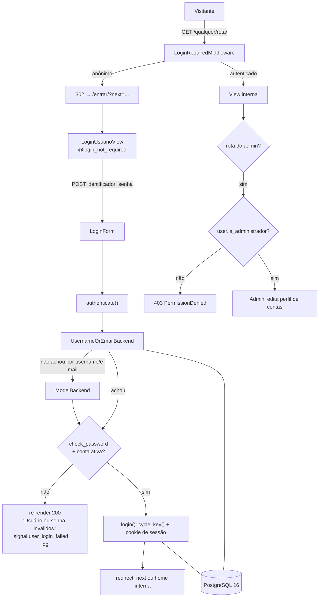

# Autenticação (F1) — Design

**Spec**: `.specs/features/autenticacao/spec.md`
**Context**: `.specs/features/autenticacao/context.md`
**Status**: Approved

**Decisões de projeto vinculantes (lidas de `.specs/STATE.md`):**

| AD | Como este design conforma |
| -- | ------------------------- |
| AD-001 — sessão nativa, não JWT | Usa `django.contrib.auth.login/logout` e o cookie de sessão. Nenhum token é emitido, nenhuma biblioteca de JWT entra no `requirements`. |
| AD-002 — MVT sem Service Layer | Não há `services/` nem `repositories/`. A regra de perfil mora no model, a de credencial no authentication backend (extensão prevista pelo próprio framework), o fluxo HTTP nas views. |
| AD-003 — PostgreSQL 16 com integridade referencial | As invariantes de perfil e de unicidade de e-mail são `Meta.constraints` — impostas pelo banco, não só pelo código. |
| AD-004 — perfil como campo enum no modelo de usuário | `Usuario.perfil`, um `TextChoices` no próprio modelo. Nenhum modelo `Perfil` à parte, nenhuma segunda classe de usuário. |

**Decisões novas que este design propõe ao log:** AD-005 (modelo de usuário customizado) e AD-006
(negar por padrão via middleware). Ambas são convenções que toda feature seguinte herda — ver
*Tech Decisions* ao final.

---

## Architecture Overview

Uma app Django chamada `contas` concentra identidade e autenticação. O acesso é **negado por
padrão**: `LoginRequiredMiddleware` intercepta toda requisição e só as views explicitamente marcadas
com `@login_not_required` respondem a anônimos. Uma view nova de F2 ou F3 nasce protegida sem que o
autor precise lembrar de nada — é assim que a AUTH-09 deixa de depender de disciplina.

O reconhecimento de "usuário ou e-mail" mora em um authentication backend próprio, encadeado antes
do `ModelBackend`. O restante do fluxo é Django de prateleira: `LoginView`, `LogoutView`, `login()`
rotacionando a chave de sessão, hashers de senha, `CsrfViewMiddleware`.



---

## Code Reuse Analysis

Projeto greenfield: não há código próprio a reaproveitar. O reuso relevante é do próprio framework —
e é deliberado, porque cada peça pronta usada é uma peça a menos para testar e errar (AD-002).

### Componentes do Django a aproveitar

| Componente | Origem | Como usamos |
| ---------- | ------ | ----------- |
| `AbstractUser` | `django.contrib.auth.models` | Classe base de `Usuario`: já traz username, senha hasheada, `is_active`, `is_staff`, `last_login`. |
| `BaseUserManager` / `UserManager` | `django.contrib.auth.models` | Estendido para forçar `perfil=ADMINISTRADOR` em `create_superuser` (AUTH-20). |
| `ModelBackend` | `django.contrib.auth.backends` | Encadeado como fallback; fornece `user_can_authenticate()`, que barra conta inativa (AUTH-23). |
| `LoginView` / `LogoutView` | `django.contrib.auth.views` | Subclassadas. `LoginView` já trata `next` com `url_has_allowed_host_and_scheme` (AUTH-10) e `redirect_authenticated_user` (AUTH-12). |
| `AuthenticationForm` | `django.contrib.auth.forms` | Subclassada para rotular o campo como "Usuário ou e-mail" e sobrescrever `error_messages['invalid_login']` (AUTH-03, AUTH-04). |
| `login()` / `logout()` | `django.contrib.auth` | `login()` chama `cycle_key()` — AUTH-05 sai de graça; `logout()` descarta a sessão no servidor (AUTH-13). |
| `LoginRequiredMiddleware` + `login_not_required` | `django.contrib.auth.middleware` / `.decorators` (Django ≥ 5.1) | Negação por padrão (AUTH-09, AUTH-11). |
| `PASSWORD_HASHERS` (PBKDF2 por padrão) | `django.contrib.auth.hashers` | AUTH-06 e AUTH-07 sem código próprio. |
| Sinal `user_login_failed` | `django.contrib.auth.signals` | Gancho de observabilidade (AUTH-27). O Django já remove a senha do dict de credenciais antes de emitir o sinal. |
| `CsrfViewMiddleware` | `django.middleware.csrf` | AUTH-24. |
| `AUTH_PASSWORD_VALIDATORS` | `django.contrib.auth.password_validation` | Política de senha assumida na spec. |
| `django.contrib.admin` | — | Única superfície de gestão de contas no MVP (nota da F1). |

### Integration Points

| Sistema | Método de integração |
| ------- | -------------------- |
| PostgreSQL 16 (AD-003) | `django.db.backends.postgresql`; as invariantes de perfil e e-mail viram constraints de tabela. |
| Features F2–F6 | Consomem `settings.AUTH_USER_MODEL` para a FK de autoria (RN08) e `user.is_administrador` para autorização (RN05, F4). |
| Django admin | Superfície de criação de contas e de troca de perfil (RN11). |

---

## Components

### `contas.models.Usuario`

- **Purpose**: modelo de usuário do projeto, carregando o perfil que governa os poderes de curadoria.
- **Location**: `contas/models.py`
- **Interfaces**:
  - `Usuario.Perfil` — `TextChoices` com `USUARIO` e `ADMINISTRADOR` (AUTH-16)
  - `is_administrador: bool` (property) — ponto único de consulta do perfil (AUTH-19)
  - `save(*args, **kwargs)` — mantém `is_staff` coerente com `perfil == ADMINISTRADOR`
- **Dependencies**: `AbstractUser`, `UsuarioManager`
- **Reuses**: `AbstractUser` inteiro; só acrescenta `email` único e `perfil`.

### `contas.models.UsuarioManager`

- **Purpose**: garantir que uma conta criada por `createsuperuser` nasça administradora.
- **Location**: `contas/models.py`
- **Interfaces**:
  - `create_superuser(username, email, password, **extra)` — força `perfil=ADMINISTRADOR` (AUTH-20)
  - `create_user(...)` — herdado; perfil fica no default `USUARIO` (AUTH-17)
- **Dependencies**: `UserManager`
- **Reuses**: `django.contrib.auth.models.UserManager`.

### `contas.backends.UsernameOrEmailBackend`

- **Purpose**: aceitar username **ou** e-mail no mesmo campo do formulário (AUTH-01, AUTH-02).
- **Location**: `contas/backends.py`
- **Interfaces**:
  - `authenticate(request, username=None, password=None, **kwargs) -> Usuario | None`
- **Dependencies**: `Usuario`
- **Reuses**: herda de `ModelBackend` e sobrescreve apenas a busca do usuário, preservando
  `user_can_authenticate()` (conta inativa → recusa, AUTH-23) e o *dummy hash* que o `ModelBackend`
  executa quando não encontra ninguém — sem isso, o tempo de resposta denuncia quais contas existem.
- **Nota de implementação**: a busca é `Q(username__iexact=ident) | Q(email__iexact=ident)`, um
  único `SELECT`; se retornar mais de uma linha, recusa — a constraint de e-mail torna isso
  inalcançável, mas o backend não confia nisso.

### `contas.forms.LoginForm`

- **Purpose**: coletar identificador e senha com rótulo correto e mensagem de erro única.
- **Location**: `contas/forms.py`
- **Interfaces**:
  - `error_messages["invalid_login"]` → `"Usuário ou senha inválidos."` (AUTH-03)
  - rótulo do campo → `"Usuário ou e-mail"`; `autofocus`, `autocomplete="username"`
- **Dependencies**: `AuthenticationForm`
- **Reuses**: `AuthenticationForm` — que já repopula o identificador digitado ao re-renderizar com
  erro (AUTH-04) e já exige ambos os campos.

### `contas.views.LoginUsuarioView`

- **Purpose**: renderizar e processar o login.
- **Location**: `contas/views.py` — rota `/entrar/`
- **Interfaces**:
  - `template_name = "contas/login.html"`
  - `authentication_form = LoginForm`
  - `redirect_authenticated_user = True` (AUTH-12)
  - decorada com `@login_not_required` — a única exceção ao default-deny
- **Dependencies**: `LoginForm`, backends configurados
- **Reuses**: `LoginView`. O tratamento do `next` (AUTH-10) e a validação de host do destino já vêm
  prontos; não escrevemos redirecionamento à mão.

### `contas.views.LogoutUsuarioView`

- **Purpose**: encerrar a sessão no servidor e devolver o visitante ao login.
- **Location**: `contas/views.py` — rota `/sair/`
- **Interfaces**:
  - `next_page = settings.LOGIN_URL`
  - `dispatch()` — adiciona a mensagem `"Sessão encerrada."` via `django.contrib.messages` (AUTH-13)
- **Dependencies**: `django.contrib.messages`
- **Reuses**: `LogoutView` (aceita apenas POST desde a 4.1 — o template usa um `<form>`, não um link).

### `contas.admin.UsuarioAdmin`

- **Purpose**: superfície de criação de contas e o guarda da RN11 (AUTH-21, AUTH-22).
- **Location**: `contas/admin.py`
- **Interfaces**:
  - `get_fieldsets(request, obj)` — remove `perfil` e `is_superuser` do formulário quando
    `not request.user.is_administrador`
  - `get_readonly_fields(request, obj)` — `perfil` somente-leitura no mesmo caso
  - `has_change_permission(request, obj)` — `False` para não administradores sobre contas de terceiros
  - `save_model(request, obj, form, change)` — `raise PermissionDenied` (→ 403) se um POST alterar
    `perfil` vindo de um não administrador, mesmo que o campo tenha sido removido do formulário
- **Dependencies**: `UserAdmin`, `Usuario`
- **Reuses**: `django.contrib.auth.admin.UserAdmin` (já trata a senha com `ReadOnlyPasswordHashField`
  — nenhuma tela do admin exibe ou aceita senha em texto puro, reforçando AUTH-08).

### `contas.signals.registrar_tentativa_malsucedida`

- **Purpose**: deixar rastro auditável de cada login recusado (AUTH-27).
- **Location**: `contas/signals.py`, conectado em `contas/apps.py::ContasConfig.ready()`
- **Interfaces**:
  - receiver de `user_login_failed(sender, credentials, request, **kwargs)` → `logger.warning` com
    timestamp e identificador submetido
- **Dependencies**: `logging`, sinal do `django.contrib.auth`
- **Reuses**: o Django já sanitiza `credentials`, removendo a senha antes de emitir o sinal — é por
  isso que este receiver não pode vazar senha nem por engano.

### `nucleo.views.HomeInternaView`

- **Purpose**: destino padrão do login enquanto a F3 não existe; primeira tela protegida, serve de
  alvo dos testes de controle de acesso.
- **Location**: `nucleo/views.py` — rota `/`
- **Interfaces**: `TemplateView` com `template_name = "nucleo/home.html"`
- **Dependencies**: nenhuma
- **Reuses**: `TemplateView`. **Substituída pela listagem de inovações quando a F3 chegar** — é
  andaime declarado, não produto.

### Configuração (`config/settings.py`)

| Setting | Valor | Requisito |
| ------- | ----- | --------- |
| `AUTH_USER_MODEL` | `"contas.Usuario"` | AD-004, AUTH-16 |
| `AUTHENTICATION_BACKENDS` | `UsernameOrEmailBackend`, depois `ModelBackend` | AUTH-01, AUTH-02 |
| `MIDDLEWARE` | inclui `LoginRequiredMiddleware` após `AuthenticationMiddleware` | AUTH-09 |
| `LOGIN_URL` | `"/entrar/"` | AUTH-09 |
| `LOGIN_REDIRECT_URL` | `"/"` | AUTH-01 |
| `SESSION_COOKIE_AGE` | `28800` (8 h) | AUTH-15 |
| `SESSION_SAVE_EVERY_REQUEST` | `True` | AUTH-15 — sem isso a expiração conta do login, não da última requisição |
| `SESSION_COOKIE_HTTPONLY` / `SECURE` / `CSRF_COOKIE_SECURE` | `True` (secure em produção) | RNF02 |
| `AUTH_PASSWORD_VALIDATORS` | os quatro validadores padrão | assumption da spec |

---

## Data Models

### `Usuario`

Tradução direta da classe `Usuario` de `docs/modelagem-uml.md` §2.1. O atributo `senhaHash` do
diagrama **não vira um campo nosso**: é o `password` que o `AbstractUser` já guarda hasheado — criar
um campo `senha_hash` próprio duplicaria o mecanismo e abriria espaço para gravar algo em texto puro.
O diagrama nomeia a intenção; o Django já a implementa.

```python
class Usuario(AbstractUser):
    class Perfil(models.TextChoices):
        USUARIO = "USUARIO", "Usuário"
        ADMINISTRADOR = "ADMINISTRADOR", "Administrador"

    email = models.EmailField("e-mail", unique=True)
    perfil = models.CharField(
        "perfil",
        max_length=13,
        choices=Perfil.choices,
        default=Perfil.USUARIO,
    )

    objects = UsuarioManager()

    class Meta:
        verbose_name = "usuário"
        verbose_name_plural = "usuários"
        constraints = [
            models.UniqueConstraint(
                Lower("email"),
                name="usuario_email_unico_ci",
                violation_error_message="Já existe uma conta com este e-mail.",
            ),
            models.CheckConstraint(
                condition=Q(perfil__in=Perfil.values),
                name="usuario_perfil_valido",
            ),
        ]

    @property
    def is_administrador(self) -> bool:
        return self.perfil == self.Perfil.ADMINISTRADOR
```

**Por que as duas constraints existem:**

- `usuario_email_unico_ci` — `unique=True` sozinho é *case-sensitive* no PostgreSQL, então
  `ana@x.com` e `Ana@X.com` conviveriam e o login por e-mail (AUTH-02) ficaria ambíguo. A
  `UniqueConstraint(Lower("email"))` fecha isso no banco (AUTH-25).
- `usuario_perfil_valido` — `choices` só é verificado em `full_clean()`; um `save()` direto ou um
  `update()` em massa gravaria lixo. A `CheckConstraint` cumpre a AUTH-18 no nível que o AD-003 exige.

> **Correção aplicada no Execute (T8):** o `TextChoices` mora no nível de módulo como
> `PerfilUsuario` (o nome do diagrama de classes), com `Usuario.Perfil` como alias. Uma classe
> aninhada ainda não existe no escopo quando o corpo de `Meta` é avaliado, então a `CheckConstraint`
> não conseguiria referenciá-la. API pública inalterada.

> **Nota de versão:** `CheckConstraint` usa `condition=` (o antigo `check=` está depreciado desde a
> 5.1). `UniqueConstraint` sobre expressão exige Django ≥ 4.0. Ambos válidos na 5.2 LTS fixada.

**Relationships**: nenhuma nesta feature. A partir da F2, `Inovacao.autor` é
`ForeignKey(settings.AUTH_USER_MODEL, on_delete=models.PROTECT)` — `PROTECT`, não `CASCADE`, para que
excluir uma conta não apague o conhecimento que ela registrou. Fica anotado aqui como orientação à F2.

### `PerfilUsuario` (enumeração do diagrama)

A enumeração `PerfilUsuario` do diagrama de classes não vira tabela nem modelo: vira o `TextChoices`
aninhado `Usuario.Perfil`, persistido como `varchar` e validado por `CheckConstraint`. É o que o
AD-004 determina — o perfil é um atributo do usuário, não uma entidade.

---

## Error Handling Strategy

| Error Scenario | Handling | User Impact |
| -------------- | -------- | ----------- |
| Credencial inválida (AUTH-03) | `LoginForm` levanta `ValidationError` com `invalid_login`; re-render HTTP 200 | "Usuário ou senha inválidos." — sem indicar qual campo falhou |
| Campo vazio (AUTH-04) | Validação `required` do form; identificador digitado é repopulado | Erro ancorado no campo, nada do que foi digitado se perde |
| Conta inativa (AUTH-23) | `user_can_authenticate()` recusa; cai no mesmo `invalid_login` | Mensagem idêntica à de senha errada — não revela que a conta existe |
| Token CSRF ausente/inválido (AUTH-24) | `CsrfViewMiddleware` → 403 antes de qualquer tentativa de autenticação | Página 403 com orientação de recarregar e tentar de novo |
| E-mail duplicado por diferença de caixa (AUTH-25) | `UniqueConstraint` → `ValidationError` no form do admin | "Já existe uma conta com este e-mail." |
| PostgreSQL indisponível (AUTH-26) | `OperationalError` não capturada → handler 500; `DEBUG=False` em produção | Página 500 própria, sem string de conexão nem traceback |
| Perfil fora do enum (AUTH-18) | `CheckConstraint` → `IntegrityError`; `full_clean()` no admin antecipa como `ValidationError` | Erro de validação no admin; gravação direta é rejeitada pelo banco |
| Não administrador tentando alterar perfil (AUTH-21) | `PermissionDenied` em `save_model` | 403 |
| Sessão expirada (AUTH-15) | Cookie inválido → requisição anônima → middleware redireciona | Volta ao login com `next` preservado |

---

## Risks & Concerns

Projeto greenfield: não há código legado a auditar. As preocupações abaixo são do desenho proposto e
de premissas da spec que só apareceram ao detalhar a implementação.

| Concern | Location | Impact | Mitigation |
| ------- | -------- | ------ | ---------- |
| **Trocar `AUTH_USER_MODEL` depois da primeira migration é notoriamente doloroso** | `config/settings.py` | Se a F2 começar com o `auth.User` padrão e o modelo próprio entrar depois, a correção envolve apagar migrations e o banco | O modelo customizado é a **primeira** tarefa do Execute, antes de qualquer migration de qualquer app. Vira AD-005 para que nenhuma feature futura o ignore. |
| **AUTH-21 exige HTTP 403, mas uma conta `USUARIO` sem `is_staff` recebe 302 do admin** | `spec.md` AUTH-21 vs `contas/admin.py` | O teste escrito ao pé da letra da AC falha por motivo errado: o acesso é negado, só que com outro código | Duas camadas: o admin nega o acesso à área (302 → login do admin) e `save_model` levanta `PermissionDenied` (403) para qualquer POST que altere `perfil`. Proponho **emendar a AUTH-21** para "SHALL deny the request, returning HTTP 403 when the request reaches the change handler and redirecting to the login page when the account cannot open the admin area". Precisa do seu aval antes do Tasks. |
| **`is_staff` e `perfil` podem divergir** | `contas/models.py` | Um `ADMINISTRADOR` sem `is_staff` não abre o admin e a RN11 fica inexequível na prática | `Usuario.save()` sincroniza `is_staff = is_administrador or is_staff`; teste dedicado cobre promoção e rebaixamento |
| **Backend customizado que pula o *dummy hash* vaza quais contas existem por tempo de resposta** | `contas/backends.py` | Enumeração de contas — agravada por termos descartado o throttling | Herdar de `ModelBackend` e chamar `UserModel().set_password(password)` no caminho "não encontrado", como o original faz. Teste não cobre timing; fica como revisão de código explícita na task. |
| **O `ModelBackend` de fallback reabre parte da recusa por ambiguidade** *(achado no Execute, T13)* | `config/settings.py` → `AUTHENTICATION_BACKENDS` | Quando o identificador casa com mais de uma conta, o `UsernameOrEmailBackend` recusa, e o `authenticate()` segue para o `ModelBackend`. Esse só aceita match **exato** de username (`get_by_natural_key`), que não é ambíguo. Ou seja: `ana` entra na conta `ana` mesmo que exista `ANA`, e ninguém entra pelo e-mail ambíguo | Aceito como está: o match exato é inequívoco, e o `UserCreationForm` do Django 5.2 já barra usernames que diferem só na caixa. Remover o fallback é a saída se um dia a regra precisar ser mais estrita. |
| **Default-deny via middleware é silencioso quando mal configurado** | `config/settings.py` | Se o middleware for removido ou reordenado, tudo abre sem nenhum erro visível | Teste de varredura: itera as rotas registradas no `urlpatterns`, pede cada uma anonimamente e exige 302 para o login, salvo uma allowlist explícita. Esse teste é o que sustenta a AUTH-09 ao longo das features seguintes. |
| **`nucleo.HomeInternaView` é andaime** | `nucleo/views.py` | Vira tela órfã se ninguém lembrar de substituí-la | Declarada como provisória aqui e no `context.md`; a F3 a substitui pela listagem. |
| **`SESSION_SAVE_EVERY_REQUEST = True` grava sessão a cada requisição** | `config/settings.py` | Escrita extra no banco por requisição — atrito com o RNF08 (≤ 2 s) | Irrelevante no volume do MVP (conjunto de demonstração). Se aparecer no passe de desempenho, a saída é mover as sessões para cache. Anotado, não pré-otimizado. |

---

## Tech Decisions (only non-obvious ones)

| Decision | Choice | Rationale |
| -------- | ------ | --------- |
| Versão do framework | Django 5.2 LTS | Suporte de segurança até abr/2028 — sobrevive ao TCC; já traz `LoginRequiredMiddleware` (5.1+). Fixada em `requirements.txt`, que se impõe sozinho — não precisa virar AD. |
| `senhaHash` do diagrama UML | Não vira campo; é o `password` do `AbstractUser` | Um campo próprio duplicaria o mecanismo de hash e abriria caminho para gravar texto puro. O diagrama nomeia a intenção; o framework a implementa. |
| Reconhecimento usuário-ou-e-mail | Authentication backend, não `clean()` do form | O ponto de extensão previsto pelo Django. Vale para admin e shell, não só para o formulário — e o form fica livre de lógica de identidade. |
| Invariantes de perfil e e-mail | `Meta.constraints` no banco, não só validação de form | AD-003 pede integridade no banco; `choices` e `unique=True` não cobrem `save()` direto nem diferença de caixa. |
| `is_staff` derivado do perfil | Sincronizado em `save()` | Sem isso a RN11 não é exequível: o admin é a única superfície de troca de perfil no MVP. |
| App `nucleo` com home provisória | Criada agora, substituída pela F3 | O login precisa de um destino e os testes de controle de acesso precisam de uma rota protegida real. |

> **Decisões de nível de projeto → `.specs/STATE.md`:** este design propõe **AD-005** (modelo de
> usuário customizado como `AUTH_USER_MODEL` desde a primeira migration) e **AD-006** (acesso negado
> por padrão via `LoginRequiredMiddleware`; view pública é exceção explícita com
> `@login_not_required`). As duas atravessam todas as features seguintes: a F2 precisa da primeira
> para a FK de autoria, e toda view de F2–F6 nasce sob a segunda. Serão anexadas ao log **após sua
> aprovação deste design** — o Design não escreve no log antes do aceite.

---

## Cobertura dos requisitos

| Requirement | Onde é atendido |
| ----------- | --------------- |
| AUTH-01 | `LoginUsuarioView` + `UsernameOrEmailBackend` + `LOGIN_REDIRECT_URL` |
| AUTH-02 | `UsernameOrEmailBackend` (`email__iexact`) + `usuario_email_unico_ci` |
| AUTH-03 | `LoginForm.error_messages["invalid_login"]` |
| AUTH-04 | `AuthenticationForm` (campos obrigatórios + repopulação) |
| AUTH-05 | `django.contrib.auth.login()` → `cycle_key()` |
| AUTH-06 / AUTH-07 | `AbstractUser.password` + `PASSWORD_HASHERS` padrão |
| AUTH-08 | `UserAdmin.ReadOnlyPasswordHashField` + receiver de `user_login_failed` (credenciais já sanitizadas) |
| AUTH-09 | `LoginRequiredMiddleware` + teste de varredura de rotas |
| AUTH-10 | `LoginView` + `redirect_field_name` |
| AUTH-11 | Ausência de checagem de perfil nas views de consulta |
| AUTH-12 | `LoginView.redirect_authenticated_user = True` |
| AUTH-13 | `LogoutUsuarioView` + `messages` |
| AUTH-14 | `logout()` descarta a sessão no servidor |
| AUTH-15 | `SESSION_COOKIE_AGE` + `SESSION_SAVE_EVERY_REQUEST` |
| AUTH-16 | `Usuario.Perfil` + `CheckConstraint` |
| AUTH-17 | `default=Perfil.USUARIO` |
| AUTH-18 | `usuario_perfil_valido` (`CheckConstraint`) |
| AUTH-19 | `Usuario.is_administrador` |
| AUTH-20 | `UsuarioManager.create_superuser` |
| AUTH-21 | `UsuarioAdmin.save_model` → `PermissionDenied` *(ver Risks: emenda proposta à AC)* |
| AUTH-22 | `UsuarioAdmin.get_fieldsets` / `has_change_permission` |
| AUTH-23 | `ModelBackend.user_can_authenticate()` herdado |
| AUTH-24 | `CsrfViewMiddleware` + `` |
| AUTH-25 | `usuario_email_unico_ci` |
| AUTH-26 | Handler 500 + `DEBUG=False` |
| AUTH-27 | Receiver de `user_login_failed` |

Nenhum requisito da spec ficou sem componente.
