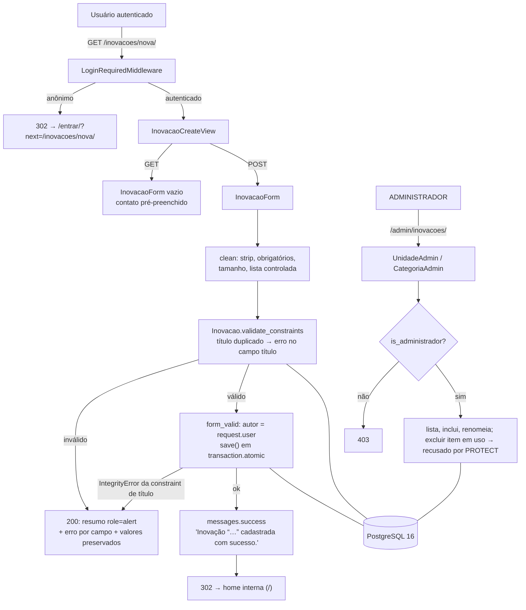

# Cadastro de Inovação (F2) — Design

**Spec**: `.specs/features/cadastro-inovacao/spec.md`
**Context**: `.specs/features/cadastro-inovacao/context.md`
**Status**: Approved (2026-09-27) — implementado e verificado (2026-09-29, `validation.md`)

**Abordagem escolhida:** A — uma app `inovacoes` com todo o domínio (Unidade, Categoria,
StatusInovacao, Inovacao). Descartada: B, duas apps (`catalogos` + `inovacoes`). A separação não
evita nenhuma dependência real, porque a F6 liga Reaproveitamento a Inovacao e a Unidade, e custaria
dependência de migrations entre apps por dois modelos de um campo.

**Decisões de projeto vinculantes (lidas de `.specs/STATE.md`):**

| AD | Como este design conforma |
| -- | ------------------------- |
| AD-001 — sessão nativa | O autor vem de `request.user`, populado pela sessão. Nenhum token. |
| AD-002 — MVT sem Service Layer | Não há `services/`. As invariantes ficam no model (constraints, `validate_constraints`), a validação de entrada no `ModelForm` e o fluxo HTTP na `CreateView`. |
| AD-003 — PostgreSQL com integridade no banco | FKs `NOT NULL` com `PROTECT`, `UniqueConstraint` de título por unidade e `CheckConstraint` de status ficam no banco. O formulário só antecipa o erro. |
| AD-004 — perfil como enum | A restrição do admin consulta `is_administrador`; a F2 não cria nenhum papel novo. |
| AD-005 — `AUTH_USER_MODEL` customizado | `Inovacao.autor = ForeignKey(settings.AUTH_USER_MODEL, on_delete=PROTECT)`. Nenhum import de `Usuario` no model. |
| AD-006 — negar por padrão | A `InovacaoCreateView` não recebe decorator nenhum: nasce protegida pelo `LoginRequiredMiddleware`, e o teste de varredura de `contas/tests/test_controle_acesso.py` a cobre automaticamente (INOV-07). |

**Decisão nova proposta ao log:** AD-007 (todo `ModelAdmin` do projeto abre só para
`ADMINISTRADOR`, pelo mesmo mixin). Ver *Tech Decisions*.

---

## Architecture Overview

Uma app nova, `inovacoes`, concentra o domínio. O cadastro é um `CreateView` de prateleira sobre um
`ModelForm`. O Django já resolve a maior parte da spec: strip de espaços, campos obrigatórios,
repopulação, `aria-invalid` e `aria-describedby` (conferidos no Django 5.2.17 instalado). O código
próprio cobre três pontos: levar o erro de título duplicado para o campo certo, tratar a corrida entre
dois envios e fixar autor e mensagens.



---

## Code Reuse Analysis

### Existing Components to Leverage

| Component | Location | How to Use |
| --------- | -------- | ---------- |
| `LoginRequiredMiddleware` + teste de varredura | `config/settings.py`, `contas/tests/test_controle_acesso.py` | A rota nova herda a proteção e entra na varredura sem mudar nada (INOV-07). |
| `Usuario` / `settings.AUTH_USER_MODEL` | `contas/models.py` | Alvo da FK `autor` (INOV-04). `get_full_name()`, `username` e `email` montam o contato pré-preenchido (INOV-39). |
| `Usuario.is_administrador` | `contas/models.py:84` | Ponto único de consulta do perfil (AUTH-19), usado pelo mixin do admin. |
| Restrição de admin por perfil | `contas/admin.py:34-50` (`has_*_permission` → `is_administrador`) | É **extraída** para `AcessoSomenteAdministradorMixin` em `contas/admin.py`; `UsuarioAdmin`, `UnidadeAdmin` e `CategoriaAdmin` passam a herdá-lo (INOV-20, INOV-21). |
| `UniqueConstraint(Lower(...))` com `violation_error_message` | `contas/models.py:65-69` | O mesmo padrão para o título por unidade (INOV-26). |
| `CheckConstraint` sobre `TextChoices` no nível de módulo | `contas/models.py:7-17, 58-61` | O mesmo padrão para `StatusInovacao` (a lição da T8: o enum fica fora da classe para a `Meta` enxergá-lo). |
| Região de mensagens `role="status"` e `:focus-visible` | `templates/base.html` | Mensagem de sucesso (INOV-28) e foco visível (INOV-35) sem CSS novo. |
| Página 500 sem vazamento | `templates/500.html` (AUTH-26) | Banco indisponível no cadastro (INOV-42). |
| `HomeInternaView` | `nucleo/views.py` | Destino do redirect e do "Cancelar" até a F3 existir (INOV-03, INOV-36). |

### Componentes do Django a aproveitar

| Componente | Como usamos |
| ---------- | ----------- |
| `CreateView` | GET/POST, re-render com erros e redirect em sucesso. |
| `ModelForm` + `CharField(strip=True)` | Remoção de espaços nas pontas, e só-espaços vira vazio → `required` (INOV-02, INOV-10). |
| `ModelChoiceField` | Só aceita pk existente no queryset; `invalid_choice` vira "Selecione … da lista." (INOV-17). |
| `error_messages` por campo | `required`, `max_length` (com `limit_value` e `show_value`) e `invalid_choice` com os textos fixos da spec. |
| Renderização de campo do Django 5.2 | `aria-invalid="true"` e `aria-describedby="id_x_helptext id_x_error"` automáticos (conferido: INOV-33, INOV-41). |
| `Field.template_name` | Template de campo próprio para pôr o help text **abaixo** do controle (o padrão do Django o põe acima; INOV-41). |
| `django.contrib.messages` | Mensagem de sucesso lida uma vez só (INOV-28, INOV-29). |
| `on_delete=PROTECT` + delete view do admin | O admin já mostra a tela "não é possível excluir" listando os objetos que protegem o item (INOV-19). |
| `RunPython` (data migration) | Carga inicial das listas (INOV-18). |

### Integration Points

| System | Integration Method |
| ------ | ------------------ |
| PostgreSQL 16 | Três tabelas novas (`inovacoes_unidade`, `inovacoes_categoria`, `inovacoes_inovacao`) com FKs e constraints; data migration das listas. |
| `contas` (F1) | FK `autor`; mixin de admin extraído do `UsuarioAdmin`. |
| `templates/base.html` | Link "Cadastrar inovação" no cabeçalho autenticado (INOV-38). |
| F3–F6 | Consomem `Inovacao`, `Unidade`, `Categoria` e `StatusInovacao`. A F3 redefine o destino pós-cadastro; a F5 usa `StatusInovacao`; a F6 liga Reaproveitamento a Inovacao e Unidade. |

---

## Components

### `inovacoes.models` — `Unidade` e `Categoria`

- **Purpose**: listas controladas da RN07.
- **Location**: `inovacoes/models.py`
- **Interfaces**:
  - `nome: CharField(max_length=100)`; `__str__` → `nome`
  - `Meta.ordering = ["nome"]` → opções em ordem alfabética (INOV-15)
  - `UniqueConstraint(Lower("nome"))` com mensagem "Já existe um item com este nome." (ver *Tech Decisions*)
- **Dependencies**: nenhuma
- **Reuses**: padrão de constraint case-insensitive da F1.
- **Ajuste na implementação (T3)**: os dois modelos herdam uma base abstrata `ItemDeLista`, que
  concentra `nome`, `ordering`, `__str__` e a constraint. O nome da constraint usa `%(class)s`, então
  o banco recebe os mesmos `unidade_nome_unico_ci` e `categoria_nome_unico_ci` do desenho.

### `inovacoes.models.StatusInovacao`

- **Purpose**: enumeração do ciclo de vida (RN03), nomeada como no diagrama de classes.
- **Location**: `inovacoes/models.py`, no nível de módulo
- **Interfaces**: `TextChoices` com `EM_TESTE = "EM_TESTE", "Em teste"`, `VALIDADA = "VALIDADA", "Validada"`,
  `DISPONIVEL_PARA_REPLICACAO = "DISPONIVEL_PARA_REPLICACAO", "Disponível para replicação"`
- **Dependencies**: nenhuma
- **Reuses**: mesmo arranjo do `PerfilUsuario` (enum fora da classe para a `CheckConstraint`).

### `inovacoes.models.Inovacao`

- **Purpose**: a entidade central do domínio (RF02).
- **Location**: `inovacoes/models.py`
- **Interfaces**:
  - campos: ver *Data Models*
  - `validate_constraints(exclude=None)` — chama o do Django e move o `ValidationError` de código
    `titulo_duplicado` de `NON_FIELD_ERRORS` para o campo `titulo` (INOV-22). Motivo: um
    `UniqueConstraint` sobre expressão não sabe a que campo pertence e levanta erro geral
    (`django/db/models/constraints.py`, ramo sem `self.fields`). Resolver no model, e não no form,
    faz a regra valer para qualquer `full_clean()`.
  - `__str__` → `titulo`
- **Dependencies**: `Unidade`, `Categoria`, `settings.AUTH_USER_MODEL`
- **Reuses**: `auto_now_add` para a data (INOV-05); `default=StatusInovacao.EM_TESTE` (INOV-05).

### `inovacoes.forms.InovacaoForm`

- **Purpose**: coletar e validar os sete campos editáveis com mensagens, rótulos e ajuda da spec.
- **Location**: `inovacoes/forms.py`
- **Interfaces**:
  - `Meta.model = Inovacao`; `Meta.fields = ["titulo", "unidade", "categoria", "problema", "solucao", "resultado", "contato"]`,
    nessa ordem (INOV-01). `autor`, `status` e `data_criacao` ficam fora, então valores forjados no
    POST são ignorados (INOV-06).
  - `labels`: "Título (obrigatório)", "Unidade de origem (obrigatório)", "Categoria (obrigatório)",
    "Problema ou dor (obrigatório)", "Solução aplicada (obrigatório)", "Resultado ou impacto",
    "Contato responsável (obrigatório)" (INOV-31, INOV-32); `label_suffix = ""`.
  - `help_texts`: uma frase com exemplo por campo (INOV-41). Exemplo para o título: "Nome curto da
    solução. Ex.: Conciliação bancária automática".
  - `error_messages`: os textos de `required`, `max_length` e `invalid_choice` da tabela de
    Assumptions da spec (INOV-09, INOV-12, INOV-17).
  - `problema`, `solucao`, `resultado` com `max_length=5000` no form (INOV-12); `titulo` e `contato`
    herdam 150 do model.
  - `ModelChoiceField` de unidade e categoria com `empty_label="Selecione…"`.
  - `__init__`: aplica `template_name = "inovacoes/campo.html"` a todos os campos.
- **Dependencies**: `Inovacao`
- **Reuses**: `ModelForm`; a validação de constraints do model (título duplicado) roda sozinha no
  `_post_clean`.

### `inovacoes.views.InovacaoCreateView`

- **Purpose**: fluxo HTTP do cadastro.
- **Location**: `inovacoes/views.py` — rota `/inovacoes/nova/`, nome `inovacoes:nova`
- **Interfaces**:
  - `model = Inovacao`, `form_class = InovacaoForm`, `template_name = "inovacoes/inovacao_form.html"`
  - `get_initial()` → `{"contato": "<nome completo ou username> (<e-mail>)"}` (INOV-39)
  - `form_valid(form)`:
    1. `form.instance.autor = self.request.user` (INOV-04);
    2. `form.save()` dentro de `transaction.atomic()`;
    3. se sair `IntegrityError` cuja `__cause__.diag.constraint_name` é
       `inovacao_titulo_unico_por_unidade`, faz `form.add_error("titulo", <mensagem>)` e devolve
       `form_invalid` com 200 (INOV-25). Qualquer outro `IntegrityError` sobe (vira 500);
    4. `messages.success(request, f"Inovação “{titulo}” cadastrada com sucesso.")` e redirect 302
       para `nucleo:home` (INOV-03, INOV-28).
  - sem decorator: protegida pelo middleware (AD-006, INOV-07).
- **Dependencies**: `InovacaoForm`, `django.contrib.messages`, `django.db.transaction`
- **Reuses**: `CreateView`.

### Templates

- **`inovacoes/templates/inovacoes/inovacao_form.html`** — estende `base.html`:
  - `<h1>Cadastrar inovação</h1>`
  - quando `form.errors` existe: `<div role="alert">` com "Não foi possível salvar a inovação.
    Corrija os campos indicados." antes do primeiro campo (INOV-30)
  - `<form method="post" novalidate>` com `` e `{{ campo.as_field_group }}` por campo.
    O `novalidate` desliga a validação nativa do navegador para que as mensagens em português do
    servidor (RF13) sejam as que o usuário vê; o atributo `required` continua no HTML (INOV-32).
  - `<button type="submit">Salvar</button>` e `<a href="">Cancelar</a>`
    (INOV-36, INOV-37)
  - só controles nativos, sem `tabindex` (INOV-34)
- **`inovacoes/templates/inovacoes/campo.html`** — cópia de `django/forms/field.html` com a ordem
  **rótulo → controle → erros → ajuda**. Os `id` `<auto_id>_helptext` e `<auto_id>_error` são os
  mesmos que o Django usa no `aria-describedby`, então a ligação continua automática (INOV-33, INOV-41).
- **`templates/base.html`** — no cabeçalho autenticado, `<nav aria-label="Principal">` com
  `<a href="">Cadastrar inovação</a>` (INOV-38).

### `inovacoes.admin` — `UnidadeAdmin` e `CategoriaAdmin`

- **Purpose**: manutenção das listas controladas, só pelo `ADMINISTRADOR` (INOV-20, INOV-21).
- **Location**: `inovacoes/admin.py`
- **Interfaces**: `class UnidadeAdmin(AcessoSomenteAdministradorMixin, admin.ModelAdmin)`, com
  `list_display = ("nome",)` e `search_fields = ("nome",)`; o mesmo para `CategoriaAdmin`.
  **`Inovacao` não é registrada** (Out of Scope da spec).
- **Dependencies**: `contas.admin.AcessoSomenteAdministradorMixin`
- **Reuses**: a delete view do admin, que já trata `ProtectedError` mostrando por que o item não pode
  ser excluído (INOV-19).

### `contas.admin.AcessoSomenteAdministradorMixin` (refatoração da F1)

- **Purpose**: um só lugar para a regra "o admin do projeto abre só para `ADMINISTRADOR`".
- **Location**: `contas/admin.py`
- **Interfaces**: `has_module_permission`, `has_view_permission`, `has_add_permission`,
  `has_change_permission`, `has_delete_permission` → `request.user.is_administrador`. É o código que
  estava em `contas/admin.py:34-50`, só movido; hoje o mixin fica em `contas/admin.py:8-32` (T1). O
  `UsuarioAdmin` passa a herdá-lo.
- **Dependencies**: `Usuario.is_administrador`
- **Reuses**: a própria F1. Os testes de `contas/tests/test_admin_perfil.py` são a rede de segurança
  da refatoração.

### Migrations

O desenho previa duas migrations. Como cada modelo nasceu em uma task, ficaram quatro, com o mesmo
esquema final:

- `inovacoes/migrations/0001_initial.py` — Unidade e Categoria, com as constraints de nome (T3).
- `inovacoes/migrations/0002_inovacao.py` — Inovacao e a constraint de status (T4).
- `inovacoes/migrations/0003_titulo_unico_por_unidade.py` — a constraint de título por unidade (T5).
- `inovacoes/migrations/0004_listas_iniciais.py` — `RunPython` que cria as 5 categorias e as 5
  unidades com `get_or_create` (idempotente). A função reversa apaga só esses nomes (INOV-18, T7).

---

## Data Models

Tradução das classes `Inovacao`, `Unidade`, `Categoria` e `StatusInovacao` de
`docs/modelagem-uml.md` §2.1. As operações do diagrama (`alterarStatus()`, `atualizarDados()`,
`podeSerReaproveitada()`) **não entram na F2**: pertencem à F5, F4 e F6, e cada uma nasce com a
feature que a usa.

```python
class StatusInovacao(models.TextChoices):
    EM_TESTE = "EM_TESTE", "Em teste"
    VALIDADA = "VALIDADA", "Validada"
    DISPONIVEL_PARA_REPLICACAO = "DISPONIVEL_PARA_REPLICACAO", "Disponível para replicação"


class Unidade(models.Model):
    nome = models.CharField("nome", max_length=100)

    class Meta:
        verbose_name = "unidade"
        verbose_name_plural = "unidades"
        ordering = ["nome"]
        constraints = [
            models.UniqueConstraint(
                Lower("nome"),
                name="unidade_nome_unico_ci",
                violation_error_message="Já existe um item com este nome.",
            ),
        ]


class Categoria(models.Model):
    # idêntica a Unidade, com a constraint categoria_nome_unico_ci


class Inovacao(models.Model):
    titulo = models.CharField("título", max_length=150)
    unidade = models.ForeignKey(Unidade, on_delete=models.PROTECT, verbose_name="unidade de origem")
    categoria = models.ForeignKey(Categoria, on_delete=models.PROTECT, verbose_name="categoria")
    problema = models.TextField("problema ou dor")
    solucao = models.TextField("solução aplicada")
    resultado = models.TextField("resultado ou impacto", blank=True)
    contato = models.CharField("contato responsável", max_length=150)
    status = models.CharField(
        "status", max_length=26, choices=StatusInovacao.choices, default=StatusInovacao.EM_TESTE
    )
    autor = models.ForeignKey(
        settings.AUTH_USER_MODEL, on_delete=models.PROTECT, related_name="inovacoes", verbose_name="autor"
    )
    data_criacao = models.DateTimeField("data de criação", auto_now_add=True)

    class Meta:
        verbose_name = "inovação"
        verbose_name_plural = "inovações"
        constraints = [
            models.UniqueConstraint(
                Lower("titulo"),
                "unidade",
                name="inovacao_titulo_unico_por_unidade",
                violation_error_code="titulo_duplicado",
                violation_error_message=(
                    "Já existe uma inovação com este título nesta unidade. Escolha outro título."
                ),
            ),
            models.CheckConstraint(
                condition=Q(status__in=StatusInovacao.values),
                name="inovacao_status_valido",
            ),
        ]
```

**Relationships**:

- `Inovacao` N → 1 `Unidade` e N → 1 `Categoria`: a multiplicidade 0..* → 1 do diagrama, com FK
  `NOT NULL` (INOV-16). `PROTECT` impede apagar item em uso (INOV-19).
- `Inovacao` N → 1 `Usuario` (`autor`): `PROTECT`, como orientado no design da F1. Excluir uma conta
  não apaga o conhecimento que ela registrou.

**Notas:**

- `UniqueConstraint(Lower("titulo"), "unidade")` combina expressão e nome de campo, o que o Django
  aceita desde a 4.0. A comparação é `lower()` no PostgreSQL, que ignora caixa e mantém acentos
  (INOV-22, INOV-26, INOV-27). O título já chega sem espaços nas pontas pelo `strip` do form
  (INOV-23).
- O limite de 5.000 caracteres dos textos longos fica no form, não no banco (`TextField` não impõe
  `max_length`). Basta porque o form é o único caminho de escrita da `Inovacao` na F2.
- `status` só aceita os três valores, também no banco (`inovacao_status_valido`). É a mesma lição do
  AUTH-18: `choices` sozinho não cobre `save()` direto.

---

## Error Handling Strategy

| Error Scenario | Handling | User Impact |
| -------------- | -------- | ----------- |
| Campo obrigatório vazio ou só com espaços (INOV-09, INOV-10) | `required` do form, depois do `strip` | 200, mensagem no campo, resumo no topo, valores preservados |
| Texto acima do limite (INOV-12) | `max_length` do form com `error_messages["max_length"]` | "Use no máximo N caracteres (você digitou M)." no campo |
| Unidade ou categoria fora da lista (INOV-17) | `ModelChoiceField` → `invalid_choice` | "Selecione uma unidade da lista." / "Selecione uma categoria da lista." |
| Título duplicado na unidade (INOV-22, INOV-23) | `UniqueConstraint.validate()` no `_post_clean`, remapeado por `Inovacao.validate_constraints` | Mensagem de duplicado no campo título |
| Segundo envio idêntico, depois do primeiro (duplo clique, INOV-43) | O primeiro já está gravado, então a validação da constraint no `_post_clean` recusa o segundo | 200 com a mensagem de duplicado no título |
| Dois envios simultâneos com o mesmo título (INOV-25) | Os dois passam na validação antes de qualquer um gravar; o segundo `save()` bate na constraint → `IntegrityError` capturado na `form_valid` pelo nome da constraint | 200 com a mesma mensagem de duplicado, nunca 500 |
| Campos do sistema forjados no POST (INOV-06) | Fora de `Meta.fields`: o form nem os lê | Nenhum; o registro sai com os valores do sistema |
| Anônimo em `/inovacoes/nova/` (INOV-07) | `LoginRequiredMiddleware` antes da view | Redirect ao login com `next` |
| Exclusão de item de lista em uso (INOV-19) | `PROTECT` → `ProtectedError`, tratado pela delete view do admin | Tela do admin explicando que o item é usado por inovações |
| Não administrador no admin das listas (INOV-20) | Mixin → `has_*_permission` falso → 403 | 403 |
| PostgreSQL indisponível (INOV-42) | `OperationalError` não capturado → handler 500 | Página 500 do projeto, sem detalhes de conexão |

---

## Risks & Concerns

| Concern | Location (file:line) | Impact | Mitigation |
| ------- | -------------------- | ------ | ---------- |
| **`UniqueConstraint` sobre expressão devolve erro geral, não do campo** | `django/db/models/constraints.py` (ramo `raise ValidationError(self.get_violation_error_message(), code=...)` sem `self.fields`); `django/forms/models.py:498` | A mensagem de duplicado sairia no topo do form, e não no título: INOV-22 falharia | `Inovacao.validate_constraints` remapeia o código `titulo_duplicado` para `titulo`. Um teste de model afirma o erro em `error_dict["titulo"]`. |
| **A corrida real entre dois POSTs é difícil de reproduzir em teste** | `inovacoes/views.py` (a criar) | INOV-25 sem evidência, ou um teste instável com threads | O teste força o caminho: `mock.patch` em `Inovacao.validate_constraints` para não fazer nada, e um registro igual já no banco. O `save()` bate na constraint real do PostgreSQL, e o teste exige 200 com a mensagem. Prova o tratamento do `IntegrityError` sem depender de agendamento. |
| **Capturar `IntegrityError` genérico mascararia outros defeitos** | `inovacoes/views.py` (a criar) | Uma FK quebrada viraria "título duplicado" | Só trata o erro cuja `diag.constraint_name` é `inovacao_titulo_unico_por_unidade` (psycopg 3, fixado em `requirements.txt`); qualquer outro sobe. O teste cobre os dois ramos. |
| **Refatorar o admin da F1 mexe em código verificado** | `contas/admin.py:34-50` | Regressão na AUTH-21 e na AUTH-22 | Task própria, só de mover o código para o mixin, sem mudar comportamento. Gate: os testes de `contas/tests/test_admin_perfil.py` e `test_admin.py` continuam verdes, sem alteração. |
| **A ordem alfabética depende da collation do banco** | `Meta.ordering = ["nome"]` | Local: `en_US.UTF-8` (conferido: "Área < atendimento < Compras < …"). Um banco em collation `C` no deploy poria nomes com acento ou minúsculos no fim | As listas iniciais não têm acento nem minúscula inicial, então INOV-15 passa nas duas collations. A collation do banco de deploy fica anotada como checagem do passe de deploy (RNF06). |
| **O contato pré-preenchido pode passar de 150 caracteres** | `InovacaoCreateView.get_initial` | `first_name` e `last_name` têm até 150 cada e o e-mail até 254; nesse caso extremo o envio falha na INOV-12 | Aceito: o usuário vê a mensagem de tamanho no campo e edita (é o comportamento da spec). Não se trunca em silêncio. |
| **A data migration afeta os testes** | `inovacoes/migrations/0004_listas_iniciais.py` | O pytest-django aplica as migrations, então os 10 itens existem em todo teste. Um teste que cria "Sede" colide com `unidade_nome_unico_ci` | Os testes usam os itens da carga inicial ou nomes próprios de teste. O teste da INOV-18 afirma exatamente os 10 nomes. |
| **O template de campo é cópia do Django** | `inovacoes/templates/inovacoes/campo.html` | Numa atualização do Django, a cópia pode divergir do original (por exemplo, `fieldset`) | Os testes afirmam o resultado (ordem controle → ajuda, `aria-describedby` com os dois ids), e não o template. Uma divergência quebra teste, não passa em silêncio. |
| **A home interna segue como andaime** | `nucleo/views.py` | O destino pós-cadastro e o "Cancelar" apontam para uma tela provisória | Declarado na spec e no Handoff. A F3 troca os dois destinos. |

---

## Tech Decisions (only non-obvious ones)

| Decision | Choice | Rationale |
| -------- | ------ | --------- |
| Onde mora a regra do título duplicado | Constraint no banco + `validate_constraints` do model remapeando para o campo + `IntegrityError` tratado na view | O banco é a garantia (AD-003); o model põe o erro no campo para qualquer `full_clean`; a view cobre a janela entre validar e gravar. |
| Unicidade do nome de Unidade e Categoria | `UniqueConstraint(Lower("nome"))` | Duas "Sede" em caixa diferente quebrariam os filtros da F3, que são a razão da RN07. Não muda nenhum comportamento da spec: só impede o admin de duplicar item. |
| Enum de status | `CharField` + `TextChoices` + `CheckConstraint`; valores iguais aos nomes do diagrama | Mesmo desenho do `PerfilUsuario`, legível no banco. A F5 só acrescenta transições. |
| `novalidate` no formulário | Validação só no servidor | As mensagens do RF13 são fixas e em português; a validação nativa do navegador mostraria outras, no idioma do navegador. `required` continua no HTML para leitores de tela. |
| Help text abaixo do controle | Template de campo próprio via `Field.template_name` | O Django põe a ajuda acima do controle; a INOV-41 pede abaixo. O `template_name` por campo é a extensão oficial do 5.x. |
| Nome da data | `data_criacao` | Espelha o atributo do diagrama e o vocabulário da RN08. |
| `Inovacao` fora do admin | Não registrada | Contornaria a autoria (RN08) e, na F4, a RN05. |

> **Decisão de nível de projeto → `.specs/STATE.md` (registrada como AD-007 em 2026-09-29):**
> **AD-007 — Todo `ModelAdmin` do projeto só abre para `ADMINISTRADOR`, herdando
> `contas.admin.AcessoSomenteAdministradorMixin`.** Sem isso, cada admin novo (listas agora,
> possivelmente outros depois) reabre a porta que a AUTH-22 fechou: basta `is_staff` e uma permissão
> de modelo para um `USUARIO` editar a lista controlada. É uma convenção que toda feature seguinte
> herda e que surpreende quem só conhece o admin padrão. **Trade-off**: as permissões de modelo e
> grupos do Django deixam de ter efeito no admin do projeto; o perfil é o único critério. Aprovada com o design em
> 2026-09-27 e registrada no log em 2026-09-29.

---

## Cobertura dos requisitos

| Requirement | Onde é atendido |
| ----------- | --------------- |
| INOV-01 | `InovacaoForm.Meta.fields` (ordem) + `InovacaoCreateView` GET |
| INOV-02 | `ModelForm` + `CharField(strip=True)` + `form.save()` |
| INOV-03 | `InovacaoCreateView.form_valid` → redirect `nucleo:home` |
| INOV-04 | `form_valid`: `instance.autor = request.user` |
| INOV-05 | `default=StatusInovacao.EM_TESTE` + `auto_now_add` |
| INOV-06 | `autor`, `status` e `data_criacao` fora de `Meta.fields` |
| INOV-07 | `LoginRequiredMiddleware` + teste de varredura |
| INOV-08 | Nenhuma checagem de perfil na view |
| INOV-09 | `error_messages["required"]` por campo |
| INOV-10 | `strip=True` antes do `required` |
| INOV-11 | Re-render do `CreateView` com o form vinculado |
| INOV-12 | `max_length` (150 no model; 5.000 no form) + `error_messages["max_length"]` |
| INOV-13 | `form_invalid` não chama `save()` |
| INOV-14 | `resultado` com `blank=True` |
| INOV-15 | `Meta.ordering = ["nome"]` + `ModelChoiceField` |
| INOV-16 | FKs `NOT NULL` |
| INOV-17 | `ModelChoiceField` → `error_messages["invalid_choice"]` |
| INOV-18 | Data migration `0004_listas_iniciais` |
| INOV-19 | `on_delete=PROTECT` + delete view do admin |
| INOV-20 | `AcessoSomenteAdministradorMixin` |
| INOV-21 | `UnidadeAdmin` / `CategoriaAdmin` registrados |
| INOV-22 | `inovacao_titulo_unico_por_unidade` + `Inovacao.validate_constraints` |
| INOV-23 | `strip=True` + `Lower("titulo")` |
| INOV-24 | Constraint inclui `unidade` |
| INOV-25 | `IntegrityError` tratado em `form_valid` |
| INOV-26 | `UniqueConstraint(Lower("titulo"), "unidade")` |
| INOV-27 | `lower()` do PostgreSQL não remove acentos |
| INOV-28 | `messages.success` + região `role="status"` do `base.html` |
| INOV-29 | Armazenamento de mensagens do Django (lidas uma vez) |
| INOV-30 | `<div role="alert">` no `inovacao_form.html` |
| INOV-31 | `label_tag` do Django (`for`/`id`) |
| INOV-32 | `labels` com "(obrigatório)" + atributo `required` |
| INOV-33 | `aria-invalid` e `aria-describedby` do Django 5.2 |
| INOV-34 | Template só com controles nativos, sem `tabindex` |
| INOV-35 | `:focus-visible` do `base.html` |
| INOV-36 | Link "Cancelar" no template |
| INOV-37 | Link GET para a home: não submete o form |
| INOV-38 | `<nav>` no `base.html` |
| INOV-39 | `InovacaoCreateView.get_initial` |
| INOV-40 | `contato` editável no form |
| INOV-41 | `help_texts` + `campo.html` (ajuda abaixo, `aria-describedby`) |
| INOV-42 | Handler 500 do projeto |
| INOV-43 | Validação da constraint no `_post_clean` (o primeiro envio já está gravado) |

Nenhum requisito da spec ficou sem componente.
