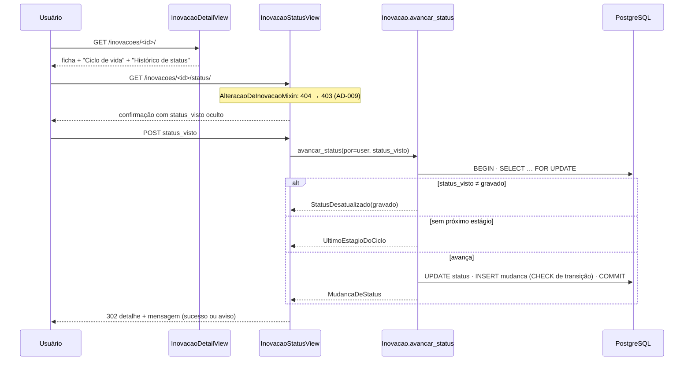

# Ciclo de Vida do Status (F5) — Design

**Spec**: `.specs/features/ciclo-de-vida-status/spec.md`
**Context**: `.specs/features/ciclo-de-vida-status/context.md`
**Status**: Approved (2026-10-18)
**Abordagem**: método no modelo, escolhida pelo usuário em 2026-10-18 entre três (ver Tech Decisions)
**Conforma com**: AD-001 a AD-010, sem supersedir nenhuma. **Cria**: AD-011 (toda mudança de status passa por `Inovacao.avancar_status`)
**Lições aplicadas**: L-003 (o `USUARIO` com `is_staff`/`is_superuser` é negado na rota nova, não só tem o link escondido) · L-005 (cada cláusula de AC com efeito em tela é afirmada por HTTP, não só no modelo)

---

## Architecture Overview

A regra do ciclo mora no modelo (AD-002): `PROXIMO_STATUS` diz qual é o próximo estágio, e
`Inovacao.avancar_status` faz o avanço inteiro numa transação: trava a linha, confere o status que
a pessoa viu, grava o novo status e cria o `MudancaDeStatus`. A view nova só autoriza (pelo mixin da
AD-009), chama o método e traduz o resultado em mensagem. O banco recusa um registro de histórico
com transição inválida (STAT-31).



---

## Code Reuse Analysis

### Existing Components to Leverage

| Component | Location | How to Use |
| --------- | -------- | ---------- |
| `StatusInovacao` | `inovacoes/models.py:11` | Valores e rótulos do ciclo; base de `PROXIMO_STATUS` e das choices do histórico |
| `Inovacao.pode_ser_alterada_por` | `inovacoes/models.py` | Única regra de quem avança (AD-009); também decide o link no detalhe (STAT-03, STAT-05) |
| `AlteracaoDeInovacaoMixin` | `inovacoes/views.py:25` | Primeira base da view nova: 404 da CONS-15, depois 403 com `acesso_negado.html` (STAT-19 a STAT-22) |
| `_inovacao_nao_encontrada` | `inovacoes/views.py:19` | 404 quando a inovação some entre o `dispatch()` e a trava (STAT-22) |
| `InovacaoDetailView.get_context_data` | `inovacoes/views.py:125` | Ganha o histórico, as etapas e o próximo status |
| `inovacao_confirm_delete.html` | `inovacoes/templates/inovacoes/` | Modelo da página de confirmação (cartão, `form.acoes`, link Cancelar) |
| `.acoes`, `.cartao`, `.selo--*`, `alerta--warning` | `templates/kira.css` | Botões e mensagens da F5 sem cor nova; o aviso usa a variante `warning` da DS-10 |
| `LoginRequiredMiddleware` | `settings` (AD-006) | Anônimo vai ao login sem código novo (STAT-23) |
| `PROTECT` em `Inovacao.autor` | `inovacoes/models.py` | Mesmo critério para `MudancaDeStatus.responsavel` (STAT-29) |
| `CheckConstraint inovacao_status_valido` | `inovacoes/models.py` | Mesmo padrão para a constraint de transição (STAT-31) |

### Testes existentes a aproveitar

| Teste | Location | Uso na F5 |
| ----- | -------- | --------- |
| Varredura de autoria | `inovacoes/tests/test_controle_autoria.py` | Cobre `inovacoes:status` sozinha (rota `<int:pk>`), em GET e POST, para `USUARIO`, staff e superuser. Só se acrescenta `inovacoes:status` à checagem de sanidade |
| Fixture `paginas` | `inovacoes/tests/test_views_sistema_design.py:63` | Ganha a página `status`: herda as checagens de base, `style` único, link de pular e cabeçalho (STAT-34) |
| `test_demais_envios_das_telas_tem_o_estilo_primario` (DS-14) | `inovacoes/tests/test_views_sistema_design.py:480` | Ganha o botão "Avançar para “Validada”" como envio primário |
| `test_banco_indisponivel_na_alteracao_devolve_500_sem_mudar_nada` | `inovacoes/tests/test_views_erro_500.py:104` | Padrão para a STAT-35 |
| `CONSULTAS_DO_DETALHE` | `inovacoes/tests/test_views_detalhe.py` | Sobe de 6 para 7 (ver Risks) |

### Integration Points

| System | Integration Method |
| ------ | ------------------ |
| Detalhe (F3/F4) | Duas seções novas depois do cartão da ficha; a `p.acoes` de Editar/Excluir não muda |
| Exclusão (F4) | `on_delete=CASCADE` apaga o histórico com a inovação (STAT-28); o `DeleteView` não muda |
| Edição (F4) | Nenhuma mudança: `InovacaoForm` não tem `status` (EDEX-08, STAT-33) |
| Listagem e filtros (F3) | Nenhuma mudança: leem `Inovacao.status`, que o avanço atualiza |
| Django admin | `MudancaDeStatus` não é registrado (AD-007, STAT-30); excluir uma conta com histórico cai na tela de "não é possível excluir" do admin (STAT-29) |
| PostgreSQL | Migration `0007_mudancadestatus`: tabela, FKs e CHECK de transição |
| F6 | Lê `MudancaDeStatus` se precisar de métricas por estágio; sinaliza reuso só com `status == DISPONIVEL_PARA_REPLICACAO` |

---

## Components

### `PROXIMO_STATUS` (novo, em `inovacoes/models.py`)

- **Purpose**: fonte única da sequência do RN03.
- **Interface**: `PROXIMO_STATUS: dict[str, str] = {EM_TESTE: VALIDADA, VALIDADA: DISPONIVEL_PARA_REPLICACAO}`. Ausência da chave = estágio final.
- **Reuses**: `StatusInovacao`. A constraint do histórico, o método e o detalhe leem daqui.

### `Inovacao.proximo_status` (novo, propriedade)

- **Purpose**: próximo estágio da inovação, ou `None` no final (STAT-03, STAT-04, STAT-06, STAT-10).
- **Interface**: `proximo_status -> StatusInovacao | None`.

### `Inovacao.avancar_status` (novo, método)

- **Purpose**: o avanço inteiro, atômico e protegido contra corrida (STAT-07 a STAT-09, STAT-12 a STAT-15, STAT-18).
- **Interface**: `avancar_status(self, *, por, status_visto: str | None) -> MudancaDeStatus`
  1. `with transaction.atomic():`
  2. `gravado = Inovacao.objects.select_for_update().values_list("status", flat=True).get(pk=self.pk)` — `Inovacao.DoesNotExist` sobe (inovação excluída no meio, STAT-22).
  3. `status_visto != gravado` → `raise StatusDesatualizado(gravado)` (STAT-12, STAT-13; `None` cai aqui).
  4. `novo = PROXIMO_STATUS.get(gravado)`; `None` → `raise UltimoEstagioDoCiclo()` (STAT-10).
  5. `self.status = novo`; `self.save(update_fields=["status"])` (AD-008: grava pelo `save()`; `status` não entra em `texto_busca`).
  6. `return MudancaDeStatus.objects.create(inovacao=self, status_anterior=gravado, status_novo=novo, responsavel=por)`.
- **Não decide autorização**: a view já passou pelo mixin. O método não repete a checagem para não ter duas fontes da regra (AD-009).
- **Exceções** (novas, no mesmo módulo): `class TransicaoDeStatusRecusada(Exception)`; `class StatusDesatualizado(TransicaoDeStatusRecusada)` com atributo `status_atual`; `class UltimoEstagioDoCiclo(TransicaoDeStatusRecusada)`.

### `InovacaoStatusView` (nova, em `inovacoes/views.py`)

- **Purpose**: confirmação (GET) e avanço (POST) em `/inovacoes/<pk>/status/`.
- **Declaração**: `class InovacaoStatusView(AlteracaoDeInovacaoMixin, DetailView)`, `template_name = "inovacoes/inovacao_status.html"`. Sem decorator (AD-006).
- **GET**: herdado do `DetailView`; o `get_object()` do mixin devolve a inovação já buscada. Nunca grava (STAT-11).
- **POST** (`post()` próprio):
  - `self.object.avancar_status(por=request.user, status_visto=request.POST.get("status_visto"))`
  - sucesso → `messages.success("Status da inovação “{titulo}” alterado de “{anterior}” para “{novo}”.")` com os rótulos (`get_status_anterior_display`, `get_status_novo_display`) (STAT-16);
  - `StatusDesatualizado` → `messages.warning("O status desta inovação já foi alterado para “{rótulo gravado}”. Confira o status atual antes de avançar.")` (STAT-12);
  - `UltimoEstagioDoCiclo` → `messages.warning(MENSAGEM_ULTIMO_ESTAGIO)` (STAT-10);
  - `Inovacao.DoesNotExist` → `_inovacao_nao_encontrada(request)` (STAT-22);
  - os três primeiros casos terminam em `HttpResponseRedirect(self.object.get_absolute_url())`.
- **Ordem das recusas**: 404 → 403 (mixin) → status desatualizado → estágio final. Um POST de terceiro nunca chega ao método.
- **Constante**: `MENSAGEM_ULTIMO_ESTAGIO = "Esta inovação já está em “Disponível para replicação”, o último estágio do ciclo."`, usada no template (via contexto) e no aviso, para que GET e POST digam o mesmo.

### `InovacaoDetailView` (alterada)

- `queryset` inalterado. `get_context_data` acrescenta:
  - `etapas`: `StatusInovacao.choices` (STAT-01, STAT-02);
  - `mudancas`: `self.object.mudancas_de_status.select_related("responsavel")` — uma consulta (STAT-24, STAT-25);
  - `pode_alterar` continua; o link "Avançar" usa `pode_alterar and inovacao.proximo_status` (STAT-03 a STAT-05).

### URLs — `inovacoes/urls.py`

- `path("<int:pk>/status/", InovacaoStatusView.as_view(), name="status")`. Parâmetro `pk`: a varredura da AD-009 já sabe montar.

### Templates

| Template | Mudança |
| -------- | ------- |
| `inovacoes/inovacao_detail.html` | Depois do cartão da ficha: `<section aria-labelledby="ciclo-titulo">` com `<h2 id="ciclo-titulo">Ciclo de vida</h2>`, `<ol class="ciclo">` com um `<li>` por etapa; a atual com `aria-current="step"` e `<strong>… (status atual)</strong>` (STAT-02); abaixo, `<p class="acoes"><a href="…/status/">Avançar para “<próximo>”</a></p>` ou `<p>Último estágio do ciclo.</p>` (STAT-03, STAT-04). Depois, `<section aria-labelledby="historico-titulo">` com `<h2 id="historico-titulo">Histórico de status</h2>` e `<ol class="historico">` ou `<p class="vazio">Nenhuma mudança de status registrada.</p>` (STAT-24 a STAT-27). Item: `{{ m.data|date:"d/m/Y H:i" }} — de “{{ m.get_status_anterior_display }}” para “{{ m.get_status_novo_display }}”, por {{ m.responsavel.get_full_name|default:m.responsavel.get_username }}` |
| `inovacoes/inovacao_status.html` (novo) | Estende o base; `Avançar status`, `<h1>Avançar status</h1>`, `div.cartao`. Com próximo: o texto da STAT-06, `<form method="post" class="acoes">` com ``, `<input type="hidden" name="status_visto" value="{{ inovacao.status }}">`, `<button type="submit">Avançar para “<próximo>”</button>` (primário, DS-14) e `<a href="{{ inovacao.get_absolute_url }}">Cancelar</a>`. Sem próximo: `MENSAGEM_ULTIMO_ESTAGIO` e `<p class="acoes"><a …>Voltar para a inovação</a></p>`, sem `form` (STAT-10) |

A seção do ciclo usa `<strong>` para o texto "(status atual)": a marcação é texto, não cor (STAT-37).

### CSS — `templates/kira.css` (AD-010)

- `.ciclo`: lista horizontal (`display: flex; flex-wrap: wrap; gap`), sem marcador; cada `li` com borda `--border` e raio; separador "→" por `li + li::before { content: "→" }` com `--text-muted`.
- `.ciclo [aria-current=step]`: borda `--brand-blue` de 2px e texto `--brand-navy` (pares já no DS-08: `brand-navy`/`surface`, `brand-navy`/`bg`).
- `.historico`: lista sem marcador, itens separados por borda `--border`, data em `--text-muted`.
- **Nenhuma cor nova**: todos os pares já estão em `PARES_DE_TEXTO`, então o DS-08 continua cobrindo (STAT-37). Regras da AD-010: seletor de atributo sem aspas, sem `="` nem `<`.

---

## Data Models

### `MudancaDeStatus` (novo, em `inovacoes/models.py`)

```python
class MudancaDeStatus(models.Model):
    inovacao = models.ForeignKey(Inovacao, on_delete=models.CASCADE,
                                 related_name="mudancas_de_status", verbose_name="inovação")
    status_anterior = models.CharField("status anterior", max_length=26, choices=StatusInovacao.choices)
    status_novo = models.CharField("status novo", max_length=26, choices=StatusInovacao.choices)
    responsavel = models.ForeignKey(settings.AUTH_USER_MODEL, on_delete=models.PROTECT,
                                    related_name="mudancas_de_status", verbose_name="responsável")
    data = models.DateTimeField("data da mudança", auto_now_add=True)

    class Meta:
        verbose_name = "mudança de status"
        verbose_name_plural = "mudanças de status"
        ordering = ["data", "id"]  # STAT-24: do mais antigo ao mais recente; id desempata
        constraints = [
            models.CheckConstraint(
                condition=reduce(or_, (Q(status_anterior=a, status_novo=n)
                                       for a, n in PROXIMO_STATUS.items())),
                name="mudanca_de_status_transicao_valida",
            ),
        ]
```

**Relationships**: N:1 com `Inovacao` (CASCADE, STAT-28); N:1 com `contas.Usuario` via `settings.AUTH_USER_MODEL` (PROTECT, AD-005, STAT-29). Índices: os das FKs, criados pelo Django; nenhum outro necessário para o volume do MVP.

**Migration**: `inovacoes/migrations/0007_mudancadestatus.py`, gerada por `makemigrations`. Só cria a tabela; nenhuma migração de dados (o histórico começa vazio, por decisão da spec).

**`Inovacao`**: sem campo novo. Ganha `proximo_status` e `avancar_status`.

---

## Error Handling Strategy

| Error Scenario | Handling | User Impact |
| -------------- | -------- | ----------- |
| Status enviado ≠ gravado (duplo clique, Voltar, outra pessoa avançou, campo ausente) | `StatusDesatualizado` depois da trava; nada gravado | Detalhe com aviso "O status desta inovação já foi alterado para “X”. Confira o status atual antes de avançar." (STAT-12) |
| Corrida real entre dois POSTs | O segundo espera o `FOR UPDATE` do primeiro, lê o status novo e cai no caso acima | Só um avanço e um registro (STAT-13) |
| Estágio final | GET: página explicativa sem botão. POST: `UltimoEstagioDoCiclo` | Mensagem do último estágio (STAT-10) |
| Terceiro `USUARIO` (inclusive staff/superuser) | Mixin da AD-009, antes do `post()` | 403 com a página da EDEX-20 (STAT-19, STAT-20) |
| Id inexistente / inovação excluída antes da trava | Mixin no `dispatch()` / `DoesNotExist` no método | 404 da CONS-15 (STAT-22) |
| Anônimo | `LoginRequiredMiddleware` | Login com `next` (STAT-23) |
| CSRF ausente | `CsrfViewMiddleware` | 403 do Django, nada muda (STAT-36) |
| Falha ao criar o histórico depois de gravar o status | `transaction.atomic()` desfaz o `UPDATE` | 500, status inalterado (STAT-15) |
| Banco indisponível | `OperationalError` sobe ao `handler500` | Página 500 do projeto, sem detalhes (STAT-35) |
| Registro inválido gravado fora da view (script, shell) | CHECK `mudanca_de_status_transicao_valida` | `IntegrityError` (STAT-31) |
| Excluir conta responsável por mudança | `PROTECT` | `ProtectedError`; no admin, a tela de "não é possível excluir" (STAT-29) |

---

## Risks & Concerns

| Concern | Location (file:line) | Impact | Mitigation |
| ------- | -------------------- | ------ | ---------- |
| Teste de contagem de consultas do detalhe fixa 6 | `inovacoes/tests/test_views_detalhe.py:222` (`CONSULTAS_DO_DETALHE`) | O histórico acrescenta uma consulta e o teste da F4 quebra | Mudança deliberada e documentada: a constante vai para 7, com comentário citando STAT-24. Um teste novo afirma que o número **não cresce com a quantidade de mudanças** (0 e 2 registros → 7), evitando N+1 no responsável |
| `Inovacao.status` pode ser escrito sem histórico | `inovacoes/models.py` (campo `status`); `carregar_demonstracao.py:72` | Um script, a F6 ou o shell que gravem `status` direto deixam o histórico incoerente com o estado | AD-011: toda mudança de status depois do cadastro passa por `avancar_status`. A carga de demonstração cria inovações já com status (cadastro, não mudança) e fica como está; o caso está nos Edge Cases da spec. Uma trigger de banco foi descartada (ver Tech Decisions) |
| Teste de corrida pode ficar frágil | — | Um teste com threads e banco transacional depende de tempo | O teste discriminante da trava afirma que o `avancar_status` emite `SELECT … FOR UPDATE` (`CaptureQueriesContext`); a corrida é testada de forma determinística por dois POSTs com o mesmo `status_visto` e por um teste que muda o status entre o `dispatch()` e a trava (padrão do teste da EDEX-29) |
| Página de acesso negado cita "editá-la ou excluí-la" | `inovacoes/templates/inovacoes/acesso_negado.html` | Texto não menciona status | Aceito na spec (premissa confirmada); sem mudança |
| CSRF responde com a página padrão do Django, em inglês | — | Mesmo achado adiado da F4 | Fora do escopo; segue em Deferred Ideas da F4 |

---

## Tech Decisions (only non-obvious ones)

| Decision | Choice | Rationale |
| -------- | ------ | --------- |
| Onde mora a regra | Método `Inovacao.avancar_status` (escolha do usuário) | Regra única, testável sem HTTP (AD-002), igual ao `pode_ser_alterada_por`. Descartados: lógica na view (só testável por HTTP; outro caminho de escrita sairia sem histórico) e signal (implícito, relê a linha e não resolve a corrida) |
| Proteção contra corrida | `select_for_update` + `status_visto` do formulário | O `FOR UPDATE` serializa os POSTs; o `status_visto` transforma reenvio e corrida em conflito explícito em vez de avançar dois estágios. Um `UPDATE … WHERE status = visto` condicional resolveria sem trava, mas exigiria `QuerySet.update()`, que a AD-008 desaconselha para escrita em `Inovacao` |
| Recusa como exceção | `StatusDesatualizado` / `UltimoEstagioDoCiclo` | O caminho feliz devolve o registro; a view escolhe a mensagem por tipo. Códigos de retorno misturariam sucesso e recusa no mesmo valor |
| `status_visto` sem `Form` | Leitura direta de `request.POST.get` | Um campo oculto sem regra de formato: qualquer valor diferente do gravado é conflito. Um `Form` só acrescentaria um caminho de erro sem mensagem própria |
| Validade da transição no banco | CHECK no histórico, sem trigger no status | O CHECK cobre a STAT-31 com o mesmo padrão da `inovacao_status_valido`. Uma trigger em `Inovacao.status` seria a primeira lógica procedural no banco, invisível ao Django, e a AD-011 fecha o caminho pela aplicação |
| `CASCADE` no histórico, `PROTECT` no responsável | Ver Data Models | Decidido na spec (STAT-28, STAT-29) |
| Etapas no template | `StatusInovacao.choices` no contexto | A ordem do enum já é a ordem do ciclo; o template não repete os rótulos |

> **AD-011** (projeto): registrada em `.specs/STATE.md`.

---

## Cobertura dos requisitos

| Requisito | Componente |
| --------- | ---------- |
| STAT-01, STAT-02 | `InovacaoDetailView` (`etapas`) + `inovacao_detail.html` (`ol.ciclo`, `aria-current`, "(status atual)") |
| STAT-03 a STAT-05 | `pode_alterar` + `Inovacao.proximo_status` no detalhe |
| STAT-06, STAT-10, STAT-11 | `InovacaoStatusView` GET + `inovacao_status.html` |
| STAT-07 a STAT-09, STAT-14, STAT-15 | `Inovacao.avancar_status` + `PROXIMO_STATUS` |
| STAT-12, STAT-13 | `avancar_status` (`select_for_update` + `status_visto`) + aviso na view |
| STAT-16 | `InovacaoStatusView.post` (`messages.success`) |
| STAT-17 a STAT-23 | `AlteracaoDeInovacaoMixin` + varredura de autoria + `LoginRequiredMiddleware` |
| STAT-24 a STAT-27 | `mudancas` no contexto + `ol.historico` |
| STAT-28, STAT-29, STAT-31 | `MudancaDeStatus` (`CASCADE`, `PROTECT`, CHECK) + migration 0007 |
| STAT-30 | `MudancaDeStatus` fora do admin e sem rota |
| STAT-32, STAT-33 | Sem mudança: cadastro e `InovacaoForm` existentes; testes de regressão novos |
| STAT-34, STAT-37 | Templates com elementos nativos + `.ciclo`/`.historico` sem cor nova + fixture `paginas` |
| STAT-35, STAT-36 | `transaction.atomic` + `handler500`; `CsrfViewMiddleware` |
