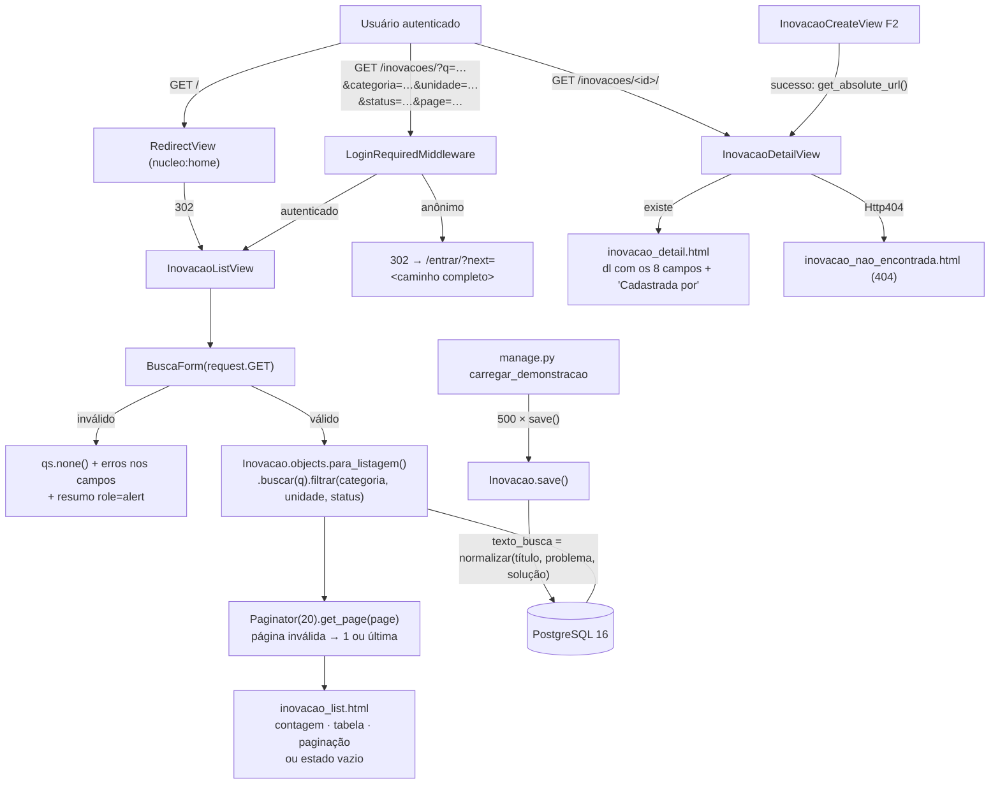

# Consulta de Inovações (F3) — Design

**Spec**: `.specs/features/consulta-inovacoes/spec.md`
**Context**: `.specs/features/consulta-inovacoes/context.md`
**Status**: Approved (2026-10-03)

**Abordagem escolhida (com o usuário):** A — coluna normalizada. `Inovacao` ganha o campo interno
`texto_busca`, com título, problema e solução sem acento e em minúsculas, calculado pela aplicação no
`save()`. A busca normaliza o termo do mesmo jeito e filtra com `texto_busca__contains` uma vez por
palavra. Descartadas: **B**, extensão `unaccent`, que traria de volta a dependência de extensão no
deploy que o usuário recusou na F2 (RNF06); e **C**, full-text search, que casa palavra inteira e não
trecho, o que quebraria a CONS-19, e também exige extensão.

**Decisões de projeto vinculantes (lidas de `.specs/STATE.md`):**

| AD | Como este design conforma |
| -- | ------------------------- |
| AD-001 — sessão nativa | Nada de novo: as views leem `request.user` da sessão. |
| AD-002 — MVT sem Service Layer | Busca, filtros e ordem moram num `QuerySet` customizado do model (`InovacaoQuerySet`). É o ORM no papel de repositório, sem `services/`. A validação dos parâmetros fica num `Form`, e o fluxo HTTP em `ListView` e `DetailView`. |
| AD-003 — PostgreSQL | Sem extensão nova. `texto_busca` é uma coluna `text NOT NULL` comum e o `LIKE` é SQL padrão. |
| AD-004 — perfil como enum | A F3 não consulta perfil: os dois perfis veem tudo (CONS-08). |
| AD-005 — `AUTH_USER_MODEL` | O detalhe lê `inovacao.autor` pela FK existente; a conta `demo` é criada com `get_user_model()`. |
| AD-006 — negar por padrão | As duas views novas e o `RedirectView` de `/` nascem sem decorator. O teste de varredura de `contas/tests/test_controle_acesso.py` cobre `/inovacoes/` e `/inovacoes/1/` sem mudança (CONS-07). |
| AD-007 — admin só para ADMINISTRADOR | `Inovacao` segue fora do admin; nenhum `ModelAdmin` novo. |

**Decisão nova registrada no log:** AD-008 (busca sem acento por coluna normalizada, mantida pelo
`save()`). Ver *Tech Decisions*.

---

## Architecture Overview

Duas views de prateleira (`ListView` e `DetailView`) sobre o model da F2. O que é próprio da F3 cabe
em quatro peças: uma função pura que normaliza texto, o campo `texto_busca` que o `save()` mantém, um
`QuerySet` com `buscar()`, `filtrar()` e `para_listagem()`, e um `Form` GET que valida os parâmetros
da URL. A raiz `/` vira um redirecionamento, a home provisória sai e o cadastro passa a terminar no
detalhe.



---

## Code Reuse Analysis

### Existing Components to Leverage

| Component | Location | How to Use |
| --------- | -------- | ---------- |
| `Inovacao`, `Unidade`, `Categoria`, `StatusInovacao` | `inovacoes/models.py` | Fonte da lista, do detalhe e das opções dos filtros. A ordem alfabética das listas já vem da `Meta.ordering = ["nome"]` de `ItemDeLista` (CONS-26). A ordem de `StatusInovacao.choices` já é a do ciclo. |
| `MENSAGEM_TAMANHO` | `inovacoes/forms.py:9` | Mesma mensagem da INOV-12 para a busca acima de 100 caracteres (CONS-24). |
| Template de campo com a ajuda abaixo | `inovacoes/templates/inovacoes/campo.html` | Os quatro controles da busca usam o mesmo `template_name`: ajuda abaixo, `aria-describedby` e `aria-invalid` automáticos (CONS-43, CONS-52). |
| `LoginRequiredMiddleware` + teste de varredura | `config/settings.py:55`, `contas/tests/test_controle_acesso.py:65` | As rotas novas entram na varredura sem mudar o teste (CONS-07). |
| Cabeçalho, região `role="status"`, `:focus-visible` | `templates/base.html` | Link "Inovações" acrescentado ao `<nav>` existente (CONS-10). A mensagem da INOV-28 aparece no detalhe sem código novo (CONS-50). O foco visível vale para as telas novas (CONS-41). |
| Página 500 sem vazamento | `templates/500.html` (AUTH-26) | Banco indisponível na lista ou no detalhe (CONS-53). |
| Fixtures de teste | `inovacoes/tests/conftest.py` (`autor`, `unidade`, `categoria`, `criar_inovacao`) | Base dos testes da F3. `criar_inovacao` grava via `objects.create()`, que chama `save()` e, portanto, preenche `texto_busca`. |
| Padrão do teste de banco fora do ar | `inovacoes/tests/test_views_erro_500.py` | Mesmo `monkeypatch` provocando `OperationalError`, agora no queryset da listagem e do detalhe (CONS-53). |

### Componentes do Django a aproveitar (conferidos no 5.2.17 instalado)

| Componente | Como usamos |
| ---------- | ----------- |
| `ListView` com `paginate_by = 20` | Lista e paginação. **Exceção:** o `paginate_queryset` padrão responde 404 para página não numérica ou fora do intervalo (`django/views/generic/list.py`). Ele é sobrescrito para usar `Paginator.get_page()`, que devolve a página 1 ou a última (CONS-05). |
| `Paginator.get_page()` | Já faz exatamente o que a CONS-05 pede (`django/core/paginator.py:74`). |
| `` (Django 5.1+) | Links "Anterior" e "Próxima" que trocam só o `page` e preservam `q` e os filtros (CONS-04). |
| `forms.SearchInput` (Django 5.2) | `<input type="search">` no campo de busca. |
| `ModelChoiceField` / `ChoiceField` com `required=False` | Valor vazio vira "sem filtro"; valor inexistente vira `invalid_choice` com o texto da spec (CONS-30). |
| Lookup `contains` | Gera `LIKE '%…%'` e escapa `\`, `%` e `_` (`prep_for_like_query`, `django/db/backends/base/operations.py:516`), o que já atende à CONS-23. |
| `DetailView` | Detalhe e 404 para id inexistente. |
| `RedirectView(pattern_name=…, permanent=False)` | `/` → `/inovacoes/` com 302 (CONS-09). |
| `CreateView` sem `success_url` | Usa `self.object.get_absolute_url()` por padrão, então o redirecionamento ao detalhe só precisa de `Inovacao.get_absolute_url()` (CONS-49). |
| Filtros `linebreaksbr` e `date` | `linebreaksbr` escapa antes de converter as quebras (CONS-16, CONS-17). `date:"d/m/Y"` renderiza no fuso ativo (`TIME_ZONE = "America/Sao_Paulo"`, `USE_TZ = True`) (CONS-13). |
| `LoginRequiredMiddleware.handle_no_permission` | Usa `request.get_full_path()`, então o `next` leva a query string (CONS-07). |

### Integration Points

| System | Integration Method |
| ------ | ------------------ |
| PostgreSQL 16 | Migration `0005`: `AddField texto_busca` + `RunPython` que preenche as linhas existentes. Nenhuma tabela nova. |
| F2 (`InovacaoCreateView`, `inovacao_form.html`) | `success_url` sai, e o padrão `get_absolute_url()` leva ao detalhe (CONS-49). O "Cancelar" passa a apontar para `inovacoes:lista` (CONS-51). |
| `nucleo` | `HomeInternaView` e `nucleo/home.html` saem. A rota `""` com nome `nucleo:home` passa a ser um `RedirectView` para `inovacoes:lista`, e o nome continua valendo. |
| `templates/base.html` | Link "Inovações" antes de "Cadastrar inovação" (CONS-10). |
| F4 / F5 / F6 | A edição da F4 grava por `ModelForm.save()` → `Inovacao.save()`, e o `texto_busca` acompanha. A troca de status da F5 não toca o texto. A F6 usa `filtrar()` e `para_listagem()` nos indicadores, se precisar. |

---

## Components

### `inovacoes.busca` — normalização (função pura)

- **Purpose**: transformar texto em forma comparável, sem acento e sem distinção de caixa, para gravar e para buscar.
- **Location**: `inovacoes/busca.py` (novo)
- **Interfaces**:
  - `normalizar(texto: str) -> str`: `unicodedata.normalize("NFKD", texto)`, descarta os caracteres com `unicodedata.combining(c)` e aplica `casefold()`. Exemplos: `"SOLUÇÃO" → "solucao"`, `"Conciliação" → "conciliacao"`.
  - `palavras(termo: str) -> list[str]`: `normalizar(termo).split()`. Espaços repetidos e espaços nas pontas não geram palavra vazia; termo em branco → `[]` (CONS-21).
  - `texto_de_busca(titulo: str, problema: str, solucao: str) -> str`: `"\n".join(normalizar(x) for x in (titulo, problema, solucao))`. O separador `\n` impede que uma palavra (que nunca contém espaço) case atravessando dois campos.
- **Dependencies**: só a biblioteca padrão.
- **Reuses**: nada. É um módulo utilitário, não camada de serviço (AD-002): não conhece model, request nem banco. Testável com `@pytest.mark.unit`.

### `inovacoes.models.Inovacao` (alterado)

- **Purpose**: manter `texto_busca` sincronizado e expor a URL do detalhe.
- **Location**: `inovacoes/models.py`
- **Interfaces**:
  - Campo novo `texto_busca = models.TextField(editable=False, default="")`. `editable=False` o deixa fora do `InovacaoForm` e de qualquer admin.
  - `save(*args, **kwargs)`: recalcula `self.texto_busca = texto_de_busca(self.titulo, self.problema, self.solucao)` antes do `super().save()`. Quando `update_fields` vem preenchido e contém `titulo`, `problema` ou `solucao`, acrescenta `"texto_busca"` a ele. Sem isso, um `save(update_fields=["titulo"])` da F4 deixaria a coluna velha.
  - `get_absolute_url() -> str`: `reverse("inovacoes:detalhe", args=[self.pk])`.
  - `objects = InovacaoQuerySet.as_manager()`.
- **Reuses**: o model da F2 sem mudar nenhum campo de domínio nem constraint.

### `inovacoes.models.InovacaoQuerySet` (novo)

- **Purpose**: os únicos pontos que sabem como buscar, filtrar e ordenar inovações.
- **Location**: `inovacoes/models.py`
- **Interfaces**:

```python
class InovacaoQuerySet(models.QuerySet):
    def para_listagem(self):
        """CONS-01, CONS-02, CONS-48: só as colunas da tabela, em 1 consulta."""
        return (
            self.select_related("unidade", "categoria")
            .only("id", "titulo", "status", "data_criacao", "unidade__nome", "categoria__nome")
            .order_by("-data_criacao", "-id")
        )

    def buscar(self, termo):
        """CONS-19 a CONS-23: cada palavra precisa aparecer (E); termo em branco não filtra."""
        qs = self
        for palavra in palavras(termo or ""):
            qs = qs.filter(texto_busca__contains=palavra)
        return qs

    def filtrar(self, *, categoria=None, unidade=None, status=""):
        """CONS-27, CONS-28: cada filtro informado restringe; os vazios são ignorados."""
        filtros = {}
        if categoria is not None:
            filtros["categoria"] = categoria
        if unidade is not None:
            filtros["unidade"] = unidade
        if status:
            filtros["status"] = status
        return self.filter(**filtros)
```

  SQL gerado para a consulta combinada da CONS-47 (`q="conciliacao planilha"`, categoria 3, unidade 5,
  status `VALIDADA`, página 1). O `Paginator` faz duas consultas:

```sql
-- contagem (CONS-33 e "Página X de Y")
SELECT COUNT(*) FROM inovacoes_inovacao
WHERE texto_busca::text LIKE '%conciliacao%'
  AND texto_busca::text LIKE '%planilha%'
  AND categoria_id = 3 AND unidade_id = 5 AND status = 'VALIDADA';

-- página
SELECT i.id, i.titulo, i.status, i.data_criacao, u.id, u.nome, c.id, c.nome
FROM inovacoes_inovacao i
JOIN inovacoes_unidade u ON u.id = i.unidade_id
JOIN inovacoes_categoria c ON c.id = i.categoria_id
WHERE <mesmo WHERE>
ORDER BY i.data_criacao DESC, i.id DESC
LIMIT 20;
```

  A ordem das chamadas não muda o resultado, porque todas acrescentam condições com `AND`.
  `buscar` e `filtrar` também servem fora da listagem, e a F6 pode reaproveitá-las.
- **Dependencies**: `inovacoes.busca.palavras`.
- **Reuses**: AD-002 (o ORM é o repositório).

### `inovacoes.forms.BuscaForm` (novo)

- **Purpose**: validar os parâmetros GET da listagem e renderizar os quatro controles com rótulo, ajuda e erros.
- **Location**: `inovacoes/forms.py`
- **Interfaces**:
  - `q = CharField(required=False, max_length=100, strip=True, label="Buscar", widget=SearchInput)`, com `error_messages={"max_length": MENSAGEM_TAMANHO}` → "Use no máximo 100 caracteres (você digitou M)." (CONS-24).
  - `categoria = ModelChoiceField(Categoria.objects.all(), required=False, empty_label="Todas as categorias", label="Categoria")`, com `invalid_choice` → "Selecione uma categoria da lista.".
  - `unidade = ModelChoiceField(Unidade.objects.all(), required=False, empty_label="Todas as unidades", label="Unidade")`, com `invalid_choice` → "Selecione uma unidade da lista.".
  - `status = ChoiceField(choices=[("", "Todos os status"), *StatusInovacao.choices], required=False, label="Status")`, com `invalid_choice` → "Selecione um status da lista.".
  - `help_text` de cada campo com os textos da tabela de Assumptions (CONS-52). `label_suffix = ""`. `template_name = "inovacoes/campo.html"` em cada campo, como no `InovacaoForm`.
  - Nomes dos parâmetros na URL: `q`, `categoria` (pk), `unidade` (pk), `status` (valor do enum), `page`.
- **Dependencies**: `Categoria`, `Unidade`, `StatusInovacao`.
- **Reuses**: `MENSAGEM_TAMANHO`, `campo.html` e o padrão de `error_messages` do `InovacaoForm`.

### `inovacoes.views.InovacaoListView` (novo)

- **Purpose**: listagem, busca, filtros, contagem e estados vazios (RF03, RF05, RF06).
- **Location**: `inovacoes/views.py`
- **Interfaces**:
  - `template_name = "inovacoes/inovacao_list.html"`, `paginate_by = 20`, `context_object_name = "inovacoes"`.
  - `get_queryset()`: `self.form = BuscaForm(self.request.GET)` (sempre vinculado, para repopular os controles; CONS-25, CONS-29). Se o form for inválido, devolve `Inovacao.objects.none()` (CONS-24, CONS-30). Se for válido, devolve `para_listagem().buscar(q).filtrar(categoria=…, unidade=…, status=…)`.
  - `paginate_queryset(queryset, page_size)`: sobrescrito para `paginator.get_page(self.request.GET.get("page"))`, devolvendo `(paginator, page, page.object_list, page.has_other_pages())` (CONS-05).
  - `get_context_data()`: acrescenta `form` e `filtros_ativos`, verdadeiro quando `q` (sem espaços nas pontas), `categoria`, `unidade` ou `status` vêm não vazios no GET (CONS-32, CONS-34, CONS-35).
- **Dependencies**: `BuscaForm`, `InovacaoQuerySet`.
- **Reuses**: `ListView`; AD-006 (sem decorator).

### `inovacoes.views.InovacaoDetailView` (novo)

- **Purpose**: detalhe com todos os campos e o contato (RF04, RN06).
- **Location**: `inovacoes/views.py`
- **Interfaces**:
  - `queryset = Inovacao.objects.select_related("unidade", "categoria", "autor")`, `context_object_name = "inovacao"`, `template_name = "inovacoes/inovacao_detail.html"`.
  - `get()`: captura o `Http404` do `get_object()` e devolve `render(request, "inovacoes/inovacao_nao_encontrada.html", status=404)` (CONS-15). O 404 é próprio da view, e não um `templates/404.html` global, porque "Inovação não encontrada." não serve para uma URL qualquer inexistente.
- **Reuses**: `DetailView`.

### `inovacoes.views.InovacaoCreateView` (alterado)

- Remove `success_url = reverse_lazy("nucleo:home")` e o comentário "PROVISORIO". O `CreateView` passa a usar `get_absolute_url()` (CONS-49). A mensagem da INOV-28 continua igual e aparece no detalhe (CONS-50).

### `nucleo` (alterado)

- `nucleo/urls.py`: `path("", RedirectView.as_view(pattern_name="inovacoes:lista", permanent=False), name="home")` (CONS-09). O nome `nucleo:home` continua válido para quem já o usa.
- Remove `HomeInternaView` (`nucleo/views.py`) e `nucleo/templates/nucleo/home.html`.
- `LOGIN_REDIRECT_URL` continua `"/"`: o login cai em `/`, que redireciona para a listagem (CONS-11), e os testes da AUTH-01 que afirmam o redirect para `/` seguem válidos.

### URLs — `inovacoes/urls.py`

```python
urlpatterns = [
    path("", InovacaoListView.as_view(), name="lista"),          # /inovacoes/
    path("nova/", InovacaoCreateView.as_view(), name="nova"),    # /inovacoes/nova/
    path("<int:pk>/", InovacaoDetailView.as_view(), name="detalhe"),  # /inovacoes/<id>/
]
```

Um id não numérico (`/inovacoes/abc/`) não casa com nenhuma rota e cai no 404 padrão do Django, fora
da CONS-15, que fala de id sem inovação.

### Templates

- **`inovacoes/inovacao_list.html`** (novo): `h1` "Inovações". Depois, `<div role="search">` com `<form method="get" action="">`, os quatro campos via `as_field_group`, `<button type="submit">Buscar</button>` e, se `filtros_ativos`, o link "Limpar filtros" (CONS-31, CONS-32, CONS-37). Se `form.errors`, `<div role="alert">` com "Não foi possível buscar. Corrija os campos indicados." (CONS-30). Os ramos de resultado, em ordem:
  1. `form.errors` → só o alerta e os erros nos campos: sem tabela e sem mensagem de vazio.
  2. `paginator.count > 0` → "1 inovação encontrada" / "N inovações encontradas" (`paginator.count`, CONS-33); `<table>` com `<caption>Inovações cadastradas</caption>`, `<th scope="col">` Título / Categoria / Unidade / Status, título como `<a href="{{ inovacao.get_absolute_url }}">`, status por `get_status_display` (CONS-38, CONS-40); se `is_paginated`, `<nav aria-label="Paginação">` com "Anterior" / "Próxima" via `` e "Página X de Y" (CONS-03, CONS-04, CONS-39).
  3. `filtros_ativos` → "Nenhuma inovação encontrada para a busca e os filtros informados." + "Limpar filtros" (CONS-35).
  4. senão → "Nenhuma inovação cadastrada ainda." + link "Cadastrar inovação" (CONS-34).
- **`inovacoes/inovacao_detail.html`** (novo): `h1` com o título; "Cadastrada por {{ autor.get_full_name|default:autor.get_username }} em {{ data_criacao|date:"d/m/Y" }}" (CONS-13); `<dl>` com `<dt>`/`<dd>` para Título, Unidade de origem, Categoria, Problema ou dor, Solução aplicada, Resultado ou impacto, Status, Contato responsável (CONS-12, CONS-42). Os textos longos usam `|linebreaksbr`; o resultado vazio mostra "Não informado" (CONS-14, CONS-16, CONS-17). Link "Voltar para a lista de inovações" (CONS-18).
- **`inovacoes/inovacao_nao_encontrada.html`** (novo): `h1` "Inovação não encontrada." e o link "Voltar para a lista de inovações" (CONS-15).
- **`inovacoes/inovacao_form.html`** (alterado): "Cancelar" → `` (CONS-51).
- **`templates/base.html`** (alterado): `<a href="">Inovações</a>` antes de "Cadastrar inovação" (CONS-10).

### `inovacoes.management.commands.carregar_demonstracao` (novo)

- **Purpose**: carregar, de forma reproduzível, o conjunto de 500 inovações do RNF08.
- **Location**: `inovacoes/management/commands/carregar_demonstracao.py` (com os `__init__.py` de `management/` e `commands/`)
- **Interfaces**: `python manage.py carregar_demonstracao`, sem argumentos. Roda dentro de `transaction.atomic()`:
  1. `get_or_create` da conta `demo` (`email="demo@demonstracao.invalid"`, perfil `USUARIO`) e `set_unusable_password()` só quando a conta é criada.
  2. Lê `Unidade` e `Categoria` em ordem (`list(...)`). Se alguma das duas tiver menos de 5 itens, o comando para com `CommandError`, porque não daria para garantir 20 por valor.
  3. Para `i` de 1 a 500: título `f"Demonstração {i:03d}"`, `unidade = unidades[i % 5]`, `categoria = categorias[(i // 5) % 5]`, `status = StatusInovacao.values[i % 3]`. Isso dá 100 por unidade, 100 por categoria e 166 ou 167 por status (CONS-44, mínimo de 20 com folga), e os 25 pares unidade × categoria aparecem 20 vezes cada, com os três status espalhados. Assim a consulta combinada da CONS-47 tem resultado. Problema e solução saem de um vocabulário fixo de back office com palavras acentuadas (conciliação, aprovação, planilha, orçamento…), sorteado por `random.Random(i)`: determinístico e reproduzível.
  4. Só cria os títulos que ainda não existem para a conta `demo`, com `Inovacao(...).save()` um a um, nunca `bulk_create`, que pularia o `save()` e deixaria `texto_busca` vazio. Rodar de novo não cria nada (CONS-45).
  5. Imprime "N inovações de demonstração criadas (500 no total)."
- **Reuses**: `Inovacao.save()` (texto de busca), listas da carga inicial `0004`.

### Migrations

- **`inovacoes/migrations/0005_inovacao_texto_busca.py`**: `AddField("inovacao", "texto_busca", TextField(editable=False, default=""))` + `RunPython(preencher, migrations.RunPython.noop)`. A função `preencher` percorre `Inovacao` pelo model histórico, que não tem o `save()` customizado, e grava `texto_busca` com uma **cópia local** da normalização. A migration não importa `inovacoes.busca`: se a função mudar no futuro, a migration antiga continua reproduzindo o que fazia.

---

## Data Models

### `Inovacao` (alteração)

```python
class Inovacao(models.Model):
    # ... campos da F2, sem mudança ...
    # AD-008: titulo + problema + solucao sem acento e em minusculas, mantido pelo save().
    texto_busca = models.TextField(editable=False, default="")

    objects = InovacaoQuerySet.as_manager()

    def save(self, *args, **kwargs): ...
    def get_absolute_url(self): ...
```

**Relationships**: nenhuma nova. `texto_busca` é dado derivado de três colunas da própria linha.
Nenhum índice novo: `LIKE '%x%'` não usa B-tree, e com 500 linhas o *seq scan* é da ordem de
milissegundos. Ver *Risks*.

**Invariante:** para toda `Inovacao` gravada, `texto_busca == texto_de_busca(titulo, problema,
solucao)`. Um teste de model verifica a invariante depois de `create()`, depois de `save()` com campo
alterado e depois de `save(update_fields=["titulo"])`.

---

## Error Handling Strategy

| Error Scenario | Handling | User Impact |
| -------------- | -------- | ----------- |
| Busca com mais de 100 caracteres (CONS-24) | `BuscaForm.q` `max_length` → form inválido → `qs.none()` | 200, mensagem no campo de busca, resumo `role="alert"`, nenhuma linha |
| `categoria`/`unidade` com pk inexistente ou não numérico (CONS-30) | `ModelChoiceField` → `invalid_choice` | 200, "Selecione uma categoria da lista." / "… unidade …" no campo, resumo, nenhuma linha |
| `status` fora do enum (CONS-30) | `ChoiceField` → `invalid_choice` | 200, "Selecione um status da lista." |
| `page` não numérico ou além da última (CONS-05) | `paginate_queryset` → `Paginator.get_page` | 200 na página 1 ou na última |
| Busca com `%`, `_` ou `\` (CONS-23) | Escapados pelo lookup `contains` | Casam literalmente |
| Busca em branco (CONS-21) | `strip=True` → `""` → `palavras("") == []` → nenhum filtro | Lista completa (com os filtros que houver) |
| Id sem inovação (CONS-15) | `Http404` capturado na `InovacaoDetailView.get` | 404, "Inovação não encontrada." + link para a lista |
| Id não numérico (`/inovacoes/abc/`) | Nenhuma rota casa | 404 padrão do Django (fora da CONS-15) |
| Anônimo na lista ou no detalhe (CONS-07) | `LoginRequiredMiddleware` | 302 para `/entrar/?next=<caminho com query string>` |
| PostgreSQL indisponível (CONS-53) | `OperationalError` não capturado → handler 500 | Página 500 do projeto, sem detalhes de conexão |
| Carga de demonstração sem listas suficientes | `CommandError` antes de gravar | Mensagem no terminal; nada gravado (transação) |

---

## Risks & Concerns

| Concern | Location (file:line) | Impact | Mitigation |
| ------- | -------------------- | ------ | ---------- |
| **`texto_busca` sai de sincronia por escrita que não passa pelo `save()`** | `inovacoes/models.py` (a alterar) | `QuerySet.update()`, `bulk_create` e `bulk_update` não chamam `save()`; uma inovação editada assim some da busca ou aparece por texto antigo | Regra na AD-008: toda escrita de título, problema ou solução passa por `save()`. Hoje só existem `InovacaoForm.save()` e o comando de carga, que usa `save()` de propósito. Teste de model cobre `create`, `save` e `save(update_fields=…)`. A F4 herda a regra pela AD. |
| **`save(update_fields=[...])` sem `texto_busca`** | `Inovacao.save` (a criar) | Um `save(update_fields=["titulo"])` gravaria o título novo e deixaria a coluna velha | O `save()` acrescenta `"texto_busca"` ao `update_fields` quando ele contém algum dos três campos. Teste dedicado. |
| **O `ListView` padrão responde 404 para página inválida** | `django/views/generic/list.py` (`paginate_queryset`, ramo `raise Http404`) | `?page=abc` e `?page=99` dariam 404, o que viola a CONS-05 | `paginate_queryset` sobrescrito com `Paginator.get_page`. Testes com `page=abc`, `page=0`, `page=99`. |
| **Testes da F1 e da F2 afirmam a home provisória** | `contas/tests/test_views_home.py:21,28`, `contas/tests/test_sessao.py:49`, `inovacoes/tests/test_views_cabecalho.py:20`, `inovacoes/tests/test_views_cadastro.py:62,117,232,238,284,292,330` | `/` deixa de responder 200 e o cadastro deixa de redirecionar para `/`: esses testes quebram por mudança de spec (CONS-09, CONS-49, CONS-51), não por defeito | Cada teste é **reapontado** para o comportamento novo, sem perder o que afirma: AUTH-01/AUTH-13 passam a seguir o redirect até a listagem e afirmar usuário e logout lá; AUTH-15 renova a sessão com `GET /inovacoes/`; INOV-38 parametriza `/inovacoes/` no lugar de `/`; INOV-03/INOV-28/INOV-29/INOV-36 passam a afirmar o detalhe e a listagem. `contas/tests/test_sessao.py:39`, `contas/tests/test_controle_acesso.py:68,77,98` e `contas/tests/test_views_login.py:26,33,90` continuam válidos (`/` ainda existe, é protegida e é o `LOGIN_REDIRECT_URL`). A spec da F2 ganha a nota "alterado pela F3 (CONS-49/CONS-51)" na INOV-03, INOV-36 e INOV-37, na mesma task. |
| **`LIKE '%x%'` não usa índice** | `InovacaoQuerySet.buscar` | O custo cresce linearmente com o número de inovações | Com 500 linhas o *seq scan* fica na casa dos milissegundos; as CONS-46/CONS-47 medem com folga de ~1000×. Se o volume real crescer muito, o caminho é um índice `pg_trgm` sobre `texto_busca`, o que exige extensão e uma AD nova. Anotado, não implementado. |
| **N+1 na tabela** | `inovacao_list.html` (a criar) | Ler `inovacao.unidade.nome` sem `select_related` faria 2 consultas por linha | `para_listagem()` usa `select_related` + `only`. A CONS-48 compara `django_assert_num_queries` com 1 e com 20 linhas na página. |
| **`only()` + acesso a campo adiado no template** | `para_listagem()` | Se o template da lista ler `problema`, cada linha dispara uma consulta extra (N+1 escondido) | O teste da CONS-48 pega isso. O template da lista só lê título, status, unidade e categoria. |
| **Medição de tempo em teste pode oscilar** | teste das CONS-46/CONS-47 | Uma máquina carregada pode gerar falso negativo | O limite da spec é 2 s, e a medição local esperada fica na casa das dezenas de milissegundos. O teste mede só a requisição (`perf_counter` em volta de `client.get`), sem a carga. O comando roda uma vez por módulo, numa fixture `django_db_setup`/`scope="module"`, ou por função, se o custo for aceitável. Decidido na task. |
| **Collation e `casefold()` divergentes** | `inovacoes/busca.py` | O banco não participa da normalização: o termo e a coluna são normalizados pela mesma função Python, então a collation do deploy não afeta a busca | Nenhuma ação. Anotado porque a F2 registrou o risco de collation para a ordem das listas, que continua valendo para os selects dos filtros. |
| **A cópia da normalização na migration pode divergir de `inovacoes.busca`** | `0005_inovacao_texto_busca.py` | Linhas antigas preenchidas por uma regra e novas por outra, se `busca.py` mudar | Teste de migração: aplica `0004`, cria uma linha pelo model histórico, migra para `0005` e afirma `texto_busca == texto_de_busca(...)` com a função atual. Uma divergência quebra o teste. |
| **O 404 de `DEBUG=True` mostra a página técnica** | `InovacaoDetailView` | Em desenvolvimento, a página de "não encontrada" seria a do Django | O 404 é renderizado pela própria view com `render(..., status=404)`, igual com e sem `DEBUG`. |

---

## Tech Decisions (only non-obvious ones)

| Decision | Choice | Rationale |
| -------- | ------ | --------- |
| Mecanismo da busca sem acento | Coluna `texto_busca` normalizada em Python no `save()` (AD-008) | Escolhido com o usuário. Sem extensão (RNF06, decisão da F2). Termo e coluna passam pela mesma função, então a regra é uma só. |
| Uma coluna para os três campos | `"\n".join(...)` de título, problema e solução | Uma condição `LIKE` por palavra, e não três `OR`. O `\n` impede casar atravessando campos, e a CONS-19 permite palavras em campos diferentes. |
| Onde mora a consulta | `InovacaoQuerySet` (`para_listagem`, `buscar`, `filtrar`) | ORM como repositório (AD-002). Os métodos são encadeáveis e testáveis sem HTTP, e a F6 pode reaproveitá-los. |
| Normalização em módulo próprio | `inovacoes/busca.py`, funções puras | Testável como unit (`@pytest.mark.unit`) e usada pelo model e pela busca. Não é camada de serviço: não toca banco nem request. |
| Form inválido → nenhum resultado | `qs.none()` + alerta, sem a mensagem da CONS-35 | O pedido não foi entendido, então dizer "nenhuma encontrada" seria falso. O alerta diz o que corrigir. |
| Página inválida | `Paginator.get_page` | URL adulterada ou registro apagado entre páginas não deve virar erro (CONS-05). |
| 404 da inovação | Template próprio renderizado pela view | A mensagem é específica de inovação; um `404.html` global a mostraria para qualquer URL. |
| Raiz `/` | `RedirectView` com o mesmo nome `nucleo:home` | Mantém `LOGIN_REDIRECT_URL`, o link do `500.html` e o teste de varredura sem mudança. |
| Fim do cadastro | `get_absolute_url()` + `CreateView` sem `success_url` | O caminho padrão do Django; o detalhe ganha uma URL canônica que a F4 também vai usar. |
| Distribuição da carga de demonstração | `i % 5`, `(i // 5) % 5`, `i % 3` | Determinística, cobre todos os 25 pares unidade × categoria e todos os status, e garante resultado para a consulta combinada da CONS-47. |

> **Decisão de nível de projeto → `.specs/STATE.md` (registrada como AD-008 em 2026-10-03, com a aprovação do design):**
> **AD-008 — A busca textual ignora caixa e acentos por meio da coluna `Inovacao.texto_busca`,
> derivada de título, problema e solução por `inovacoes.busca.normalizar` e mantida por
> `Inovacao.save()`; nenhuma extensão do PostgreSQL é usada.**
> **Reason:** a CONS-20 exige busca sem acento, e a F2 recusou depender da extensão `unaccent` no
> deploy (RNF06). Normalizar o termo e o texto pela mesma função Python dá uma regra única, testável
> sem banco e independente da collation.
> **Trade-off:** dado derivado no banco e uma regra de escrita: toda gravação de título, problema ou
> solução precisa passar por `Inovacao.save()`. `QuerySet.update()`, `bulk_create` e `bulk_update`
> nesses campos deixam a busca errada. O `LIKE '%…%'` não usa índice; para volumes muito maiores que
> o do MVP, o caminho é `pg_trgm`, que exigiria supersedir esta decisão.
> **Scope:** F3 (busca), F4 (edição grava por `save()`), F6 (se reaproveitar `buscar()`), e qualquer
> carga ou script que grave inovações.

---

## Cobertura dos requisitos

| Requirement | Onde é atendido |
| ----------- | --------------- |
| CONS-01 | `InovacaoListView` + `para_listagem()` + tabela de `inovacao_list.html` |
| CONS-02 | `para_listagem()`: `order_by("-data_criacao", "-id")` |
| CONS-03 | `paginate_by = 20` + bloco de paginação ("Anterior" só se `has_previous`, "Próxima" só se `has_next`) |
| CONS-04 | `` |
| CONS-05 | `InovacaoListView.paginate_queryset` → `Paginator.get_page` |
| CONS-06 | `<a href="{{ inovacao.get_absolute_url }}">` |
| CONS-07 | `LoginRequiredMiddleware` (`get_full_path`) + teste de varredura |
| CONS-08 | Nenhum filtro por autor, unidade ou perfil no queryset base |
| CONS-09 | `RedirectView` em `nucleo/urls.py` |
| CONS-10 | Link "Inovações" no `<nav>` do `base.html` |
| CONS-11 | `LOGIN_REDIRECT_URL = "/"` + CONS-09 |
| CONS-12 | `InovacaoDetailView` + `<dl>` com os 8 campos |
| CONS-13 | `get_full_name|default:get_username` + `date:"d/m/Y"` no fuso do projeto |
| CONS-14 | `default:"Não informado"` no resultado |
| CONS-15 | `InovacaoDetailView.get` → `inovacao_nao_encontrada.html` com status 404 |
| CONS-16 | `linebreaksbr` |
| CONS-17 | Autoescape do Django (`linebreaksbr` escapa antes) |
| CONS-18 | Link no `inovacao_detail.html` |
| CONS-19 | `InovacaoQuerySet.buscar` (um `contains` por palavra, encadeados) + `texto_de_busca` |
| CONS-20 | `inovacoes.busca.normalizar` no termo e no `save()` |
| CONS-21 | `strip=True` + `palavras("") == []` |
| CONS-22 | `texto_busca` contém só título, problema e solução |
| CONS-23 | Escape do lookup `contains` |
| CONS-24 | `BuscaForm.q` `max_length=100` + `MENSAGEM_TAMANHO` + `qs.none()` |
| CONS-25 | `BuscaForm` vinculado ao `request.GET` |
| CONS-26 | `ModelChoiceField` com `empty_label` + `Meta.ordering`; `ChoiceField` com `StatusInovacao.choices` |
| CONS-27 | `InovacaoQuerySet.filtrar` |
| CONS-28 | `buscar()` + `filtrar()` encadeados (AND) |
| CONS-29 | `BuscaForm` vinculado |
| CONS-30 | `error_messages["invalid_choice"]` + alerta + `qs.none()` |
| CONS-31 | `<form method="get">` único + botão "Buscar"; nenhum JavaScript |
| CONS-32 | `filtros_ativos` + link "Limpar filtros" |
| CONS-33 | `paginator.count` com plural |
| CONS-34 | Ramo 4 do template |
| CONS-35 | Ramo 3 do template |
| CONS-36 | `label_tag` do Django via `campo.html` |
| CONS-37 | `<div role="search">` |
| CONS-38 | `<caption>` + `<th scope="col">` |
| CONS-39 | `<nav aria-label="Paginação">` |
| CONS-40 | `get_status_display` em texto |
| CONS-41 | Templates só com links, controles nativos e `button`, sem `tabindex`; `:focus-visible` do `base.html` |
| CONS-42 | `<dl>`/`<dt>`/`<dd>` no detalhe |
| CONS-43 | `aria-invalid` e `aria-describedby` do Django 5.2 via `campo.html` |
| CONS-44 | `carregar_demonstracao` (distribuição `i % 5`, `(i // 5) % 5`, `i % 3`) |
| CONS-45 | Comando cria só os títulos ausentes; `get_or_create` da conta |
| CONS-46 | Teste de tempo sobre `GET /inovacoes/` com a carga |
| CONS-47 | Teste de tempo sobre a consulta combinada com a carga |
| CONS-48 | `select_related` + `only` em `para_listagem()`; teste com `django_assert_num_queries` |
| CONS-49 | `Inovacao.get_absolute_url()` + `CreateView` sem `success_url` |
| CONS-50 | `messages.success` existente + região `role="status"` do `base.html` |
| CONS-51 | "Cancelar" → `` |
| CONS-52 | `help_text` no `BuscaForm` + `campo.html` |
| CONS-53 | Handler 500 do projeto |

Nenhum requisito da spec ficou sem componente.
