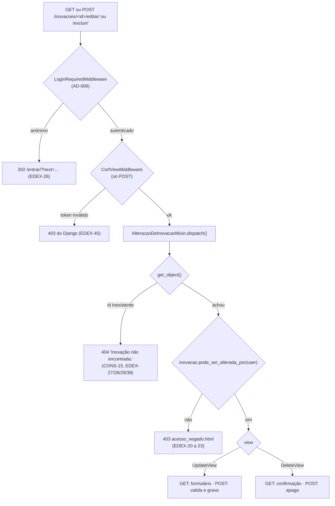
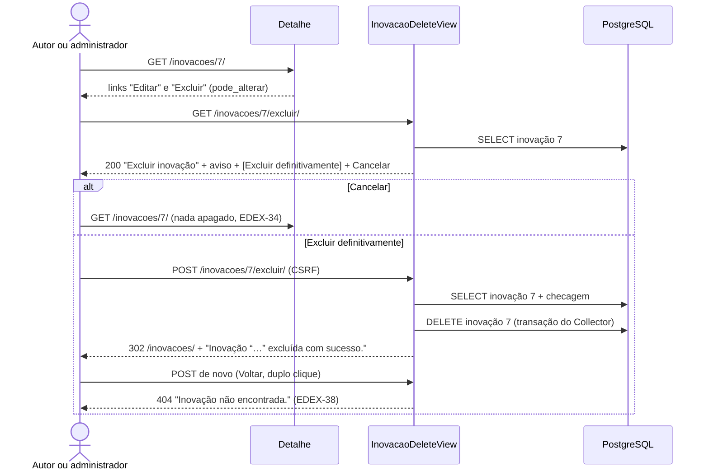

# Edição e Exclusão de Inovações (F4) — Design

**Spec**: `.specs/features/edicao-exclusao/spec.md`
**Context**: `.specs/features/edicao-exclusao/context.md`
**Status**: Approved (2026-10-11) — implementado e verificado (2026-10-11, `validation.md`, iteração 2 PASS)

**Abordagem escolhida (com o usuário):** A — modelo + mixin. A regra "autor ou administrador" vira
um único método do modelo, `Inovacao.pode_ser_alterada_por(usuario)`. Um mixin,
`AlteracaoDeInovacaoMixin`, busca a inovação e aplica a regra no `dispatch()`, antes de qualquer GET
ou POST, nas duas views novas. O detalhe usa o mesmo método para decidir se mostra os links.
Descartadas: **B**, permissões do Django (`has_perm` num backend + `PermissionRequiredMixin`), porque
a AD-007 já tirou o efeito das permissões de modelo, o `is_superuser` passaria por cima da regra e o
403 cairia no `403.html` global, que o Django admin também usa; e **C**, filtrar o queryset por
autor, porque o terceiro receberia 404 em vez do 403 decidido no Discuss.

**Conformidade com as ADs ativas:**

| AD | Como a F4 conforma |
| -- | ------------------ |
| AD-001 | O usuário vem da sessão do Django (`request.user`), recarregado do banco a cada requisição |
| AD-002 | A regra fica no model e a aplicação dela num mixin de view; nenhuma camada de serviço |
| AD-003 | Nenhuma migration; a unicidade do título continua na constraint do PostgreSQL |
| AD-004 | O perfil é lido só por `usuario.is_administrador`; nunca se compara o campo `perfil` |
| AD-005 | A autoria é comparada por `autor_id == usuario.pk`, sem importar o modelo de usuário |
| AD-006 | As duas rotas novas não têm decorator nem exceção: o `LoginRequiredMiddleware` nega o anônimo antes do `dispatch()` (EDEX-26) |
| AD-007 | `Inovacao` continua fora do admin; nenhum `ModelAdmin` novo |
| AD-008 | A edição grava por `form.save()` → `Inovacao.save()`, que recalcula `texto_busca` (EDEX-11); nenhum `update()` |

**Decisão de projeto nova:** AD-009 (ver *Tech Decisions*) — toda view que altera uma `Inovacao`
herda o `AlteracaoDeInovacaoMixin`.

---

## Architecture Overview

**Fluxo da exclusão (RN12, EDEX-30 a 40):**

O GET da rota de exclusão só renderiza; o único caminho que apaga é o POST, que passa pelo
`dispatch()` com a checagem (EDEX-36).

---

## Code Reuse Analysis

### Existing Components to Leverage

| Component | Location | How to Use |
| --------- | -------- | ---------- |
| `Inovacao` e suas constraints | `inovacoes/models.py` | Ganha só o método `pode_ser_alterada_por`. A unicidade do título (INOV-26) e o `validate_constraints` que leva o erro para o campo (INOV-22) valem para a edição sem mudança |
| `Inovacao.save()` | `inovacoes/models.py` | Recalcula `texto_busca` em toda gravação (AD-008, EDEX-11) |
| `Inovacao.get_absolute_url()` | `inovacoes/models.py` | Destino do sucesso da edição (EDEX-05) e alvo dos dois "Cancelar" e do link do 403 |
| `InovacaoForm` | `inovacoes/forms.py` | Formulário da edição, sem mudança: mesmos campos (EDEX-01), mensagens (EDEX-09) e acessibilidade (EDEX-41). `Meta.fields` já deixa autor, status e data de fora (EDEX-08) |
| Tratamento da corrida de título | `inovacoes/views.py` (`InovacaoCreateView.form_valid`) | Extraído para um mixin e reaproveitado pela edição (EDEX-14) |
| 404 próprio da inovação | `inovacoes/views.py` (`InovacaoDetailView.get`) + `inovacao_nao_encontrada.html` | Extraído para uma função e reaproveitado pelo mixin (EDEX-27, 28, 29, 38, 39) |
| `Usuario.is_administrador` | `contas/models.py:85` | Único ponto de consulta do perfil (AD-004) |
| `inovacao_form.html` + `campo.html` | `inovacoes/templates/inovacoes/` | O mesmo template serve à edição, com título, botão e alvo do "Cancelar" vindos do contexto |
| Região `role="status"` | `templates/base.html` | Mensagens de sucesso da edição e da exclusão (EDEX-06, EDEX-40) |
| `:focus-visible` | `templates/base.html` | Foco visível nas telas novas sem CSS novo (EDEX-42) |
| Página 500 | `templates/500.html` | Banco indisponível (EDEX-44) |
| Fixture `banco_fora_do_ar` | `inovacoes/tests/test_views_erro_500.py` | Testes da EDEX-44 |
| Varredura de rotas da AD-006 | `contas/tests/test_controle_acesso.py` | Já cobre as rotas novas para o anônimo (EDEX-26) sem alteração |

### Componentes do Django a aproveitar (conferidos no 5.2.17 instalado)

| Componente | Comportamento conferido | Uso |
| ---------- | ----------------------- | --- |
| `UpdateView` | `get()` e `post()` fazem `self.object = self.get_object()`; sem `success_url`, redireciona para `object.get_absolute_url()`; `get_initial()` vazio, então o formulário parte da instância | `InovacaoUpdateView` (EDEX-02, EDEX-05) |
| `DeleteView` | `get()` renderiza `<app>/<model>_confirm_delete.html`; `post()` faz `get_object()` e `form_valid()`, que chama `object.delete()` e redireciona | `InovacaoDeleteView` (EDEX-30, 35, 36) |
| `UniqueConstraint.validate` | Numa instância já salva, exclui o próprio `pk` da checagem | EDEX-12 sem código novo |
| `Model.save()` | Se o UPDATE não afeta linha nenhuma, faz INSERT com o mesmo `pk` | Exige o bloqueio da linha na edição (ver *Risks*) |
| `permission_denied` (handler403) | Renderiza o `403.html` global, o mesmo das recusas do admin (INOV-20, AUTH-22) | **Não** usado: a página de acesso negado é renderizada pela view |
| `CsrfViewMiddleware` | POST sem token válido → 403 antes da view | EDEX-45 sem código novo |
| `AuthenticationMiddleware` | Recarrega o usuário do banco a cada requisição | EDEX-25 sem código novo |

### Integration Points

| System | Integration Method |
| ------ | ------------------ |
| Detalhe da F3 | `InovacaoDetailView.get_context_data()` passa `pode_alterar`; o template mostra "Editar" e "Excluir" só com ele verdadeiro (EDEX-03, 24, 31) |
| Listagem da F3 | Destino da exclusão; a busca e a contagem refletem a remoção e a edição sem código novo (EDEX-11, EDEX-37) |
| Cadastro da F2 | Passa a usar o mixin de gravação com título único e o template parametrizado; comportamento e textos iguais |
| PostgreSQL | UPDATE e DELETE de uma linha; `SELECT … FOR UPDATE` na edição |

---

## Components

### `Inovacao.pode_ser_alterada_por` (novo, em `inovacoes/models.py`)

- **Purpose**: Dizer se uma conta pode editar ou excluir esta inovação (RN05, RNF07).
- **Interfaces**:
  - `pode_ser_alterada_por(usuario) -> bool` — `usuario.is_authenticated and (usuario.is_administrador or self.autor_id == usuario.pk)`.
- **Notas**: lê `autor_id`, não `autor`, para não disparar consulta. A guarda de `is_authenticated`
  deixa o método seguro com `AnonymousUser`, que não tem `is_administrador`, mesmo que o middleware
  já barre o anônimo. O perfil é o único critério: `is_superuser` e `is_staff` não contam (AD-007).
- **Reuses**: `Usuario.is_administrador` (AD-004).

### `_inovacao_nao_encontrada(request)` (novo, função em `inovacoes/views.py`)

- **Purpose**: Resposta única da CONS-15, usada pelo detalhe e pelo mixin.
- **Interfaces**: `_inovacao_nao_encontrada(request) -> HttpResponse` — `render(request, "inovacoes/inovacao_nao_encontrada.html", status=404)`.
- **Reuses**: o template da F3. `InovacaoDetailView.get()` passa a chamá-la.

### `AlteracaoDeInovacaoMixin` (novo, em `inovacoes/views.py`)

- **Purpose**: Buscar a inovação e aplicar a regra de autoria antes de qualquer método HTTP das views
  que alteram uma inovação.
- **Interfaces**:
  - `queryset = Inovacao.objects.select_related("unidade", "categoria")` — a confirmação mostra unidade e categoria sem consulta extra.
  - `context_object_name = "inovacao"`.
  - `dispatch(request, *args, **kwargs)`:
    1. `self.object = self.get_object()`; `Http404` → `_inovacao_nao_encontrada(request)` (EDEX-27, 28, 29, 38);
    2. `not self.object.pode_ser_alterada_por(request.user)` → `render(request, "inovacoes/acesso_negado.html", {"inovacao": self.object}, status=403)` (EDEX-20 a 23);
    3. senão, `super().dispatch(...)`.
  - `get_object(queryset=None)` — devolve o `self.object` já buscado no `dispatch()`; o `get()`/`post()` das views genéricas o chamam de novo.
- **Notas**: a checagem fica no `dispatch()`, e não em `get()`/`post()`, para valer para qualquer
  método HTTP, inclusive os que uma view futura acrescentar. A ordem 404 → 403 é a da spec.
- **Reuses**: `SingleObjectMixin.get_object()`; `_inovacao_nao_encontrada`.

### `GravacaoComTituloUnicoMixin` (novo, extraído de `InovacaoCreateView.form_valid`)

- **Purpose**: Gravar o formulário dentro de uma transação, transformar a violação da constraint de
  título numa mensagem de campo (INOV-25, EDEX-14) e publicar a mensagem de sucesso.
- **Interfaces**:
  - `mensagem_de_sucesso: str` — com `{titulo}`; cada view define a sua.
  - `gravar(form) -> Inovacao` — padrão `form.save()`; a edição sobrescreve.
  - `form_valid(form)` — `transaction.atomic()` + `self.object = self.gravar(form)`; `IntegrityError` da `inovacao_titulo_unico_por_unidade` → `form.add_error("titulo", …)` e `form_invalid`; outras violações sobem (500); no sucesso, `messages.success(...)` e redirect para `get_success_url()`.
- **Reuses**: o corpo atual de `InovacaoCreateView.form_valid` e `_mensagem_de_titulo_duplicado()`,
  sem mudança de comportamento. Os testes da INOV-25 e da INOV-28 continuam sendo a prova.

### `InovacaoCreateView` (alterado)

- Passa a herdar `GravacaoComTituloUnicoMixin`, com `mensagem_de_sucesso = "Inovação “{titulo}” cadastrada com sucesso."`; `get_initial()` (INOV-39) e a atribuição do autor (INOV-04) ficam como estão, o autor num `gravar()` próprio ou antes do `super().form_valid()`.
- Contexto do template: `titulo_pagina = "Cadastrar inovação"`, `rotulo_botao = "Salvar"`, `url_cancelar = /inovacoes/` — o HTML renderizado não muda.

### `InovacaoUpdateView` (novo)

- **Purpose**: Edição dos sete campos pelo autor ou por um administrador (RF07).
- **Location**: `inovacoes/views.py`; herda `AlteracaoDeInovacaoMixin, GravacaoComTituloUnicoMixin, UpdateView`.
- **Interfaces**:
  - `form_class = InovacaoForm`; `template_name = "inovacoes/inovacao_form.html"`.
  - `mensagem_de_sucesso = "Inovação “{titulo}” atualizada com sucesso."` (EDEX-06).
  - `gravar(form)` — dentro da transação aberta pelo mixin, `Inovacao.objects.select_for_update().filter(pk=self.object.pk).exists()`; se a linha sumiu, sinaliza inovação excluída e a view responde com `_inovacao_nao_encontrada` (EDEX-29); senão, `form.save()`.
  - `get_context_data()` — `titulo_pagina = "Editar inovação"`, `rotulo_botao = "Salvar alterações"`, `url_cancelar = self.object.get_absolute_url()` (EDEX-16).
  - Sem `success_url`: o `UpdateView` usa `get_absolute_url()` (EDEX-05).
- **Notas**: sem `get_initial()`: o formulário mostra os valores salvos, inclusive o contato (EDEX-02),
  e não o pré-preenchimento da INOV-39. Autor, status e data não estão em `Meta.fields`, então valores
  forjados não são lidos (EDEX-08, EDEX-18). A última gravação vence (EDEX-15): não há checagem de
  versão.
- **Reuses**: `UpdateView`, `InovacaoForm`, os dois mixins.

### `InovacaoDeleteView` (novo)

- **Purpose**: Confirmação e exclusão definitiva pelo autor ou por um administrador (RF08, RN12).
- **Location**: `inovacoes/views.py`; herda `AlteracaoDeInovacaoMixin, DeleteView`.
- **Interfaces**:
  - `template_name` padrão: `inovacoes/inovacao_confirm_delete.html`.
  - `success_url = reverse_lazy("inovacoes:lista")` (EDEX-35).
  - `form_valid(form)` — guarda o título, chama `super().form_valid(form)` (que apaga e redireciona) e publica `"Inovação “{titulo}” excluída com sucesso."` (EDEX-40).
- **Notas**: o GET herdado só renderiza (EDEX-36). O `Collector` do Django apaga dentro de uma
  transação; hoje nenhuma FK aponta para `Inovacao`, então só a linha dela sai (EDEX-37).
- **Reuses**: `DeleteView`, `AlteracaoDeInovacaoMixin`.

### `InovacaoDetailView` (alterado)

- `get()` usa `_inovacao_nao_encontrada`.
- `get_context_data()` acrescenta `pode_alterar = self.object.pode_ser_alterada_por(self.request.user)` (EDEX-03, 24, 31). Nenhuma consulta extra: `autor` já vem no `select_related`.

### URLs — `inovacoes/urls.py`

| Rota | View | Nome |
| ---- | ---- | ---- |
| `<int:pk>/editar/` | `InovacaoUpdateView` | `inovacoes:editar` |
| `<int:pk>/excluir/` | `InovacaoDeleteView` | `inovacoes:excluir` |

### Templates

| Template | Situação | Conteúdo |
| -------- | -------- | -------- |
| `inovacoes/inovacao_form.html` | alterado | `` e `h1` = `titulo_pagina`; botão = `rotulo_botao`; "Cancelar" → `url_cancelar`. Resumo da INOV-30 e loop de campos iguais |
| `inovacoes/inovacao_confirm_delete.html` | novo | `<title>`/`h1` "Excluir inovação"; parágrafo "Você vai excluir a inovação “{{ inovacao.titulo }}” ({{ inovacao.unidade.nome }} · {{ inovacao.categoria.nome }}). Esta ação não pode ser desfeita."; `<form method="post">` com ``, `<button type="submit">Excluir definitivamente</button>` e `<a href="{{ inovacao.get_absolute_url }}">Cancelar</a>` |
| `inovacoes/acesso_negado.html` | novo | `<title>`/`h1` "Acesso negado"; "Você não tem permissão para alterar esta inovação."; "Só quem cadastrou a inovação ou um administrador pode editá-la ou excluí-la."; `<a href="{{ inovacao.get_absolute_url }}">Voltar para a inovação</a>` |
| `inovacoes/inovacao_detail.html` | alterado | Com `pode_alterar`, logo após "Cadastrada por…": `<a href="">Editar</a>` e `<a href="">Excluir</a>` |

Os três templates usam só `a`, `button`, `form` e os campos do `InovacaoForm`, sem `tabindex`
(EDEX-42), e herdam o `:focus-visible` do `base.html`.

---

## Data Models

Nenhuma mudança de schema e nenhuma migration: `Inovacao` ganha só um método.
`makemigrations --check` continua no gate.

---

## Error Handling Strategy

| Error Scenario | Handling | User Impact |
| -------------- | -------- | ----------- |
| Anônimo nas rotas novas | `LoginRequiredMiddleware` (AD-006) | Login com `next` (EDEX-26) |
| POST sem token CSRF | `CsrfViewMiddleware` | 403 do Django, nada muda (EDEX-45) |
| Id inexistente | `Http404` do `get_object()` capturado no mixin | "Inovação não encontrada." com 404 (EDEX-27, 28, 38) |
| Terceiro sem perfil de administrador | `pode_ser_alterada_por` falso no `dispatch()` | 403 com a página de acesso negado; o POST não chega ao `form_valid` (EDEX-20 a 23) |
| Dados inválidos na edição | `form_invalid` do `UpdateView` | Formulário com mensagens, valores preservados e resumo em `role="alert"`; banco intacto (EDEX-09, 10) |
| Título de outra inovação da unidade | `validate_constraints` do model (INOV-22) | Mensagem no campo título (EDEX-13) |
| Corrida no título (duas edições, ou edição e cadastro) | `IntegrityError` da constraint no `GravacaoComTituloUnicoMixin` | Mensagem no campo título com 200, nunca 500 (EDEX-14) |
| Inovação excluída entre a abertura e o envio da edição | `dispatch()` não acha → 404 | "Inovação não encontrada." (EDEX-29) |
| Inovação excluída entre o `dispatch()` e a gravação (mesma requisição) | `select_for_update` em `gravar()` não acha a linha | 404 da CONS-15; nada é recriado (EDEX-29) |
| Banco indisponível | `OperationalError` sobe | Página 500 sem detalhes; transação desfeita (EDEX-44) |

---

## Risks & Concerns

| Concern | Location (file:line) | Impact | Mitigation |
| ------- | -------------------- | ------ | ---------- |
| **Segurança:** uma view futura que altere `Inovacao` (troca de status da F5) pode esquecer a checagem de autoria, e o esquecimento abre a porta em silêncio | `inovacoes/views.py` | Usuário comum altera registro de terceiro (RNF07) | AD-009: toda view que altera `Inovacao` herda o mixin. Teste de varredura: toda rota de `inovacoes` com `pk`, exceto o detalhe (allowlist), responde 403 a GET e POST de um terceiro `USUARIO` — o mesmo desenho da varredura da AD-006. *Reforçado na T18 (Verifier, iteração 1): a coleta lê os parâmetros capturados, não o texto `<int:pk>`, e falha em rota com parâmetro que não seja `pk`; a recusa roda também para `USUARIO` com `is_staff` e `is_superuser` (T15)* |
| **Integridade:** o `Model.save()` faz INSERT quando o UPDATE não acha a linha; uma exclusão entre o `dispatch()` e o `save()` da edição recriaria a inovação | `django/db/models/base.py` (`_save_table`), usado por `form.save()` | Inovação excluída volta a existir | `SELECT … FOR UPDATE` dentro da transação em `InovacaoUpdateView.gravar()`; linha ausente → 404. Alternativa descartada: `save(force_update=True)`, que exigiria distinguir o `DatabaseError` dela do `OperationalError` de banco fora do ar (a EDEX-44 pede 500) |
| **Fragilidade:** o `403.html` global é compartilhado com o admin | `templates/` (não existe hoje) | Um `403.html` com o texto da F4 apareceria nas recusas do admin (INOV-20, AUTH-22) | A página de acesso negado é renderizada pela view; nenhum `403.html` global é criado |
| **Fragilidade:** parametrizar `inovacao_form.html` e extrair o `form_valid` do cadastro mexe em código da F2 | `inovacoes/templates/inovacoes/inovacao_form.html`, `inovacoes/views.py:23-50` | Regressão no cadastro | O cadastro passa os mesmos textos pelo contexto; a suíte da F2 (título, botão, "Cancelar", INOV-25, INOV-28) tem de passar sem alteração |
| **Corrida aceita:** duas exclusões simultâneas da mesma inovação passam as duas pelo `dispatch()`; a segunda apaga zero linhas e mostra sucesso | `InovacaoDeleteView.form_valid` | Mensagem de sucesso para uma inovação que outra pessoa acabou de apagar; nenhum dado errado | Aceito: o estado final é o pedido. A EDEX-38 (POST repetido em sequência) continua dando 404 |
| **UX fora do escopo:** a recusa de CSRF usa a página padrão do Django, em inglês | `django.views.csrf.csrf_failure` | Texto técnico em inglês num caso raro (sessão expirada com o formulário aberto) | A EDEX-45 só exige o 403 e nada alterado. Registrado em Deferred Ideas |
| **Cobertura:** `pode_ser_alterada_por` com `AnonymousUser` não é alcançável pelas views (o middleware barra antes) | `inovacoes/models.py` | A guarda de `is_authenticated` pode regredir sem ninguém notar | Teste unitário do método com `AnonymousUser`, além das quatro combinações autor/terceiro × `USUARIO`/`ADMINISTRADOR` |

---

## Tech Decisions (only non-obvious ones)

| Decision | Choice | Rationale |
| -------- | ------ | --------- |
| Onde mora a regra de autoria | `Inovacao.pode_ser_alterada_por(usuario)` | Uma regra só para views e template, testável sem HTTP (AD-002: no model, sem serviço) |
| Onde a regra é aplicada | `AlteracaoDeInovacaoMixin.dispatch()` | Vale para todo método HTTP antes de qualquer processamento; o POST negado nunca chega ao `form_valid` |
| Página de acesso negado | `render(..., status=403)` na view, não `raise PermissionDenied` | O `403.html` global é compartilhado com o admin |
| Ordem das respostas | 404 antes de 403 | Decidido na spec; o detalhe já revela a existência do id a qualquer autenticado |
| Formulário da edição | O mesmo `InovacaoForm` e o mesmo template, com título, botão e "Cancelar" pelo contexto | Uma regra de validação e um HTML de formulário (H4) |
| Tratamento da corrida de título | Extraído para `GravacaoComTituloUnicoMixin`, usado pelo cadastro e pela edição | A edição tem a mesma corrida (EDEX-14); copiar o bloco duplicaria uma regra sutil |
| Edição de linha apagada no meio da requisição | `select_for_update` antes do `save()` | Impede o INSERT silencioso do `Model.save()` sem interpretar exceções do banco |
| Confirmação da exclusão | `DeleteView` padrão: GET renderiza, POST apaga | Decidido no Discuss; sem JavaScript |
| Mensagem pós-exclusão | `form_valid` guarda o título antes do `super()` | O detalhe não existe mais; a mensagem aparece na lista |

**AD-009 (projeto)** — registrada em `.specs/STATE.md` na aprovação deste design (2026-10-11): toda view que altera uma `Inovacao` herda
`AlteracaoDeInovacaoMixin`, a regra "autor ou administrador" mora só em
`Inovacao.pode_ser_alterada_por`, e a recusa é 403 com página própria, nunca o `403.html` global. A F5
(troca de status) conforma com ela ou a supersede.

---

## Cobertura dos requisitos

| Requisito | Componente |
| --------- | ---------- |
| EDEX-01, 02, 04, 05, 16 | `InovacaoUpdateView` + `inovacao_form.html` parametrizado |
| EDEX-03, 24, 31 | `InovacaoDetailView.get_context_data` (`pode_alterar`) + `inovacao_detail.html` |
| EDEX-06, 07 | `GravacaoComTituloUnicoMixin.mensagem_de_sucesso` + `role="status"` do `base.html` |
| EDEX-08, 18 | `InovacaoForm.Meta.fields` (sem autor, status, data) |
| EDEX-09, 10, 41 | `InovacaoForm` e `inovacao_form.html` da F2, sem mudança |
| EDEX-11 | `Inovacao.save()` (AD-008) via `form.save()` |
| EDEX-12, 13 | `UniqueConstraint` + `Inovacao.validate_constraints` da F2 |
| EDEX-14 | `GravacaoComTituloUnicoMixin` |
| EDEX-15 | Comportamento padrão do `UpdateView` (sem versão) |
| EDEX-17, 19, 25 | `Inovacao.pode_ser_alterada_por` |
| EDEX-20 a 23 | `AlteracaoDeInovacaoMixin.dispatch` + `acesso_negado.html` |
| EDEX-26 | `LoginRequiredMiddleware` (AD-006) |
| EDEX-27, 28, 38, 39 | `AlteracaoDeInovacaoMixin.dispatch` / `InovacaoDetailView` + `_inovacao_nao_encontrada` |
| EDEX-29 | `dispatch` (sequencial) + `InovacaoUpdateView.gravar` com `select_for_update` (mesma requisição) |
| EDEX-30, 32, 33, 34, 36 | `InovacaoDeleteView` (GET) + `inovacao_confirm_delete.html` |
| EDEX-35, 37, 40 | `InovacaoDeleteView.form_valid` |
| EDEX-42, 43 | Os três templates + `:focus-visible` do `base.html` |
| EDEX-44 | Página 500 da F1; transações do mixin e do `Collector` |
| EDEX-45 | `CsrfViewMiddleware` |
