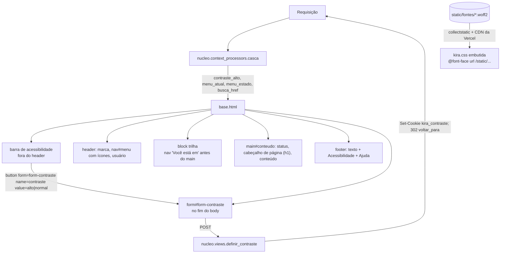

# Fundação do Redesign (R1) Design

**Spec**: `.specs/features/fundacao-do-redesign/spec.md`
**Context**: `.specs/features/fundacao-do-redesign/context.md`
**Status**: Draft — aguardando aprovação (2026-11-15)

Conforma com AD-001 a AD-012. Novas: **AD-013** (recursos estáticos do projeto), **AD-014**
(preferência de apresentação por cookie), **AD-015** (casca da página). A AD-010 segue ativa e
sem emenda: a `kira.css` continua embutida; só a fonte vai para `/static/`.

---

## Architecture Overview

Tudo é servidor e template; nenhum JavaScript. Uma view nova (contraste), duas páginas
estáticas, um context processor que calcula o estado da casca, e o `base.html` que monta a casca
na ordem que os testes antigos permitem.

### Abordagens consideradas

| Abordagem | Como | Veredito |
| --------- | ---- | -------- |
| **A. Context processor + blocos no base** (escolhida) | Um processor calcula contraste e página atual a partir de `request.COOKIES` e `request.resolver_match`; o base monta tudo; telas só preenchem blocos | Uma regra só para o menu atual; testável sem HTTP; nenhuma view existente muda |
| B. Template tags de inclusão (``) | A lógica fica numa tag | Mesma regra, mais um `templatetags` e `` em cada lugar; sem ganho |
| C. Lógica no próprio template (`request.resolver_match.url_name == …`) | Comparações no base | Regra espalhada no HTML, não testável sem renderizar; quebra com rota nova em silêncio |

---

## Onde cada peça fica no DOM (e por quê)

Ordem final do `body`:

1. `div.barra-acessibilidade` — atalhos (`nav aria-label="Atalhos de acessibilidade"`), link
   "Acessibilidade" e o **botão** "Alto contraste" (`form="form-contraste"`).
2. `div.faixa-marca.decorativo aria-hidden="true"` (substitui o `body > header::before`).
3. `<header>` sem atributo: marca, `nav id="menu" aria-label="Principal"`, área do usuário.
4. `` — a `nav aria-label="Você está em"`, **antes** do `main`.
5. `<main id="conteudo">` exato: `div role="status"`, cabeçalho de página, conteúdo.
6. `<footer>` sem atributo.
7. `form id="form-contraste" method="post"` só com o CSRF e o `voltar_para` (nenhum controle visível).

Três posições divergem da letra da §5 da design-spec, todas para não mudar teste antigo além dos
autorizados (AD-015):

| Peça | design-spec | Aqui | Teste que obriga |
| ---- | ----------- | ---- | ---------------- |
| Trilha | dentro do `main` | antes do `main`, como landmark próprio | `test_views_acessibilidade_alteracao.py:237` (todos os links do `main` da página de avançar status == [detalhe]) e `:442` (ordem de Tab do `main` da sinalização) |
| `<form>` do contraste | na barra | no fim do `body`; o botão na barra aponta para ele por `form=` | `contas/tests/test_views_login_acessibilidade.py:100,113` (o primeiro `<form>` da página é o do login) |
| Foco no alvo do atalho | `tabindex="-1"` | sem `tabindex` | `<main id="conteudo">` literal em 3 arquivos de teste |

A trilha antes do `main` é o padrão do GOV.UK Design System (breadcrumbs antes do `main`); o
"Ir para o conteúdo" pula a trilha, o que é desejável. Visualmente, a trilha fica logo acima do
alerta e do h1 (o alerta aparece entre a trilha e o h1, não acima da trilha).

---

## Code Reuse Analysis

### Existing Components to Leverage

| Component | Location | How to Use |
| --------- | -------- | ---------- |
| Base e folha | `templates/base.html`, `templates/kira.css` | Estendidos; nenhum seletor usado por tela é removido |
| Marca | `templates/marca.html` | Sem mudança |
| `--sombra`, `--raio`, escala de espaço | `templates/kira.css:12-60` | Reusados pelos componentes novos |
| `nav[aria-label=Principal]` e `.usuario` | `templates/kira.css` | Recebem os estados novos (atual, ícone) |
| `exibido()` | `inovacoes/tests/visibilidade.py` | Ganha o modo `rigoroso=True` (aditivo; o padrão não muda) |
| Helpers de folha | `inovacoes/tests/test_views_sistema_design.py` (`CSS`, `_regra`, `_corpos`, `_token`, `_contraste`) | Importados pelos testes novos, sem mexer no arquivo além de T-C, T-D e T-F |
| `@login_not_required` | `contas/views.py:11` | Nas três rotas públicas (AD-006) |
| `SESSION_COOKIE_SECURE = not DEBUG` | `config/settings.py:179` | Mesma regra para o `Secure` do cookie de contraste |

### Integration Points

| System | Integration Method |
| ------ | ------------------ |
| URLs | `nucleo/urls.py` ganha `acessibilidade`, `contraste`, `ajuda` (namespace `nucleo`) |
| Settings | `context_processors` + `nucleo.context_processors.casca`; `STATICFILES_DIRS = [BASE_DIR / "static"]` |
| Vercel | O `collectstatic` do build já roda (DEPL-10/11); a pasta `static/` não está no `.vercelignore` |
| Varredura AD-006 | `ROTAS_PUBLICAS` ganha as três rotas (T-B) |

---

## Components

### Context processor da casca

- **Purpose**: Calcular, por requisição, o estado da casca que o base precisa.
- **Location**: `nucleo/context_processors.py`
- **Interfaces**:
  - `casca(request) -> dict` com `contraste_alto: bool` (`request.COOKIES.get("kira_contraste") == "alto"`), `menu_atual: "inovacoes" | "nova" | "indicadores" | None`, `menu_estado: "page" | "true" | None`, `busca_href: "#id_q" | "/inovacoes/#id_q"`.
  - Tabela única `PAGINA_ATUAL = {("inovacoes", "lista"): ("inovacoes", "page"), ("inovacoes", "nova"): ("nova", "page"), ("indicadores", "painel"): ("indicadores", "page")}`; qualquer outra rota do namespace `inovacoes` → `("inovacoes", "true")`; resto → `(None, None)`. A 404 e a 403 de inovação são renderizadas pelas views de `detalhe`/`editar`/…, então caem na seção (RED-18).
- **Dependencies**: `request.resolver_match` (None em 404 de URL inexistente → sem item atual).
- **Reuses**: nada; não há processor próprio hoje.

### View de contraste

- **Purpose**: Gravar ou apagar a preferência e voltar à página.
- **Location**: `nucleo/views.py`
- **Interfaces**:
  - `definir_contraste(request)` — `@login_not_required`, `@require_POST`. `contraste` ∉ {`alto`, `normal`} → `HttpResponseBadRequest` sem `Set-Cookie` (RED-38). `voltar_para` validado por `url_has_allowed_host_and_scheme(…, allowed_hosts={request.get_host()}, require_https=request.is_secure())`; inválido → `/` (RED-37). `alto` → `set_cookie("kira_contraste", "alto", max_age=365*24*3600, httponly=True, samesite="Lax", secure=not settings.DEBUG)`; `normal` → `delete_cookie("kira_contraste", samesite="Lax")`. Resposta `HttpResponseRedirect` (302).
- **Dependencies**: CSRF padrão (403 sem token, RED-39).

### Páginas de apoio

- **Purpose**: "Acessibilidade" (RED-33, RED-34) e "Ajuda" (RED-35).
- **Location**: `nucleo/views.py` (`TemplateView` com `login_not_required`); templates `templates/paginas/acessibilidade.html` e `templates/paginas/ajuda.html` (raiz já vigiada pelo DS-01).
- **Interfaces**: `GET /acessibilidade/` e `GET /ajuda/` → 200.

### base.html

- **Purpose**: A casca da §5 v2 na ordem da seção anterior.
- **Location**: `templates/base.html`
- **Blocos**: `title` (igual), `trilha` (vazio por padrão), `cabecalho_pagina` (padrão: `div.cabecalho-pagina` com `<h1></h1>`, `` e ``), `conteudo` (igual).
- **Detalhes**:
  - `<html lang="pt-br" data-contraste="alto">`.
  - `<link rel="preload" href="" as="font" type="font/woff2" crossorigin>`.
  - Atalho 1 sempre; 2 e 3 só com `user.is_authenticated` (RED-14, RED-15). `<kbd aria-hidden="true">n</kbd>` depois de cada link, fora dele.
  - Botão de contraste e `form#form-contraste` só `` (RED-41: a 500 renderiza sem request).
  - Usuário: `{{ user.get_full_name|default:user.get_username }}`; iniciais em `span.usuario__iniciais aria-hidden="true"`.
  - Ícones por `` (extensão `.svg`: o DS-01 só varre `*.html`).

### Parcial da trilha

- **Location**: `templates/paginas/trilha.html` (entra em `PECAS`, T-C).
- **Interface**: `` — `secao` põe o link "Inovações" na raiz; `inovacao` põe o link do título; `atual` é o último item (`aria-current="page"`, sem link).

| Tela | Chamada |
| ---- | ------- |
| Lista | `atual="Inovações"` |
| Detalhe | `secao=True atual=inovacao.titulo` |
| Cadastrar | `secao=True atual="Cadastrar inovação"` |
| Editar / Avançar status / Sinalizar / Excluir | `secao=True inovacao=inovacao atual="Editar"` (etc.) |
| Indicadores / Acessibilidade / Ajuda | `atual="Indicadores"` (etc.) |

Login, 403, 404 de inovação e 500: sem trilha. O login sobrescreve `cabecalho_pagina` com vazio:
o h1 "Entrar" fica no cartão (exceção da RED-31; o login é refeito no passe dele).

### Ícones

- **Location**: `templates/icones/{lampada,circulo-mais,grafico-barras,contraste}.svg` + `templates/icones/LICENSE` (ISC do Lucide e o MIT do Feather).
- Cada arquivo: `<svg aria-hidden="true" focusable="false" width="20" height="20" viewBox="0 0 24 24" fill="none" stroke="currentColor" stroke-width="2" stroke-linecap="round" stroke-linejoin="round">…</svg>`, caminhos copiados do Lucide (`lightbulb`, `circle-plus`, `chart-column`, `contrast`).

### Fonte

- **Location**: `static/fontes/inter-latin-wght-normal.woff2` e `static/fontes/OFL.txt`.
- **Origem**: pacote npm `@fontsource-variable/inter` (arquivo `files/inter-latin-wght-normal.woff2`), versão publicada há mais de duas semanas, baixada uma vez no Execute; o arquivo é versionado no repositório.

### kira.css (extensão)

Seções novas, na ordem: tokens v2; `@font-face`; barra; faixa; menu (ícone, atual); usuário;
trilha (`li + li::before { content: "›" / ""; }`); cabeçalho de página; rodapé; componentes v2;
alto contraste; reduzir movimento estendido. Restrições AD-010: sem `="`, sem `<`, seletores
de atributo sem aspas, nenhum nome de usuário dos testes.

| Componente | Classes e estados |
| ---------- | ----------------- |
| Botão | `button`, `.botao`: `:hover` (`--brand-blue-hover`), `:focus-visible`, `:active`, `:disabled` e `[aria-disabled=true]` (`--bg`, `--text-muted`, `not-allowed`); `.botao--secundario:hover` (`--info-tint`); `.botao--perigo:hover` (`--error-tint`) |
| Campo | `input`, `select`, `textarea`: `1.5px solid var(--borda-campo)`; `[aria-invalid=true]`: `2px solid var(--error)` |
| Cartão | `.cartao`: `--raio-cartao`, `--sombra` (alfa ≤ 0.12) |
| Selo | `.selo`: `--raio-pilula` |
| Cartão de inovação | `.cartao-inovacao`, `__cabeca`, `__titulo`, `__resumo`, `__meta`; `:hover` borda `--brand-blue`, título sublinhado |
| Etapas | `.etapas`, `.etapa--concluida`, `.etapa--atual`, `.etapa--futura` |
| Linha do tempo | `.linha-do-tempo`, `li`, `time`, `.linha-do-tempo__ponto--cadastro` |
| Contato | `.cartao-contato` (borda superior 4px `--brand-blue`, `white-space: pre-line`) |
| Fieldset | `.grupo`, `.grupo legend`, `.grupo__numero` |
| Etiqueta de filtro | `.filtros-ativos`, `.etiqueta-filtro`, `.etiqueta-filtro a:hover`, `.etiqueta-filtro a:focus-visible` |
| Resumo de erros | `.resumo-erros` (`--error-tint`, borda `--error`) |
| Barra de ações | `.barra-acoes`, `.barra-acoes__nota` |
| Cartão de indicador | `.cartao-indicador`, `__numero`, `.variacao--alta`, `--queda`, `--igual` |
| Carregando | `.esqueleto` (animação; desligada em reduzir movimento) |
| Decorativo | `.decorativo` (some no alto contraste) |

O `.ciclo` e o `.historico` da F5 ficam; o passe do detalhe troca-os por `.etapas` e
`.linha-do-tempo` e os remove.

---

## Data Models

Nenhum. Cookie `kira_contraste`: valor `alto` ou ausente; qualquer outro valor = normal (RED-40).

---

## Error Handling Strategy

| Error Scenario | Handling | User Impact |
| -------------- | -------- | ----------- |
| `contraste` inválido ou ausente | 400, cookie intocado | Página de erro 400 padrão; nada muda (só alcançável por POST forjado) |
| `voltar_para` externo, vazio ou ausente | Redireciona a `/` | Cai na lista (ou no login, se anônimo) |
| GET na rota de contraste | 405 (`require_POST`) | — |
| Sem CSRF | 403 padrão do Django | — |
| Arquivo da fonte ausente (CDN, cache) | `font-display: swap` e a pilha da §3 | Texto em Segoe UI/system-ui |
| 500 sem request | Base sem botão de contraste nem atalhos 2/3 | Página de erro legível e com o link de pular |

---

## Testes

| Arquivo novo | Cobre |
| ------------ | ----- |
| `inovacoes/tests/test_folha_v2.py` | RED-01 a RED-12, RED-19, RED-22, RED-27, RED-28 (folha), reusando os helpers do DS |
| `nucleo/tests/test_casca.py` | RED-13 a RED-18, RED-20, RED-21, RED-29 a RED-32, RED-41, com `exibido(…, rigoroso=True)` |
| `nucleo/tests/test_contraste.py` | RED-23 a RED-26, RED-37 a RED-40, RED-42 |
| `nucleo/tests/test_paginas_apoio.py` | RED-33 a RED-36 |
| `config/tests/test_estaticos.py` (testes novos no arquivo) | RED-06, RED-07, RED-08 |

`exibido(html, rigoroso=True)` (aditivo em `visibilidade.py`): além do que já faz, esconde
controles com `disabled`, elementos com `role` `presentation`/`none` e os que casam com um
seletor de classe simples que a `kira.css` declara com `display: none` fora de `@media` e fora
de `[data-contraste=alto]`. O comportamento padrão não muda, então nenhum teste da F6 muda.

### Testes antigos que mudam

T-A a T-D já autorizados na spec. O design acrescenta dois, **a autorizar**:

| # | Teste | Muda o quê | Por quê |
| - | ----- | ---------- | ------- |
| T-E | `indicadores/tests/test_views_painel.py:178` (`"<svg" not in html`, REAP-37) | Passa a olhar só o `<main>` | Os ícones do menu são `<svg>` (RED-16); a intenção do teste é "sem gráfico no painel vazio" |
| T-F | `inovacoes/tests/test_views_sistema_design.py:177` (DS-05, `\s*ana\s*`) | Espera `Ana Souza` | A fixture `autor` tem nome "Ana Souza" e a RED-20 mostra o nome completo |

---

## Risks & Concerns

| Concern | Location (file:line) | Impact | Mitigation |
| ------- | -------------------- | ------ | ---------- |
| Testes que fixam HTML por regex literal | `inovacoes/tests/test_views_cabecalho.py:9-60`, `contas/tests/test_views_login_acessibilidade.py:100` | Cada mudança de casca pode quebrar um teste não listado | Posições do DOM escolhidas para não tocá-los (AD-015); se outro quebrar no Execute, parar e pedir |
| `exibido()` não cobre `disabled`, CSS e `role` (F6, L1–L4) | `inovacoes/tests/visibilidade.py:16-21` | Mutantes de visibilidade sobrevivem e o Verifier reprova | Modo `rigoroso=True` desde a primeira task |
| Duas famílias de componente para o mesmo conceito (`.ciclo` e `.etapas`) | `templates/kira.css` (`.ciclo`, `.historico`) | Folha maior e confusa por algumas features | Remoção registrada para o passe do detalhe (Deferred Ideas) |
| Tamanho da folha embutida | `templates/kira.css` (588 linhas, ~14 KB) | Com os componentes, ~25 KB por página, sem cache (trade-off da AD-010) | Aceito; mover para `/static/` exige supersedir a AD-010 |
| Atalhos `accesskey` | `templates/base.html` | Conflito com leitor de tela ou navegador | Documentado na página Acessibilidade; conferir na UAT |
| Versão do pacote da fonte não fixada aqui | — | Arquivo diferente do esperado | O Execute registra versão e SHA-256 no `design.md` |
| Context processor roda também no admin | `config/settings.py:81` | Custo desprezível; nomes não colidem com os do admin | Nomes sem prefixo comum no admin (`contraste_alto`, `menu_atual`, `menu_estado`, `busca_href`) |

---

## Tech Decisions (feature-local)

| Decision | Choice | Rationale |
| -------- | ------ | --------- |
| Campo de retorno do contraste | `voltar_para`, não `next` | O login já tem `name="next"`; dois na mesma página confundiriam testes e leitura |
| Botão de contraste | `name="contraste" value="alto|normal"` (o valor oposto ao atual) | Valor explícito: idempotente (RED-42) |
| `Secure` do cookie | `not settings.DEBUG` | Mesma regra do cookie de sessão; atrás do proxy da Vercel, `is_secure()` depende do cabeçalho do proxy |
| Ícones como `.svg` incluídos | `` | Não contam como tela no DS-01; abrem no editor como SVG |
| Iniciais | Primeira letra do nome e do sobrenome; sem nome, a do `username` | §5 v2 |
