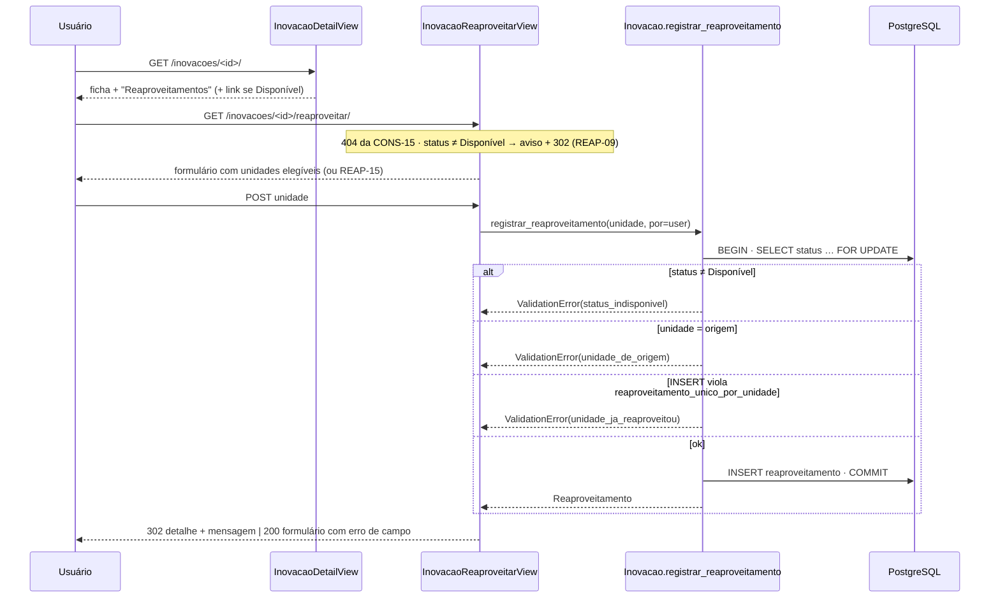
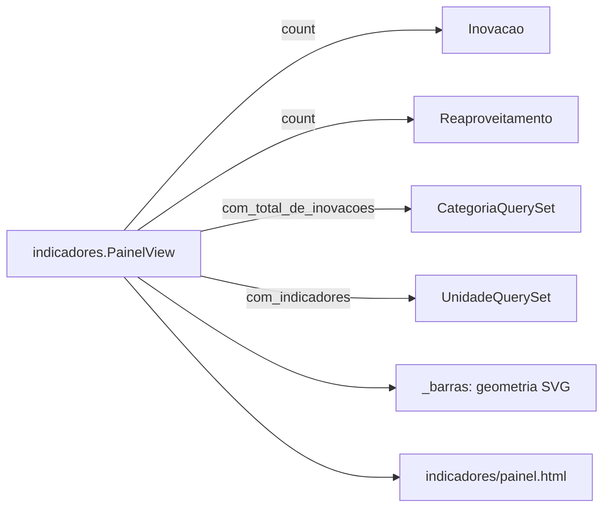
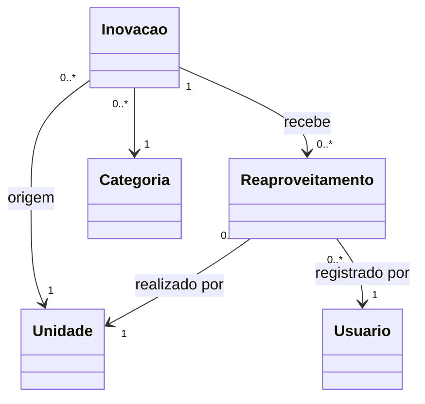

# Reaproveitamento e Indicadores (F6) — Design

**Spec**: `.specs/features/reaproveitamento-indicadores/spec.md`
**Context**: `.specs/features/reaproveitamento-indicadores/context.md`
**Status**: Approved (2026-10-18) · implementação parcial: sinalização (RF11) feita em T1–T10; painel (RF10) não iniciado
**Abordagem**: regra da RN09 num método do modelo, e painel numa app nova `indicadores` só de leitura, escolhidas pelo usuário em 2026-10-18 (ver Tech Decisions)
**Conforma com**: AD-001 a AD-011, sem supersedir nenhuma. **Cria**: AD-012 (todo `Reaproveitamento` nasce por `Inovacao.registrar_reaproveitamento`)
**Lições aplicadas**: L-003 (o `USUARIO` com `is_staff`/`is_superuser` é negado nas páginas do admin de `Reaproveitamento`, não só fica sem o link) · L-005 (cada cláusula com efeito em tela é afirmada por HTTP: a guarda de status tem teste no modelo, REAP-10, **e** na rota, REAP-09)

---

## Architecture Overview

A F6 tem duas metades com dependência de mão única:

1. **Sinalização (app `inovacoes`)**. O modelo novo `Reaproveitamento` liga uma `Inovacao` a uma
   `Unidade`, conforme o diagrama de classes. A regra da RN09 mora em
   `Inovacao.registrar_reaproveitamento`: ele trava a linha da inovação, confere o status gravado e a
   unidade de origem e cria o registro. A unicidade por unidade fica com o banco. A view só valida a
   entrada, chama o método e traduz o resultado em mensagem (AD-002, mesmo desenho da AD-011).
2. **Painel (app `indicadores`, sem modelos)**. O painel só lê. As agregações são métodos de
   QuerySet de `Categoria` e `Unidade` em `inovacoes/models.py`, o mesmo lugar onde a F3 deixou
   `para_listagem`, `buscar` e `filtrar` (AD-002: o ORM é o repositório). A view monta os números e a
   geometria das barras, e o template desenha cards, SVG e tabelas.

`indicadores` importa de `inovacoes`. `inovacoes` nunca importa de `indicadores`.





---

## Code Reuse Analysis

### Existing Components to Leverage

| Component | Location | How to Use |
| --------- | -------- | ---------- |
| `Inovacao`, `Unidade`, `Categoria`, `StatusInovacao` | `inovacoes/models.py` | Reusados sem campo nem valor novo. `Reaproveitamento` aponta para `Inovacao` e `Unidade`. |
| Padrão de `avancar_status` (AD-011) | `inovacoes/models.py:Inovacao.avancar_status` | Mesmo esqueleto: `transaction.atomic` + `select_for_update().values_list("status").get(pk=…)`, e `Inovacao.DoesNotExist` sobe quando a inovação foi apagada. |
| Tradução de `IntegrityError` por nome de constraint | `inovacoes/views.py:GravacaoComTituloUnicoMixin.form_valid` | Mesmo teste de `erro.__cause__.diag.constraint_name`, agora dentro do método do modelo. |
| `_inovacao_nao_encontrada` | `inovacoes/views.py` | 404 da CONS-15 na rota nova (REAP-16). |
| `ItemDeLista` e as listas controladas | `inovacoes/models.py` | Base de `Unidade`/`Categoria`. Ganham managers próprios só para as agregações. |
| `AcessoSomenteAdministradorMixin` | `contas/admin.py` | Base do `ReaproveitamentoAdmin` (AD-007, REAP-26). |
| `UnidadeAdmin` com `PROTECT` | `inovacoes/admin.py` | A tela de exclusão do admin já recusa unidade protegida e lista quem protege (REAP-24, sem código novo). |
| Parcial de campo do formulário | `inovacoes/templates/inovacoes/campo.html` | Renderiza o select com rótulo, `aria-invalid` e `aria-describedby` (REAP-44, REAP-45). |
| Componentes `cartao`, `tabela`, `vazio`, `acoes`, `botao` | `templates/kira.css` | Cards de métrica, tabelas do painel, estado vazio e ações (AD-010). |
| Carga de demonstração | `inovacoes/management/commands/carregar_demonstracao.py` | Base do teste de 2 s (REAP-41), sem mudança na carga. |

### Testes existentes a aproveitar

| Teste | Uso na F6 |
| ----- | --------- |
| `contas/tests/test_controle_acesso.py` (varredura AD-006) | Cobre `/indicadores/` e `/inovacoes/<id>/reaproveitar/` sem mudança (REAP-20, REAP-40). |
| `inovacoes/tests/test_controle_autoria.py` (varredura AD-009) | Passa a achar `inovacoes:reaproveitar`. A rota entra num conjunto novo `ROTAS_SEM_AUTORIA`, separado de `ROTAS_DE_LEITURA`, com comentário que remete à REAP-19. |
| `inovacoes/tests/test_views_sistema_design.py` | `RAIZES` ganha `indicadores/templates`. DS-01 passa de 9 para 11 telas. A fixture `paginas` ganha "reaproveitar" e "painel". O teste de cores do componente ganha `.metrica`, `.grafico` e `.reaproveitamentos`. |
| `inovacoes/tests/test_views_detalhe.py` | `CONSULTAS_DO_DETALHE` passa de 7 para 8 (uma consulta para a seção "Reaproveitamentos"). |
| `inovacoes/tests/test_views_cabecalho.py` | Padrão de `_navegacao_principal` para afirmar o link "Indicadores" (REAP-28). |
| `inovacoes/tests/test_desempenho.py` | Fixture `demonstracao`, `_medir` e `LIMITE_EM_SEGUNDOS` (REAP-41). |

### Integration Points

| System | Integration Method |
| ------ | ------------------ |
| Detalhe da inovação | `InovacaoDetailView.get_context_data` passa `reaproveitamentos` (uma consulta com `select_related("unidade")`). O template ganha o link (REAP-01) e a seção (REAP-17, REAP-18). |
| Menu principal | `templates/base.html`: link "Indicadores" depois de "Cadastrar inovação" (REAP-28). |
| Rotas | `inovacoes/urls.py`: `<int:pk>/reaproveitar/` (name `reaproveitar`). `config/urls.py`: `path("indicadores/", include("indicadores.urls"))`. |
| Settings | `INSTALLED_APPS` ganha `"indicadores"` depois de `"inovacoes"`. |
| Banco | Migration `inovacoes/0008_reaproveitamento.py`: tabela, três FKs e a UniqueConstraint. A app `indicadores` não tem migration. |
| Django admin | `ReaproveitamentoAdmin` em `inovacoes/admin.py`. |

---

## Components

### `Inovacao.pode_ser_reaproveitada` (novo, método em `inovacoes/models.py`)

- **Purpose**: responde se a inovação, no estado desta instância, aceita sinalização (RN09). É a operação `podeSerReaproveitada()` do diagrama de classes.
- **Interfaces**: `pode_ser_reaproveitada() -> bool`, que vale `self.status == StatusInovacao.DISPONIVEL_PARA_REPLICACAO`.
- **Uso**: template do detalhe (REAP-01, REAP-02) e checagem rápida no `dispatch` da view. A garantia final é a releitura travada dentro de `registrar_reaproveitamento`.

### `Inovacao.registrar_reaproveitamento` (novo, método; AD-012)

- **Purpose**: único caminho para criar um `Reaproveitamento` (REAP-05, REAP-09 a REAP-12, REAP-14).
- **Interfaces**: `registrar_reaproveitamento(*, unidade: Unidade, por: Usuario) -> Reaproveitamento`
  - Raises `ValidationError(code="status_indisponivel")` quando o status gravado não é "Disponível para replicação" (REAP-10). A mensagem é a da REAP-09, com o rótulo do status gravado.
  - Raises `ValidationError(code="unidade_de_origem")` quando `unidade.pk == self.unidade_id` (REAP-11).
  - Raises `ValidationError(code="unidade_ja_reaproveitou")` quando o INSERT viola `reaproveitamento_unico_por_unidade` (REAP-12, REAP-14).
  - `Inovacao.DoesNotExist` sobe se a inovação foi apagada (REAP-16), como em `avancar_status`.
- **Algoritmo**:
  ```python
  with transaction.atomic():
      gravado = Inovacao.objects.select_for_update().values_list("status", flat=True).get(pk=self.pk)
      if gravado != StatusInovacao.DISPONIVEL_PARA_REPLICACAO:
          raise ValidationError(
              MENSAGEM_STATUS.format(status=StatusInovacao(gravado).label), code="status_indisponivel"
          )
      if unidade.pk == self.unidade_id:
          raise ValidationError(MENSAGEM_ORIGEM, code="unidade_de_origem")
      try:
          with transaction.atomic():  # savepoint: a transação externa sobrevive ao erro
              return Reaproveitamento.objects.create(
                  inovacao=self, unidade=unidade, registrado_por=por
              )
      except IntegrityError as erro:
          if constraint_name(erro) != "reaproveitamento_unico_por_unidade":
              raise  # outra violação vira 500
          raise ValidationError(
              MENSAGEM_REPETIDO.format(unidade=unidade.nome), code="unidade_ja_reaproveitou"
          )
  ```
- **Por que travar a linha**: o status só avança (AD-011), mas a trava serializa duas sinalizações da mesma inovação, de modo que a segunda vê a primeira já gravada e cai no erro da constraint em vez de numa corrida. A trava também impede a exclusão concorrente da inovação no meio do INSERT (a FK do Django é `DEFERRABLE INITIALLY DEFERRED` e só falharia no COMMIT).
- **Não faz**: não decide autorização (todo autenticado pode, REAP-19), não grava nenhum campo da `Inovacao` (REAP-07, AD-008, AD-011).
- **Mensagens**: constantes de módulo em `inovacoes/models.py` (`MENSAGEM_REAPROVEITAMENTO_STATUS`, `…_ORIGEM`, `…_REPETIDO`), com o texto exato da spec. *(Implementado na T2 com o nome `MENSAGEM_REAPROVEITAMENTO_REPETIDO`, o de `tasks.md`.)*

### `CategoriaQuerySet.com_total_de_inovacoes` e `UnidadeQuerySet.com_indicadores` (novos, em `inovacoes/models.py`)

- **Purpose**: as agregações do painel num lugar só (AD-002), com ordem e zeros da spec (REAP-32, REAP-33).
- **Location**: `Categoria.objects = CategoriaQuerySet.as_manager()` e `Unidade.objects = UnidadeQuerySet.as_manager()`. `ItemDeLista` continua abstrato e sem manager próprio.
- **Interfaces e SQL**: ver [Consultas de agregação do painel](#consultas-de-agregação-do-painel).

### `ReaproveitamentoForm` (novo, em `inovacoes/forms.py`)

- **Purpose**: valida a entrada da tela: unidade presente e existente (REAP-13). Mostra no select só as unidades elegíveis (REAP-04).
- **Interfaces**: `ReaproveitamentoForm(data=None, *, inovacao: Inovacao)`, com o campo `unidade`.
- **Campo**: `UnidadeElegivelField(ModelChoiceField)`:
  - `queryset` = elegíveis = `Unidade.objects.exclude(pk=inovacao.unidade_id).exclude(reaproveitamentos__inovacao=inovacao).order_by("nome")`, que define as opções exibidas.
  - `to_python` sobrescrito para buscar em `Unidade.objects.all()`. Assim a unidade de origem ou uma já registrada, vindas de POST forjado, passam pela validação de entrada e chegam ao método do modelo, que dá a mensagem específica (REAP-11, REAP-12) em vez do genérico "Faça uma escolha válida".
  - `label="Unidade que reaproveitou"`, `empty_label="Selecione a unidade"`, `required=True`. `error_messages`: `required` e `invalid_choice` = "Selecione a unidade que reaproveitou a inovação." (REAP-13). Um valor não numérico cai em `invalid_choice`.
- **Reuses**: o parcial `inovacoes/campo.html` para rótulo, erro e ARIA (REAP-44, REAP-45).

### `InovacaoReaproveitarView` (nova, em `inovacoes/views.py`)

- **Purpose**: GET mostra o formulário e POST registra (REAP-03 a REAP-16).
- **Base**: `FormView`, **sem** `AlteracaoDeInovacaoMixin`, porque a sinalização não altera a `Inovacao` (AD-009, REAP-19).
- **Interfaces**:
  - `dispatch`: busca `Inovacao.objects.select_related("unidade")` pelo `pk`. Se a inovação não existe, devolve `_inovacao_nao_encontrada` (REAP-16). Se `not pode_ser_reaproveitada()`, grava `messages.warning(MENSAGEM_REAPROVEITAMENTO_STATUS…)` e devolve 302 ao detalhe em GET **e** POST (REAP-09), sem renderizar formulário.
  - `get_form_kwargs`: devolve só `data` (o POST, ou `None` no GET) e `inovacao`. *(SPEC_DEVIATION da T4: o design previa acrescentar `inovacao` aos kwargs do `super()`, mas o `FormView` manda `initial` e `prefix`, que a assinatura `ReaproveitamentoForm(data=None, *, inovacao)` não aceita.)*
  - `get_context_data`: `inovacao` e `sem_elegiveis = not form.fields["unidade"].queryset.exists()`. O template mostra a REAP-15 no lugar do formulário.
  - `form_valid`: chama `inovacao.registrar_reaproveitamento(unidade=…, por=request.user)`.
    - `status_indisponivel` → aviso e 302, como no `dispatch` (corrida improvável, mesmo resultado).
    - `unidade_de_origem` ou `unidade_ja_reaproveitou` → `form.add_error("unidade", erro)` e `form_invalid`, com 200 e o formulário refeito.
    - `Inovacao.DoesNotExist` → 404 da CONS-15.
    - Sucesso → `messages.success("Reaproveitamento da inovação “{título}” pela unidade “{unidade}” registrado.")` e 302 para `get_absolute_url()` (REAP-05, REAP-06).
  - `registrado_por`, `data` e `inovacao` nunca vêm do POST: o form só tem `unidade` (REAP-22).
- **Template**: `inovacoes/templates/inovacoes/inovacao_reaproveitar.html`. `Sinalizar reaproveitamento`, texto da REAP-03, formulário com ``, botão "Sinalizar reaproveitamento" e link "Cancelar". No ramo `sem_elegiveis`, o texto da REAP-15 e o link "Voltar para a inovação".

### `InovacaoDetailView` (alterada)

- `get_context_data` ganha `reaproveitamentos=self.object.reaproveitamentos.select_related("unidade")`: uma consulta, ordenada por `Meta.ordering = ["data", "id"]` (REAP-18, REAP-43).
- Template, depois da seção "Histórico de status":
  - `` → `<p class="acoes"><a href="">Sinalizar reaproveitamento</a></p>` (REAP-01, REAP-02).
  - `<section aria-labelledby="reaproveitamentos-titulo">` com `h2` "Reaproveitamentos" e ``. A contagem sai da lista já carregada, sem `COUNT` extra:
    - 0 → `<p class="vazio">Nenhum reaproveitamento registrado.</p>`
    - 1 → "Reaproveitada por 1 unidade."
    - N → "Reaproveitada por N unidades." (REAP-17)
  - `<ol class="reaproveitamentos">`, com itens `{{ r.unidade.nome }} — {{ r.data|date:"d/m/Y" }}` (REAP-18).

### `indicadores` (app nova)

- **Location**: `indicadores/{__init__,apps,urls,views}.py`, `indicadores/templates/indicadores/painel.html` e `indicadores/tests/`.
- **URLs**: `app_name = "indicadores"` e `path("", PainelView.as_view(), name="painel")`, montada em `/indicadores/`.

### `PainelView` (nova, em `indicadores/views.py`)

- **Purpose**: o RF10 (REAP-29 a REAP-40).
- **Base**: `TemplateView`, sem decorator (AD-006), `template_name = "indicadores/painel.html"`.
- **`get_context_data`**:
  ```python
  total_inovacoes = Inovacao.objects.count()
  total_reaproveitamentos = Reaproveitamento.objects.count()
  contexto = {"total_inovacoes": …, "total_reaproveitamentos": …}
  if total_inovacoes:                                   # REAP-37: vazio não consulta distribuições
      categorias = list(Categoria.objects.com_total_de_inovacoes())
      unidades = list(Unidade.objects.com_indicadores())
      contexto |= {
          "categorias": categorias,
          "unidades": unidades,
          "graficos": [
              Grafico("grafico-categorias", "Inovações por categoria", _barras(categorias, "total")),
              Grafico("grafico-unidades-origem", "Inovações de origem por unidade",
                      _barras(unidades, "inovacoes_de_origem")),
              Grafico("grafico-unidades-reaproveitamentos", "Reaproveitamentos feitos por unidade",
                      _barras(unidades, "reaproveitamentos_feitos")),
          ],
      }
  ```
  Nenhuma escrita (REAP-39). Sem cache (REAP-38).
- **`_barras(itens, atributo) -> list[Barra]`**: função pura, testável sem banco.
  - `Barra = namedtuple(nome, valor, y, comprimento, x_valor)`.
  - `maior = max(valores, default=0)`.
  - `comprimento = round(valor * AREA / maior, 2) if valor and maior else 0`, com `AREA = 480` unidades do `viewBox` (REAP-35).
  - `y = i * ALTURA_DA_LINHA` com `ALTURA_DA_LINHA = 44`.
  - `x_valor = comprimento + 8`: o número fica logo depois da barra, ou no início quando o valor é 0 (REAP-36).
  - A altura do SVG é `len(barras) * 44`.
- **`Grafico = namedtuple(id, titulo, barras, altura)`**, com `altura = len(barras) * ALTURA_DA_LINHA` calculada em Python (o template do Django não multiplica).

### `indicadores/painel.html` (novo)

Estrutura (todo estilo vem de `kira.css`, AD-010):

```html
<h1>Painel de indicadores</h1>
<dl class="metricas">
  <div class="cartao metrica"><dt>Inovações cadastradas</dt><dd>{{ total_inovacoes }}</dd></div>
  <div class="cartao metrica"><dt>Reaproveitamentos registrados</dt><dd>{{ total_reaproveitamentos }}</dd></div>
</dl>

  <section aria-labelledby="por-categoria"> <h2 id="por-categoria">Por categoria</h2>
    
    <div class="tabela"><table><caption>Inovações por categoria</caption>
      <thead><tr><th scope="col">Categoria</th><th scope="col">Inovações</th></tr></thead>
      <tbody><tr><th scope="row">{{ c.nome }}</th><td>{{ c.total }}</td></tr></tbody>
    </table></div>
  </section>
  <section aria-labelledby="por-unidade"> <h2 id="por-unidade">Por unidade</h2>
     
    <div class="tabela"><table><caption>Inovações por unidade</caption> … três colunas … </table></div>
  </section>

  <div class="vazio"><p>Nenhuma inovação cadastrada ainda.</p>
    <p class="acoes"><a href="">Cadastrar inovação</a></p></div>

```

Peça `indicadores/grafico.html` (entra em `PECAS` do DS-01, porque não estende o base):

```html
<figure class="cartao grafico">
  <figcaption id="{{ grafico.id }}">{{ grafico.titulo }}</figcaption>
  <svg role="img" aria-labelledby="{{ grafico.id }}" viewBox="0 0 600 {{ grafico.altura }}" width="100%">
    
      <text class="grafico__nome" x="0" y="{{ b.y|add:14 }}">{{ b.nome|truncatechars:70 }}</text>
      <rect class="grafico__barra" x="0" y="{{ b.y|add:20 }}" width="{{ b.comprimento }}" height="16"/>
      <text class="grafico__valor" x="{{ b.x_valor }}" y="{{ b.y|add:33 }}">{{ b.valor }}</text>
    
  </svg>
</figure>
```

- Nome em cima, barra embaixo e valor no fim da barra. Assim o nome tem a largura toda do `viewBox` e nunca disputa espaço com a barra (REAP-36).
- `role="img"` + `aria-labelledby` = título (REAP-47). Os `<text>` dentro de um `role="img"` não são lidos item a item: a alternativa acessível é a tabela da mesma seção.
- Números do `viewBox` passam por `floatformat`/`unlocalize`, para não sair vírgula decimal com `pt-BR` (ver Risks).

### URLs

- `inovacoes/urls.py`: `path("<int:pk>/reaproveitar/", InovacaoReaproveitarView.as_view(), name="reaproveitar")`.
- `config/urls.py`: `path("indicadores/", include("indicadores.urls"))`, antes do `include("nucleo.urls")`.

### Django admin — `ReaproveitamentoAdmin` (novo, em `inovacoes/admin.py`)

- `@admin.register(Reaproveitamento)`, herda `AcessoSomenteAdministradorMixin, admin.ModelAdmin` (AD-007, REAP-26).
- `list_display = ("inovacao", "unidade", "registrado_por", "data")`, `list_select_related = True`.
- `has_add_permission` → `False`. `has_change_permission` → `False`. `has_view_permission` e `has_delete_permission` ficam com o mixin (só `ADMINISTRADOR`). Com change negado e view permitido, o admin mostra o registro só para leitura e recusa POST na URL de alteração com 403 (REAP-27).

### CSS — `templates/kira.css` (AD-010)

Componentes novos, só com tokens existentes e sem cor nova:

| Seletor | Papel | Cores (par do DS-08) |
| ------- | ----- | -------------------- |
| `.metricas` | grid dos cards (`auto-fit`, mín. 14rem) | — |
| `.metrica dt` | rótulo do card | `text-muted` sobre `surface` |
| `.metrica dd` | número grande (`--fs-2xl`, peso 700) | `brand-navy` sobre `surface` |
| `.grafico figcaption` | título do gráfico | `brand-navy` sobre `surface` |
| `.grafico__nome`, `.grafico__valor` | `fill` do texto do SVG | `text` sobre `surface` (4.5:1) |
| `.grafico__barra` | `fill` da barra | `brand-blue` sobre `surface` (≥ 3:1, WCAG 1.4.11) |
| `.reaproveitamentos` | lista do detalhe, mesmo desenho da `.historico` | `text` e, na data em `<time>`, `text-muted` sobre `bg` (implementado na T7; os dois pares já estavam no DS-08) |

Seletores sem aspas e sem `<` (AD-010). O teste de cores do componente hoje lê `color` e `background`. Ele passa a ler também `fill` dos seletores `.grafico__*`, conferindo `fill` contra o fundo do `.cartao` (REAP-48).

---

## Data Models

### `Reaproveitamento` (novo, em `inovacoes/models.py`)

Do diagrama de classes (`docs/modelagem-uml.md` §2.1): `Inovacao 1 → 0..* Reaproveitamento` (recebe) e `Reaproveitamento 0..* → 1 Unidade` (realizado por). Acrescenta o responsável, pelo critério da RN08 e do `MudancaDeStatus`.

```python
class Reaproveitamento(models.Model):
    """Uma unidade reaproveitou uma inovacao de outra (RF11, RN09).

    AD-012: so nasce por Inovacao.registrar_reaproveitamento.
    """

    # REAP-23: apagar a inovacao apaga os reaproveitamentos dela.
    inovacao = models.ForeignKey(
        Inovacao,
        on_delete=models.CASCADE,
        related_name="reaproveitamentos",
        verbose_name="inovação",
    )
    # REAP-24: unidade em uso nao pode ser apagada (mesmo criterio da INOV-19).
    unidade = models.ForeignKey(
        Unidade,
        on_delete=models.PROTECT,
        related_name="reaproveitamentos",
        verbose_name="unidade que reaproveitou",
    )
    # REAP-25: excluir a conta nao apaga o registro do que ela sinalizou.
    registrado_por = models.ForeignKey(
        settings.AUTH_USER_MODEL,
        on_delete=models.PROTECT,
        related_name="reaproveitamentos_registrados",
        verbose_name="registrado por",
    )
    data = models.DateTimeField("data", auto_now_add=True)

    class Meta:
        verbose_name = "reaproveitamento"
        verbose_name_plural = "reaproveitamentos"
        # REAP-18: do mais antigo ao mais recente; o id desempata.
        ordering = ["data", "id"]
        constraints = [
            # REAP-14: uma sinalizacao por unidade, garantida pelo banco.
            models.UniqueConstraint(
                fields=["inovacao", "unidade"],
                name="reaproveitamento_unico_por_unidade",
            ),
        ]

    def __str__(self):
        return f"{self.inovacao} — {self.unidade}"
```

**Relationships**



**Tabela `inovacoes_reaproveitamento` (migration 0008)**

| Coluna | Tipo | Restrição |
| ------ | ---- | --------- |
| `id` | `bigint` identity | PK |
| `inovacao_id` | `bigint` | FK `inovacoes_inovacao` ON DELETE CASCADE (Django), índice coberto pela unique |
| `unidade_id` | `bigint` | FK `inovacoes_unidade` (PROTECT no Django), índice próprio |
| `registrado_por_id` | `bigint` | FK `contas_usuario` (PROTECT no Django), índice próprio |
| `data` | `timestamptz` | NOT NULL |
| — | — | `UNIQUE (inovacao_id, unidade_id)` = `reaproveitamento_unico_por_unidade` |

**O que o banco não garante** (regra de aplicação, AD-012): status "Disponível para replicação" e unidade ≠ origem dependem de outra tabela. Uma CHECK do PostgreSQL não lê outra linha, e uma trigger foi recusada (ver Tech Decisions).

### Consultas de agregação do painel

Toda consulta conta no banco (`COUNT`/`GROUP BY`). Nenhuma traz linhas de inovação para o Python. O total de consultas por GET em `/indicadores/` é fixo: 2 da sessão/usuário + 2 quando não há inovação, ou + 4 quando há (REAP-42). Não depende do volume.

**Q1 — total de inovações (REAP-30)**

```python
Inovacao.objects.count()
```
```sql
SELECT COUNT(*) FROM inovacoes_inovacao;
```

**Q2 — total de reaproveitamentos (REAP-31)**

```python
Reaproveitamento.objects.count()
```
```sql
SELECT COUNT(*) FROM inovacoes_reaproveitamento;
```

**Q3 — inovações por categoria, com zeros (REAP-32)**

```python
class CategoriaQuerySet(models.QuerySet):
    def com_total_de_inovacoes(self):
        return self.annotate(total=Count("inovacao")).order_by("-total", "nome")
```
```sql
SELECT c.id, c.nome, COUNT(i.id) AS total
FROM inovacoes_categoria c
LEFT OUTER JOIN inovacoes_inovacao i ON i.categoria_id = c.id
GROUP BY c.id
ORDER BY total DESC, c.nome ASC;
```

- `Count("inovacao")` segue a FK reversa de `Inovacao.categoria` (sem `related_name`, nome de consulta `inovacao`).
- O `LEFT OUTER JOIN` mantém categorias sem inovação com `total = 0`, porque `COUNT(i.id)` ignora o `NULL`.
- Uma relação só, então não há multiplicação de linhas.

**Q4 — por unidade: inovações de origem e reaproveitamentos feitos, com zeros (REAP-33)**

São duas contagens sobre duas relações diferentes da mesma `Unidade`. Duas `Count()` no mesmo `annotate` fariam dois `JOIN`s e multiplicariam as linhas (inovações × reaproveitamentos por unidade), e a contagem sairia errada sem `distinct=True`. Por isso cada contagem é uma subconsulta correlacionada:

```python
class UnidadeQuerySet(models.QuerySet):
    def com_indicadores(self):
        def contagem(modelo):
            return Coalesce(
                Subquery(
                    modelo.objects.filter(unidade=OuterRef("pk"))
                    .order_by()  # limpa o Meta.ordering do GROUP BY
                    .values("unidade")
                    .annotate(n=Count("pk"))
                    .values("n")
                ),
                0,
            )

        return self.annotate(
            inovacoes_de_origem=contagem(Inovacao),
            reaproveitamentos_feitos=contagem(Reaproveitamento),
        ).order_by("-inovacoes_de_origem", "nome")
```
```sql
SELECT u.id, u.nome,
  COALESCE((SELECT COUNT(i.id) FROM inovacoes_inovacao i
            WHERE i.unidade_id = u.id GROUP BY i.unidade_id), 0) AS inovacoes_de_origem,
  COALESCE((SELECT COUNT(r.id) FROM inovacoes_reaproveitamento r
            WHERE r.unidade_id = u.id GROUP BY r.unidade_id), 0) AS reaproveitamentos_feitos
FROM inovacoes_unidade u
ORDER BY inovacoes_de_origem DESC, u.nome ASC;
```

- Cada subconsulta usa o índice da FK (`inovacao.unidade_id`, `reaproveitamento.unidade_id`).
- A subconsulta sem linha devolve `NULL`, e o `COALESCE` o troca por 0 (unidade sem nada aparece com dois zeros).
- O `.order_by()` vazio é obrigatório: sem ele, o `Meta.ordering = ["data", "id"]` de `Reaproveitamento` entraria no `GROUP BY` da subconsulta e devolveria uma linha por data, quebrando o `Subquery`. *(Achado da T11: o Django 5.2 já não usa o `Meta.ordering` em consultas com `GROUP BY`, desde o 3.1, então a subconsulta sai certa mesmo sem ele. O `.order_by()` fica como proteção explícita, e o teste das duas datas prova o resultado, não o `.order_by()`.)*

**Q5 — reaproveitamentos no detalhe (REAP-17, REAP-18, REAP-43)**

```python
inovacao.reaproveitamentos.select_related("unidade")
```
```sql
SELECT r.*, u.* FROM inovacoes_reaproveitamento r
INNER JOIN inovacoes_unidade u ON u.id = r.unidade_id
WHERE r.inovacao_id = %s
ORDER BY r.data ASC, r.id ASC;
```

A contagem do texto "Reaproveitada por N unidades." é `|length` da lista já carregada, sem `COUNT` à parte.

**Q6 — unidades elegíveis do select (REAP-04)**

```python
Unidade.objects.exclude(pk=inovacao.unidade_id).exclude(
    reaproveitamentos__inovacao=inovacao
).order_by("nome")
```
```sql
SELECT u.* FROM inovacoes_unidade u
WHERE NOT (u.id = %s)
  AND NOT (u.id IN (SELECT r.unidade_id FROM inovacoes_reaproveitamento r WHERE r.inovacao_id = %s))
ORDER BY u.nome ASC;
```

---

## Error Handling Strategy

| Error Scenario | Handling | User Impact |
| -------------- | -------- | ----------- |
| Inovação inexistente (GET/POST) | `dispatch` devolve `_inovacao_nao_encontrada` | 404 "Inovação não encontrada." (REAP-16) |
| Inovação fora de "Disponível" (GET/POST) | `dispatch` grava `messages.warning` e devolve 302 ao detalhe | Aviso da REAP-09 no detalhe, nada gravado |
| Unidade ausente, inexistente ou não numérica | `ReaproveitamentoForm` inválido | 200, erro de campo da REAP-13, select com `aria-invalid` |
| Unidade de origem (POST forjado) | Método levanta `unidade_de_origem` e a view faz `add_error` | 200, erro da REAP-11 |
| Unidade já registrada (incl. duplo clique e corrida) | INSERT viola a unique dentro do savepoint, o método levanta `unidade_ja_reaproveitou` e a view faz `add_error` | 200, erro da REAP-12, um registro só (REAP-14) |
| Nenhuma unidade elegível | Template no ramo `sem_elegiveis` | 200, texto da REAP-15 e "Voltar para a inovação" |
| Inovação apagada entre `dispatch` e a trava | `Inovacao.DoesNotExist` → 404 da CONS-15 | 404, nada gravado |
| Outra `IntegrityError` | Relançada | 500 do projeto (REAP-49) |
| Anônimo | `LoginRequiredMiddleware` (AD-006) | Login com `next` (REAP-20, REAP-40) |
| POST sem CSRF | `CsrfViewMiddleware` | 403, nada gravado (REAP-21) |
| Banco indisponível | `OperationalError` sobe até o handler 500 | 500 sem detalhe de conexão (REAP-49) |
| Admin: `USUARIO` com `is_staff` (com ou sem `is_superuser`) | `AcessoSomenteAdministradorMixin` | 403 nas páginas do admin de reaproveitamento (REAP-26) |
| Admin: `USUARIO` com `is_superuser` sem `is_staff` | Porteiro do próprio admin do Django | 302 para `/admin/login/`, registro intacto (achado da T8; a spec fala em "negar", não define 403 para esse caso) |
| Admin: URL de adicionar/alterar | `has_add_permission`/`has_change_permission` = `False` | 403 no POST, nada gravado (REAP-27) |
| Unidade protegida no admin | `PROTECT` na tela de exclusão do admin | Admin lista os reaproveitamentos que a protegem, nada é apagado (REAP-24) |

---

## Risks & Concerns

| Concern | Location (file:line) | Impact | Mitigation |
| ------- | -------------------- | ------ | ---------- |
| Regra de aplicação, não de banco: status e unidade ≠ origem | `inovacoes/models.py` (`Reaproveitamento`) | `Reaproveitamento.objects.create()` direto (script, shell, teste) grava um reuso inválido e infla o painel | AD-012 fixa o método como único caminho. O admin não permite incluir (REAP-27). Os testes de desempenho criam reaproveitamentos pelo método. |
| `Meta.ordering` no `GROUP BY` da subconsulta | Q4, `UnidadeQuerySet.com_indicadores` | Sem o `.order_by()` vazio, a subconsulta devolve várias linhas e o PostgreSQL recusa ("more than one row returned by a subquery") | `.order_by()` explícito com comentário. Teste com duas sinalizações em datas diferentes para a mesma unidade. |
| Fan-out de duas `Count()` no mesmo `annotate` | Q4 | Contagens infladas, erro silencioso | Subconsultas correlacionadas. Teste com unidade que tem 2 inovações e 3 reaproveitamentos afirma 2 e 3, não 6. |
| Localização `pt-BR` dos números do SVG | `indicadores/grafico.html` | `width="123,45"` com `USE_L10N` vira atributo inválido e a barra some | `` no bloco do SVG (ou `unlocalize`). Teste que exige ponto decimal no `width`. |
| Nomes longos de unidade no SVG | `indicadores/grafico.html` | Texto passa da largura do `viewBox` e é cortado | `truncatechars:70` no SVG. O nome completo fica na tabela, que é a alternativa (REAP-47). |
| `to_python` sobrescrito no `ModelChoiceField` | `inovacoes/forms.py` | Desvio do comportamento padrão do Django; quem ler pode estranhar | Docstring explicando o porquê (mensagem específica da REAP-11/REAP-12). Testes de POST forjado com a origem, com unidade repetida e com valor não numérico. |
| Testes antigos com contagens fixas | `inovacoes/tests/test_views_detalhe.py:188`, `test_views_sistema_design.py:394` | `CONSULTAS_DO_DETALHE` 7→8 e DS-01 9→11 quebram de propósito | Alteração autorizada na aprovação da spec. Cada mudança vem com comentário citando a REAP. |
| Varredura AD-009 exige 403 em toda rota com `pk` | `inovacoes/tests/test_controle_autoria.py:15` | `inovacoes:reaproveitar` responderia 302/200 a terceiro e falharia a varredura | Conjunto novo `ROTAS_SEM_AUTORIA = {"inovacoes:reaproveitar"}`, separado de `ROTAS_DE_LEITURA`. Teste próprio afirma que o terceiro **não** recebe 403 (REAP-19). |
| App nova fora das raízes do DS-01 | `inovacoes/tests/test_views_sistema_design.py:372` | `painel.html` escaparia da checagem de "estende o base, sem `<style>`" | `RAIZES` ganha `indicadores/templates`. `PECAS` ganha `indicadores/grafico.html`. |
| Teste de cor do componente não lê `fill` | `inovacoes/tests/test_views_sistema_design.py:587` | Uma cor literal no `fill` passaria sem conferência de contraste | Estender a leitura para `fill` nos seletores `.grafico__*` e conferir contra o fundo do `.cartao` (REAP-48). |
| Testes de corrida exigem transação real | REAP-14 | O `TestCase` envolve tudo numa transação e não reproduz duas conexões | Mesmo recurso da F5 para STAT-13 (`transaction=True` e duas conexões). Se não reproduzir, afirmar a unique pelo banco e o tratamento do `IntegrityError` com uma unidade inserida entre a leitura e o INSERT. |

---

## Tech Decisions (only non-obvious ones)

| Decision | Choice | Rationale |
| -------- | ------ | --------- |
| Onde mora a regra da RN09 | Método `Inovacao.registrar_reaproveitamento` (escolhido pelo usuário). Alternativas recusadas: só no `clean()` do formulário (scripts e admin contornam, e a REAP-10 ficaria sem dono) e trigger no PostgreSQL (primeira lógica procedural no banco, invisível ao Django, já recusada pela AD-011) | Mesmo desenho da AD-011: regra única, testável sem HTTP (AD-002), visível como a operação `podeSerReaproveitada()` da UML. **Vira AD-012.** |
| Onde ficam painel e sinalização | `Reaproveitamento` e a sinalização em `inovacoes`. Painel numa app `indicadores` sem modelos (escolhido pelo usuário) | A sinalização trava e lê a `Inovacao` e aparece no detalhe. O painel só lê e é o "BI" do eixo 3; separar dá um módulo de leitura com dependência de mão única (RNF04). |
| Agregações | Métodos de `QuerySet` de `Categoria`/`Unidade`, não um módulo `consultas.py` | AD-002: o ORM é o repositório. Um módulo de consultas à parte seria a camada que a decisão recusa. |
| Duas contagens por unidade | Subconsultas correlacionadas, não `Count(distinct=True)` | `distinct` dá o número certo, mas o JOIN cresce com inovações × reaproveitamentos por unidade. A subconsulta fica linear e explícita. |
| Duplicidade | Sem pré-consulta: o INSERT bate na unique e o `IntegrityError` vira `ValidationError` | Uma pré-consulta teria janela de corrida. O banco é a fonte da verdade (AD-003), como no título duplicado da F2. |
| Validação de entrada × regra | O form só garante "unidade existente". Origem e repetição vêm do método | Uma regra num lugar só. O form não duplica a RN09. |
| Opções do select × valores aceitos | `queryset` = elegíveis (o que se exibe), `to_python` busca em todas | Exibir só as elegíveis (REAP-04) sem perder as mensagens específicas para POST forjado (REAP-11, REAP-12). |
| Gráfico | SVG inline gerado pelo template, nome acima da barra, comprimento calculado em Python | Sem JS nem dependência (AD-010). A geometria em função pura é testável sem banco. A tabela é a alternativa acessível. |
| Detalhe: contagem | `|length` da lista carregada | Uma consulta só (REAP-43); `CONSULTAS_DO_DETALHE` sobe 1. |
| Admin de reaproveitamento | Só listar e excluir | Incluir ou editar pelo admin contornaria a RN09. Excluir é a correção prevista (REAP-26). |

> **Project-level decision:** AD-012 anexada ao `.specs/STATE.md` em 2026-10-18, com a aprovação deste design.

---

## Cobertura dos requisitos

| Requisitos | Componente |
| ---------- | ---------- |
| REAP-01, REAP-02 | `pode_ser_reaproveitada` + template do detalhe |
| REAP-03, REAP-04, REAP-15 | `InovacaoReaproveitarView` (GET), `ReaproveitamentoForm`, Q6, `inovacao_reaproveitar.html` |
| REAP-05, REAP-06, REAP-07, REAP-08, REAP-22 | `registrar_reaproveitamento` + `form_valid` |
| REAP-09, REAP-10 | `dispatch` (rota) + `registrar_reaproveitamento` (modelo) — L-005 |
| REAP-11, REAP-12, REAP-13, REAP-14 | `registrar_reaproveitamento`, `UnidadeElegivelField`, UniqueConstraint |
| REAP-16 | `_inovacao_nao_encontrada` |
| REAP-17, REAP-18, REAP-43 | `InovacaoDetailView` + Q5 |
| REAP-19, REAP-20, REAP-21, REAP-40 | Sem mixin de autoria; `LoginRequiredMiddleware`; CSRF; `ROTAS_SEM_AUTORIA` |
| REAP-23, REAP-24, REAP-25 | `on_delete` de `Reaproveitamento` |
| REAP-26, REAP-27 | `ReaproveitamentoAdmin` — L-003 |
| REAP-28 | `templates/base.html` |
| REAP-29 … REAP-39 | `PainelView`, Q1–Q4, `_barras`, `painel.html`, `grafico.html` |
| REAP-41, REAP-42 | Q1–Q4 com número fixo de consultas; teste com demonstração + 200 reaproveitamentos via método |
| REAP-44 … REAP-48 | `campo.html`, tabelas com `th scope`, `role="img"`, CSS da `kira.css` |
| REAP-49 | Handler 500 do projeto, sem código novo |
