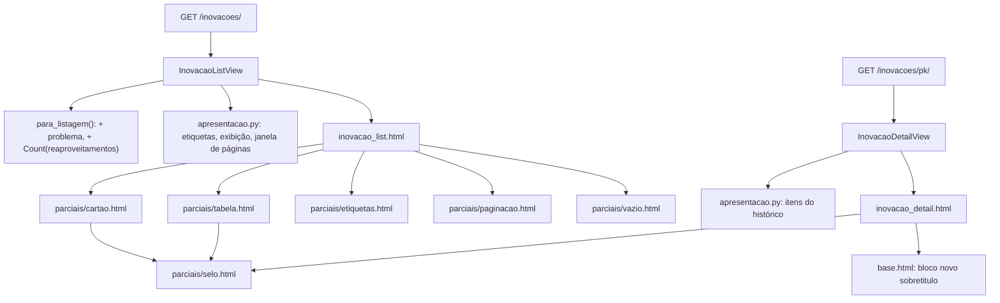

# Redesign da Consulta (R2) Design

**Spec**: `.specs/features/redesign-consulta/spec.md`
**Context**: `.specs/features/redesign-consulta/context.md`
**Status**: Approved (2026-11-19; T-P autorizado)

Conforma com AD-002 (sem camada de serviço), AD-006, AD-008 (a busca não muda), AD-009 (a
decisão de alterar continua em `pode_ser_alterada_por`), AD-010 (folha única embutida, sem
estilo nas telas), AD-011 e AD-012 (a transição e o reaproveitamento não mudam), AD-013 (ícones
Lucide em `templates/icones/`), AD-014 (alto contraste pelo `data-contraste`) e AD-015 (posições
da casca). Nenhuma decisão é supersedida e nenhuma AD nova é criada: as escolhas abaixo valem só
para esta feature.

---

## Architecture Overview

A R2 mexe só em três camadas: a consulta da lista ganha duas colunas, as views montam um
contexto de apresentação pronto, e os templates se dividem em parciais que consomem os
componentes da R1.

### Abordagens consideradas

| Abordagem | Como | Veredito |
| --------- | ---- | -------- |
| **A. View monta, template mostra** (escolhida) | Funções puras em `inovacoes/apresentacao.py` (sem banco) calculam etiquetas, URLs, janela de páginas e itens do histórico; as views as chamam; os templates só iteram | Testável sem HTTP, como `busca.normalizar` (AD-002, AD-008); o número de consultas fica sob controle da view |
| B. Biblioteca de template tags (`inclusion_tag`) | Cada parcial vira uma tag com a própria lógica | Padrão novo no projeto; a lógica fica longe da view que conta as consultas; testar exige renderizar template |
| C. Só template, com `` e filtros nativos | Remoção de filtro por `` | `querystring` devolve `"?"` sozinho quando o último parâmetro sai (RCON-05 pede `/inovacoes/`); a janela de páginas e o item de cadastro do histórico precisam de Python; indexar `mudancas.0` no template dispara consulta extra e quebra o `CONSULTAS_DO_DETALHE` |

---

## Onde cada peça fica no DOM

**Lista** (`main`, em ordem): alerta de erro (se houver) → `div role="search".cartao` > `form.busca`
(linha principal: lupa decorativa + campo `q` + botão "Buscar"; grade dos três selects; grupo
"Filtros ativos:") → barra de resultados (`p.total role="status"` + grupo "Exibição") → cartões
**ou** tabela → paginação → ou, sem resultados, o vazio.

O grupo de etiquetas fica dentro do `div role="search"` e fora do `<form>`. Assim o form continua
único, com um só botão (CONS-31, DS-14), e as etiquetas aparecem também com o form inválido
(RCON-08).

**Detalhe** (`main`, em ordem): `div role="status"` do base → `div.cabecalho-pagina` (bloco novo
`sobretitulo` com o selo → `h1` → bloco `descricao` com a linha "Cadastrada por…" → bloco
`acao_principal` com `div.acoes-pagina`) → `div.detalhe` (grade) com
`section` "Como a inovação funciona" → `aside aria-label="Resumo da inovação"` (contato, ciclo,
ficha) → `section` "Reaproveitamentos ({n})" → `section` "Histórico de status" → link "Voltar para
a lista de inovações".

Na tela larga (≥ 45rem), `div.detalhe` é uma grade `minmax(0, 2fr) minmax(0, 1fr)`: as seções vão
na coluna 1 e o `aside` na coluna 2, linhas 1 a 3 (`grid-row: 1 / span 3`). Ele fica ao lado da
narrativa, que o precede no código. Nenhum elemento é posto antes de um irmão anterior (RCON-47).
Na tela estreita, a grade vira uma coluna na ordem do código.

---

## Code Reuse Analysis

### Existing Components to Leverage

| Component | Location | How to Use |
| --------- | -------- | ---------- |
| Componentes v2 da R1 | `templates/kira.css:742-922` (`.cartao-ino\76 acao*`, `.etapas`/`.etapa*`, `.linha-do-tempo*`, `.cartao-contato*`, `.filtros-ativos`, `.etiqueta-filtro`) | Usados como estão, com as classes que o `test_folha_v2.py` já fixa |
| `.botao`, `.botao--secundario`, `.botao--perigo`, `.cartao`, `.tabela`, `.vazio`, `.total` | `templates/kira.css` | Ações em hierarquia, quadro da tabela, vazio, contador (RED-04 fixa `.total` tabular) |
| Blocos do cabeçalho de página | `templates/base.html:82-88` | Lista: `descricao`, `acao_principal`. Detalhe: `sobretitulo` (novo), `descricao`, `acao_principal` |
| Parcial da trilha | `templates/paginas/trilha.html` | Já usada pelas duas telas; não muda |
| Ícones Lucide | `templates/icones/*.svg` + `LICENSE` (AD-013) | Mesmo formato (`aria-hidden="true" focusable="false"`, `stroke="currentColor"`), incluídos por `` |
| `Paginator.get_elided_page_range(number, on_each_side=2, on_ends=1)` | Django 5.2 | A janela de páginas (RCON-22) com `Paginator.ELLIPSIS` ("…") |
| `` | Django 5.2 | Links de paginação (mantêm todos os parâmetros, inclusive `exibicao`, RCON-24); o formato `?page=N` continua o que CONS-03/04 leem |
| `truncatechars` | Django | Resumo do cartão (RCON-13) |
| `pode_ser_alterada_por`, `proximo_status`, `pode_ser_reaproveitada` | `inovacoes/models.py:248, 260, 292` | Escolha da ação primária e da explicação |
| `exibido()` | `inovacoes/tests/visibilidade.py:135` | Regra de teste da feature (L-028, L-030, L-044) |

### Integration Points

| System | Integration Method |
| ------ | ------------------ |
| Banco | `para_listagem()` ganha `problema` no `.only()` e `annotate(total_reaproveitamentos=Count("reaproveitamentos"))`: continua uma consulta para a página e uma para o `count` do paginador (CONS-48, RCON-16) |
| Detalhe | `reaproveitamentos` passa a `select_related("unidade", "registrado_por")` (mesma consulta, coluna "Registrado por"); `mudancas` vira `list(...)` avaliada uma vez na view, para o template e o helper não a consultarem duas vezes. Total segue 8 (RCON-36) |
| Base | Um bloco novo, vazio por padrão (``), antes do `h1`. Vazio, não muda o HTML das outras telas (`CABECALHO_DE_PAGINA` das outras telas segue igual) |

---

## Components

### `para_listagem()` (extensão)

- **Purpose**: Entregar à lista, na mesma consulta, o resumo e a contagem de reaproveitamentos.
- **Location**: `inovacoes/models.py:113`
- **Interfaces**: `Inovacao.objects.para_listagem() -> QuerySet` com `.problema` e `.total_reaproveitamentos` (int) em cada item.
- **Reuses**: o `select_related`/`only`/`order_by` atuais; `buscar()` e `filtrar()` encadeiam como hoje.

### `inovacoes/apresentacao.py` (novo)

- **Purpose**: Funções puras que transformam o estado da consulta em dados de exibição, sem banco e sem HTTP.
- **Location**: `inovacoes/apresentacao.py`
- **Interfaces**:
  - `url_da_lista(consulta: QueryDict, **mudancas) -> str`: `/inovacoes/` mais a query string com as mudanças (`None` remove). Sem parâmetro sobrando, devolve `/inovacoes/` sem `?` (RCON-05, RCON-06, RCON-18).
  - `exibicao(consulta) -> "tabela" | "cartoes"`: só `tabela` vale; o resto é cartões (RCON-20).
  - `etiquetas(dados_validos: dict, consulta) -> list[Etiqueta]`: `Etiqueta(texto, href)` na ordem Busca, Categoria, Unidade, Status; só para valores válidos e não vazios; `href = url_da_lista(consulta, <param>=None, page=None)` (RCON-04, RCON-05, CONS-21).
  - `paginas(page_obj) -> list[int | str]`: `page_obj.paginator.get_elided_page_range(page_obj.number, on_each_side=2, on_ends=1)` em lista (RCON-22).
  - `itens_do_historico(inovacao, mudancas: list) -> list[ItemDoHistorico]`: `ItemDoHistorico(data, texto, cadastro: bool)`; o primeiro é o cadastro, com o status inicial (`mudancas[0].status_anterior` ou o status atual) e o autor; depois cada mudança (RCON-43 a RCON-45). O nome segue a CONS-13 (`get_full_name` ou `username`).
- **Dependencies**: `django.http.QueryDict`, `StatusInovacao`. Nenhuma consulta: recebe os objetos já carregados.
- **Reuses**: o padrão de `inovacoes/busca.py` (módulo de funções puras chamado pelo modelo e pela view).

### `InovacaoListView` (extensão)

- **Purpose**: Passar ao template o contexto pronto da lista.
- **Location**: `inovacoes/views.py:329`
- **Interfaces**: contexto novo `exibicao`, `url_cartoes`, `url_tabela`, `etiquetas` (vazia com o form inválido, RCON-08), `url_limpar` (`/inovacoes/`, ou `/inovacoes/?exibicao=tabela`), `paginas`. `filtros_ativos` continua como está (pelo GET cru, CONS-32).
- **Reuses**: `get_queryset`, `paginate_queryset` atuais (CONS-05 intacto).

### `InovacaoDetailView` (extensão)

- **Purpose**: Entregar o histórico como linha do tempo e os reaproveitamentos com quem registrou, sem consulta nova.
- **Location**: `inovacoes/views.py:126`
- **Interfaces**: contexto `historico` (lista de `ItemDoHistorico`), `reaproveitamentos` (lista, com `unidade` e `registrado_por`), `etapas` passa a vir com a situação de cada etapa (`concluida`/`atual`/`futura`), calculada pela posição do status atual em `StatusInovacao.choices`.
- **Reuses**: `pode_alterar` (AD-009).

### Templates

| Arquivo | Conteúdo | ACs |
| ------- | -------- | --- |
| `inovacoes/templates/inovacoes/inovacao_list.html` | Cabeçalho (descrição, ação), busca, barra de resultados, escolha cartões/tabela, paginação, vazio | RCON-01 a 10, 17 a 26 |
| `inovacoes/parciais/cartao.html` | `li` > `article.cartao-inovacao` com cabeça (selo + data), `h2`, resumo e `ul` de metadados com ícones | RCON-11 a 14 |
| `inovacoes/parciais/selo.html` | `span.selo.selo--{status}` com o ícone do status e o rótulo | RCON-15 |
| `inovacoes/parciais/tabela.html` | A tabela atual, com o selo da parcial | RCON-19 |
| `inovacoes/parciais/etiquetas.html` | `div.filtros-ativos role="group" aria-labelledby` ("Filtros ativos:"), as etiquetas com o link "×" (`aria-label` "Remover filtro {texto}"), "Limpar filtros" | RCON-04 a 07 |
| `inovacoes/parciais/paginacao.html` | `nav aria-label="Paginação"`, pontas desabilitadas como `span aria-disabled="true"`, números e "…" | RCON-21 a 24 |
| `inovacoes/parciais/vazio.html` | Ilustração + as duas variantes | RCON-25, 26 |
| `inovacoes/parciais/ilustracao_vazio.svg` | Desenho próprio (lupa sobre uma pilha de cartões), traço `--brand-navy`, acento `--brand-blue-light`, `aria-hidden="true" focusable="false"`, até 160px | RCON-25 a 27 |
| `inovacoes/templates/inovacoes/inovacao_detail.html` | Cabeçalho com selo, linha e ações; grade; narrativa; `aside`; reaproveitamentos; histórico | RCON-28 a 46 |
| `templates/base.html` | Bloco `sobretitulo` vazio antes do `h1` | RCON-28 |

A ilustração fica em `inovacoes/templates/inovacoes/parciais/` e não em `templates/icones/`
porque é desenho próprio, não Lucide. Assim o `LICENSE` da pasta de ícones continua cobrindo só o
que veio do Lucide.

### Ícones novos (Lucide, ISC, em `templates/icones/`)

`frasco.svg` (flask-conical, Em teste), `visto.svg` (check, Validada), `caixa-seta.svg`
(square-arrow-out-up-right, Disponível para replicação), `lupa.svg` (search), `fechar.svg` (x),
`grade.svg` (layout-grid), `tabela.svg` (table), `predio.svg` (building-2), `etiqueta.svg` (tag),
`repetir.svg` (repeat). Mesmo cabeçalho SVG dos quatro da R1.

### `kira.css` (extensão e limpeza)

**Acrescenta:** `.busca__principal` (linha da lupa, campo de 52px a 17px, botão), `.busca__filtros`
(grade `repeat(auto-fit, minmax(min(14rem, 100%), 1fr))`), `.resultados` (barra: contador +
alternador), `.alternador` (links com ícone; `[aria-current=true]` em `--brand-navy` com texto
`--on-brand`), `.cartoes` (grade `repeat(auto-fill, minmax(min(320px, 100%), 1fr))`, sem
marcador), `.paginacao` (números, atual em `--brand-navy`, pontas desabilitadas em
`--text-muted`), `.vazio__ilustracao` (até 160px; `display: none` sob `[data-contraste=alto]`),
`.acoes-pagina` (primária, secundária e `.acoes-pagina__perigo` com divisor vertical e 32px de
respiro; quebra de linha em tela estreita), `.detalhe` (grade de duas colunas a partir de 45rem),
`.narrativa` (passos numerados por `counter` no `::before`, linha decorativa), `.ficha-resumo`
(a `dl` da lateral, números tabulares), `.visualmente-oculto` (o `caption` da tabela de
reaproveitamentos, padrão clip + 1px).

**Remove (código morto depois da R2):** `.ficha dd.selo`, `.ficha .destaque`, as regras `.ciclo`,
`.historico` e `.reaproveitamentos` antigas, e as formas `::before` do selo (o ícone passa a ser a
forma). Cada remoção tem o teste antigo correspondente na tabela da spec (T-L) ou abaixo (T-P).

**Restrições da folha:** sem `="` nem `<` (AD-010); seletores de atributo sem aspas; nenhum nome
de usuário dos testes como substring de classe (a regra que levou ao `\76` em `.cartao-inovacao`,
DS-02); todo par de cor novo entra no DS-08, também no alto contraste; transições novas entram no
`prefers-reduced-motion` (RED-11); nenhuma largura acima de 320px fora de `min()`/`max-width`
(RED-12).

---

## Data Models

Nenhum model, campo ou migration. A anotação `total_reaproveitamentos` existe só no queryset da
lista.

---

## Error Handling Strategy

| Error Scenario | Handling | User Impact |
| -------------- | -------- | ----------- |
| Filtro inválido (CONS-30) | `etiquetas = []`; alerta e erros de campo como hoje; "Limpar filtros" aparece pelo `filtros_ativos` | Vê o erro e o caminho de volta; nenhuma etiqueta de valor inválido |
| `exibicao` desconhecida | Vira cartões, sem erro | Vê os cartões |
| `page` inválida ou além do fim (CONS-05) | `paginate_queryset` atual; a paginação marca a página de fato mostrada | Vê a primeira ou a última página |
| Inovação sem mudança de status | Só o item do cadastro (RCON-45) | Linha do tempo com um ponto |
| Resultado vazio | "Resultado ainda não informado." (RCON-30) | Texto em `--text-muted` |

---

## Testes

- **Novos**, por story, em arquivos próprios: `test_views_lista_cartoes.py`,
  `test_views_lista_filtros.py`, `test_views_lista_paginacao.py`, `test_views_detalhe_v2.py`,
  `test_apresentacao.py` (unidade, sem banco onde der) e extensões de `test_folha_v2.py`
  (componentes novos, DS-08, RED-11, RED-12, RCON-47).
- Toda AC de exibição usa `exibido(html, rigoroso=True)` no DOM parseado da página inteira e
  confere que a folha não esconde o seletor (L-028, L-030, L-044). As ações por perfil testam
  também `USUARIO` com `is_staff` (L-003).
- Os testes antigos de T-A a T-O mudam no mesmo commit da task que quebra cada um, com a AC
  original na docstring.

### Teste antigo que muda (acrescentado no Design, autorização na aprovação)

| # | Teste | AC original | Muda o quê | Por quê |
| - | ----- | ----------- | ---------- | ------- |
| T-P | `inovacoes/tests/test_views_sistema_design.py:480` `test_cada_status_tem_uma_forma_propria_alem_da_cor` | DS-13 | Deixa de ler `.selo--x::before` e passa a exigir, no selo renderizado de cada status, um SVG `aria-hidden` diferente (frasco, visto, caixa-seta), mais a ausência de `::before` com forma no `.selo` | O ícone vira a forma que distingue o status sem a cor (RCON-15). Manter os dois daria duas marcas no selo; manter a regra morta deixaria o DS-13 passando sobre um CSS que ninguém vê |

---

## Risks & Concerns

| Concern | Location (file:line) | Impact | Mitigation |
| ------- | -------------------- | ------ | ---------- |
| Teste que passa sem testar: `_titulos` devolve `[]` sem `<tbody>` | `inovacoes/tests/test_views_busca.py:20` | Os asserts `== []` da busca passariam com qualquer lista | T-A: o helper novo falha quando não acha a lista de resultados; a primeira task da lista troca os helpers antes de mudar o template |
| N+1 no cartão: `.only()` sem `problema` e sem a contagem | `inovacoes/models.py:117` | 20 consultas a mais por página; o RNF08 cai | `only("problema")` + `Count` na mesma consulta; RCON-16 com 20 cartões de contagens diferentes; CONS-46/47 (< 2 s com 500) |
| `Count` com `select_related` e `only` muda o `GROUP BY` | `inovacoes/models.py:113` | Erro de SQL no PostgreSQL ou contagem multiplicada se outro join entrar | Agrupa pelo `pk` (o PostgreSQL aceita colunas funcionalmente dependentes); teste com contagens 0, 1 e 3 em inovações da mesma página |
| `mudancas` avaliada duas vezes | `inovacoes/views.py:146` | Consulta 9 no detalhe | `list()` na view; `CONSULTAS_DO_DETALHE = 8` segue no teste |
| `"?"` sozinho no link de remoção | `` do Django | `href="/inovacoes/?"` em vez de `/inovacoes/` | `url_da_lista` monta o href; teste unitário com o último filtro saindo |
| Folha embutida engana teste de substring | `templates/kira.css` (DS-02, AUTH-01) | Classe nova com "ana" ou atributo entre aspas faria um teste antigo passar ou falhar em falso | Restrições da folha acima; o teste existente da folha (sem `="` nem `<`) continua valendo |
| Ocultação por CSS que o DOM não vê | `templates/kira.css` | Elemento "exibido" no teste e invisível na tela (L-044) | `exibido(rigoroso=True)` + o teste de `display: none` da R1 (T-N lista as duas ocultações novas) |
| Risco residual herdado: RED-16 e RED-22 | R1 | As checagens de exibição podem não pegar vetores fora do `exibido()` (L1–L4 da F6) | Fora do escopo; segue registrado na R1 |

---

## Tech Decisions (feature-local)

| Decision | Choice | Rationale |
| -------- | ------ | --------- |
| Onde mora a lógica de apresentação | `inovacoes/apresentacao.py`, funções puras | Abordagem A; testável sem HTTP; não é camada de serviço (não grava, não consulta) |
| Bloco novo no base | `sobretitulo`, vazio por padrão | O selo vai acima do `h1` sem que o detalhe sobrescreva o `cabecalho_pagina` inteiro (o h1 único continua no base, RED-31) |
| Etiquetas fora do `<form>` | No `div role="search"`, depois do form | Mantém um form e um botão (CONS-31, DS-14) e aparece com o form inválido |
| Página atual e pontas da paginação | `span` com `aria-current="page"` / `aria-disabled="true"`, sem `role` e sem `tabindex` | CONS-41: todo `a` tem `href` e nenhum controle ganha `role` |
| Alternador | Dois links com `href`, o atual com `aria-current="true"` | §10; CONS-41 |
| Etapas com situação | A view passa `(valor, rótulo, situação)` | O template não compara posições; a regra fica testável na view |

---

## Ajustes do Execute

### Lote 1

- **T4, janela de páginas:** `paginas()` calcula a janela em Python e não usa
  `Paginator.get_elided_page_range(on_each_side=2, on_ends=1)`. Esse método não troca uma página
  só por "…": na 5 de 25 devolve `1 2 3 4 5 6 7 … 25`, e a RCON-22 (e o "Done when" da T4) pede
  `1 … 3 4 5 6 7 … 25`. O "…" continua sendo `Paginator.ELLIPSIS`. Marcado com `SPEC_DEVIATION`
  em `inovacoes/apresentacao.py`.
- **T7, selo:** a parcial `inovacoes/parciais/selo.html` recebe `status` (o valor) e `rotulo`
  (o texto), e não a inovação inteira, para o DS-13 renderizá-la sem banco. Até a T16 o `dd.selo`
  do detalhe fica sem forma: o `::before` saiu da folha e o detalhe ainda não usa a parcial.

### Lote 2

- **T8, etiquetas com o form inválido:** a view passa `etiquetas(form.cleaned_data, GET)` também
  com o form inválido, e não uma lista vazia. O `cleaned_data` guarda só os campos válidos, então
  o parâmetro inválido fica sem etiqueta (RCON-08) e os válidos mantêm a sua, como pede o "Done
  when" da T12 ("só as válidas + Limpar filtros"). Com só o parâmetro inválido a lista continua
  vazia. Marcado com `SPEC_DEVIATION` em `inovacoes/views.py`.
- **T9, resumo do cartão:** o template corta o problema com `slice:":159"` mais "…" quando ele
  passa de 160 caracteres, e não com `truncatechars:160`. A tradução pt-BR do Django devolve
  `" %(truncated_text)s…"`: o filtro põe um espaço na frente e deixa 158 caracteres. A RCON-13
  pede 159 seguidos de "…". A spec foi ajustada depois (commit e4a1d02): a RCON-13 não nomeia
  mais o filtro, só o resultado. O `slice` deixou de ser desvio e o `SPEC_DEVIATION` saiu do
  `parciais/cartao.html` (T13).
- **T9, testes antigos adiantados:** a T9 é a task que tira a tabela da exibição padrão, e por
  isso quebra, além de T-A, T-E e CONS-06, também CONS-38 e DS-16 (T-B, previstos na T10) e o
  DS-12 da lista (T-C, previsto na T7, que ainda lia a tabela). Os três mudam na T9, do jeito
  que a tabela da spec descreve: CONS-38 e DS-16 abrem `?exibicao=tabela`; o DS-12 lê o selo
  do cartão. A regra "muda no commit da task que o quebra" vale sobre a coluna de task.
- **T9, `_titulos` sem lista:** o helper só devolve `[]` quando a página exibe o
  `div.vazio`; sem a lista e sem o vazio, falha. Assim o `== []` da CONS-28 continua testando
  alguma coisa.
- **T13, testes antigos T-Q:** CONS-03 (`test_views_lista.py`, primeira e última página) deixa
  de exigir a ausência de "Anterior"/"Próxima" e passa a exigir que a ponta não seja link e
  exista como `span aria-disabled="true"` (RCON-23). Autorizado pelo usuário em 2026-11-19.
- **T14, estados vazios:** o acento da ilustração usa `--info-tint`, e não `--brand-blue-light`
  como dizia o design: o DS-08 proíbe o azul claro fora do gradiente da marca. O traço segue
  `--brand-navy` por `currentColor`. T-D muda a constante do vazio com filtro em
  `test_views_busca.py` (vale para os quatro testes da CONS-35 que a usam) e T-R muda o EDEX-37
  em `test_views_exclusao.py`, os dois para "Nenhuma inovação encontrada para esta busca.".
- **T15, T-O estendido à lista:** a regex `CABECALHO_DE_PAGINA` de `nucleo/tests/test_casca.py`
  aceita, depois do h1, a descrição (`p`) e a ação principal (`a`), nessa ordem. Continua
  exigindo o h1 único logo depois do status, como primeiro título do `main` (RED-29, RED-31).
  Autorizado pelo usuário em 2026-11-19.

### Lote 3

- **T16, T-O de uma vez:** a regex `CABECALHO_DE_PAGINA` (`nucleo/tests/test_casca.py`) passa a
  aceitar, no detalhe, o selo antes do h1 e, depois da linha de autoria, o `div.acoes-pagina`
  da T19 (links e, por último, o `div.acoes-pagina__perigo` com o Excluir). A T-O está
  autorizada só na T16 e a spec descreve as duas partes ("aceita o selo antes do `h1` e as
  ações depois"), então a mudança entra inteira aqui. O h1 continua único e primeiro título do
  `main`.
- **T16, linha de autoria:** vai no bloco `descricao` como `
` sem classe (a regra
  `.cabecalho-pagina p` já a pinta em `--text-muted`). A classe `.meta` deixou de ter uso no
  HTML e a regra saiu da folha na mesma task (código morto que a T16 criou).

- **T17, ficha antiga inteira fora:** além de `.ficha dd.selo` e `.ficha .destaque`, saem todas
  as regras `.ficha` (e o `@media (max-width: 40rem)` dela): a `dl` da lateral usa só
  `.ficha-resumo` e nenhum outro template usa `.ficha`. O número dos passos da narrativa usa o
  par `on-brand`/`brand-navy`, que já está no DS-08 (T10); nenhum par novo.
- **T18, bloco do ciclo:** continua uma `section aria-labelledby="ciclo-titulo"`, agora dentro
  do `aside`, entre o contato e a ficha. O marcador da etapa concluída é o ícone `visto.svg`; o
  da atual e das futuras, o número da etapa. O T-L troca `.ciclo` por `.etapas` no
  `CADEIA_DO_COMPONENTE` e o STAT-37 passa a ler `.etapa--atual` (negrito) e
  `.etapa--atual .etapa__marcador` (`--brand-blue` com `--on-brand`, par aprovado da §2 v2).
  O link "Avançar para …" fica no bloco até a T19.
- **T19, ações:** o bloco `acao_principal` do detalhe só renderiza o `div.acoes-pagina` quando
  há alguma ação (quem pode alterar, ou status "Disponível para replicação"). O T-G troca o
  regex literal de `_links` por uma leitura do DOM exibido (`href` + texto, qualquer ordem de
  atributos); STAT-03 e REAP-01 procuram no cabeçalho de página. O T-K procura o Avançar no
  cabeçalho e confere o `aria-describedby` contra a explicação do bloco do ciclo.
